<p align="center"><a href="README.md">简体中文</a> · <a href="README.zh-Hant.md">繁體中文</a> · <a href="README.ja.md">日本語</a></p>

<p align="center"></p>

<h1 align="center">ウマ娘あてクイズ</h1>
<p align="center"><strong>『ウマ娘』のこと、どれくらい知ってる？</strong><br>UmaGuessingGame</p>

<p align="center">
<a href="LICENSE"></a>
<a href="docs/ja/玩法与规则.md"></a>

<a href="docs/ja/快速开始.md"></a>
</p>

<p align="center">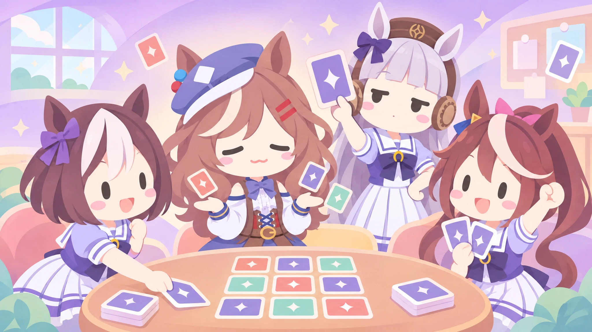</p>

<p align="center">九つのヒントでキャラクター当て。記憶・声・レースの知識を使うクイズや、友達との協力・対戦も楽しめます</p>

<p align="center"><a href="#play"><strong>種目ガイド</strong></a> · <a href="#start"><strong>起動方法</strong></a> · <a href="#docs"><strong>ドキュメント</strong></a> · <a href="#contribute"><strong>参加する</strong></a> · <a href="https://numakkiyu.github.io/UmaGuessingGame/ja/"><strong>Web ガイド</strong></a></p>

## 一人でも、みんなでも

<table>
<tr><td width="50%" valign="top"><h3>一人で挑戦</h3><p>データの準備が終われば開始。対応する種目は保存して続けられます</p></td><td width="50%" valign="top"><h3>フレンド</h3><p>ルームコードを共有して友達を招待</p></td></tr>
<tr><td width="50%" valign="top"><h3>ランダム対戦</h3><p>待機列に入り、全員が確認すると自動で開始</p></td><td width="50%" valign="top"><h3>パーティー</h3><p>進行役がチームとラウンドを設定。大画面にも表示</p></td></tr>
</table>

<a id="play"></a>

## 遊び方ガイド

[ウマ娘知識テスト](docs/ja/玩法与规则.md#ウマ娘知識テスト)では、全身イラストを見て名前とプロフィールを答えます。毎回ランダムに 20 人を出題し、提出後に評価と答え合わせを確認できます

現在の問題パックは 14 種目に対応。「にせプロフィール発表会」は事実の確認中です。種目と遊び方はサイトごとに設定できます

### ウマ娘の知識

<table>
<tr>
<td width="50%" valign="top">
<a href="docs/ja/play/classic.md">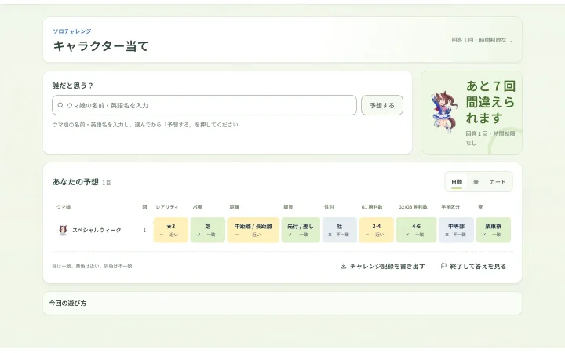</a>
<h4><a href="docs/ja/play/classic.md">キャラクター当て</a></h4>
<p>九つのヒントから、思い浮かぶ一人を探そう</p>
<p><a href="docs/ja/play/classic.md">画像付きガイド ↗</a></p>
</td>
<td width="50%" valign="top">
<a href="docs/ja/play/aptitude-grid.md">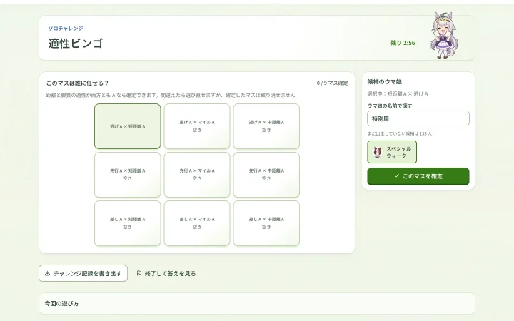</a>
<h4><a href="docs/ja/play/aptitude-grid.md">適性マス埋め</a></h4>
<p>行と列の適性を両方満たすウマ娘を選んで、九つのマスを埋めよう。同じ一人は一度だけ。確定後は変更できません</p>
<p><a href="docs/ja/play/aptitude-grid.md">画像付きガイド ↗</a></p>
</td>
</tr>
<tr>
<td width="50%" valign="top">
<a href="docs/ja/play/sort.md">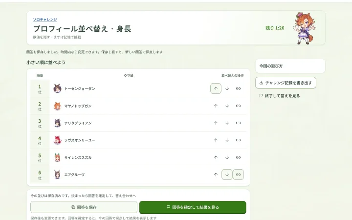</a>
<h4><a href="docs/ja/play/sort.md">並べ替え</a></h4>
<p>身長や誕生日、ウマ娘の知識で順序を当てよう</p>
<p><a href="docs/ja/play/sort.md">画像付きガイド ↗</a></p>
</td>
<td width="50%" valign="top">
<a href="docs/ja/play/pedigree.md">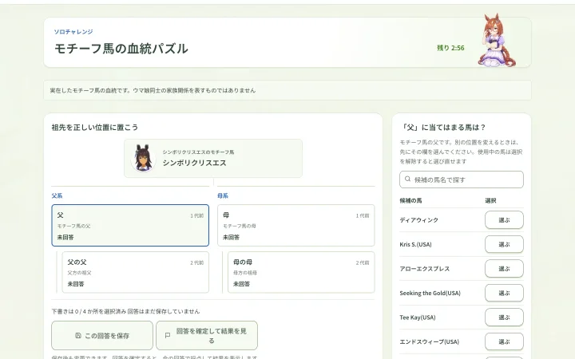</a>
<h4><a href="docs/ja/play/pedigree.md">モデル馬の血統パズル</a></h4>
<p>モチーフとなった競走馬は、どんな血統？父系と母系をたどり、父母や祖父母を正しい位置に当てはめよう</p>
<p><a href="docs/ja/play/pedigree.md">画像付きガイド ↗</a></p>
</td>
</tr>
</table>

### 観察と記憶

<table>
<tr>
<td width="50%" valign="top">
<a href="docs/ja/play/memory.md">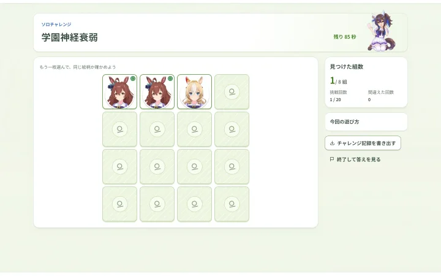</a>
<h4><a href="docs/ja/play/memory.md">学園の神経衰弱</a></h4>
<p>最初の 8 秒で絵柄の位置を覚えよう。二枚ずつめくって、20 回以内に八組のペアを探します</p>
<p><a href="docs/ja/play/memory.md">画像付きガイド ↗</a></p>
</td>
<td width="50%" valign="top">
<a href="docs/ja/play/audio.md">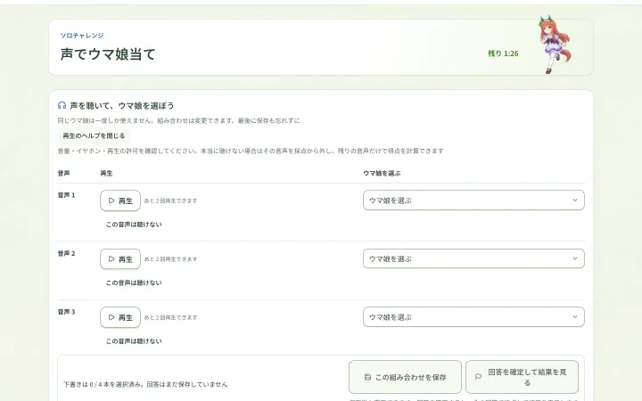</a>
<h4><a href="docs/ja/play/audio.md">声当て</a></h4>
<p>聞き覚えのある声、誰だか分かるかな？各ボイスは 2 回まで再生できます。話しているウマ娘と組み合わせよう。間違えても追加の減点はありません</p>
<p><a href="docs/ja/play/audio.md">画像付きガイド ↗</a></p>
</td>
</tr>
</table>

### レースの歴史

<table>
<tr>
<td width="50%" valign="top">
<a href="docs/ja/play/race-rebuild.md">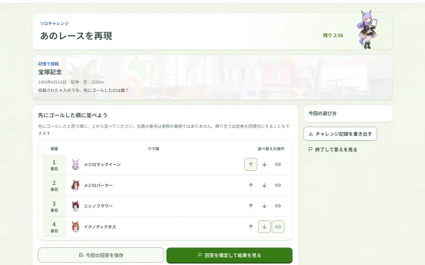</a>
<h4><a href="docs/ja/play/race-rebuild.md">レース着順の再現</a></h4>
<p>あの一戦を思い出して、出題された出走者を史実の着順に並べよう。同着の組み合わせも忘れずに</p>
<p><a href="docs/ja/play/race-rebuild.md">画像付きガイド ↗</a></p>
</td>
<td width="50%" valign="top">
<a href="docs/ja/play/co-race-path.md">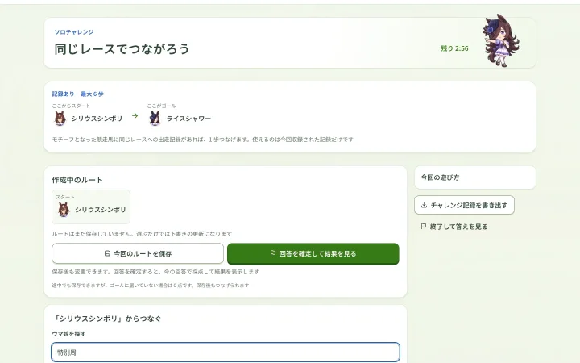</a>
<h4><a href="docs/ja/play/co-race-path.md">共通レースのつながり</a></h4>
<p>モチーフ馬が同じレースに出た記録をたどり、一人から別のウマ娘へ。短いルートほど高得点です</p>
<p><a href="docs/ja/play/co-race-path.md">画像付きガイド ↗</a></p>
</td>
</tr>
</table>

### 編成と作戦

<table>
<tr>
<td width="50%" valign="top">
<a href="docs/ja/play/draft.md">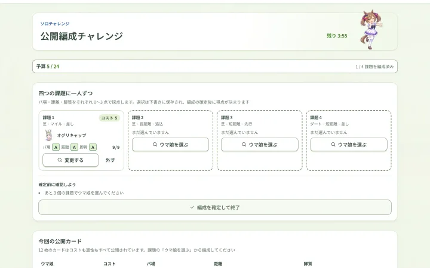</a>
<h4><a href="docs/ja/play/draft.md">公開ドラフト編成</a></h4>
<p>限られた予算で、四つの課題を誰に任せる？コストと適性を見ながら、異なる四人を選ぼう</p>
<p><a href="docs/ja/play/draft.md">画像付きガイド ↗</a></p>
</td>
<td width="50%" valign="top">
<a href="docs/ja/play/strategy-race.md">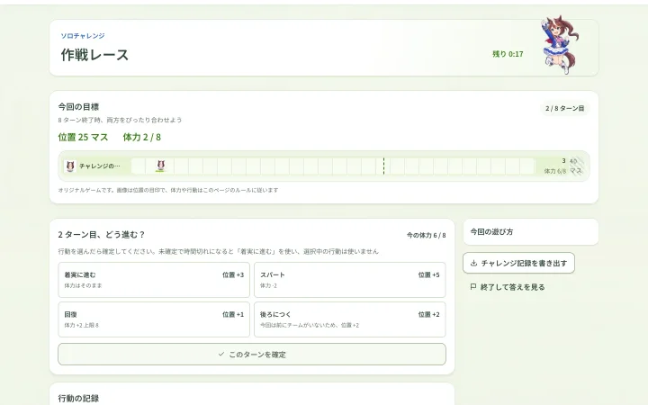</a>
<h4><a href="docs/ja/play/strategy-race.md">ターン制レース</a></h4>
<p>スパートのタイミングは今？8 ターン分の体力を考え、毎ターン行動を一斉に公開。最後に一番前にいるチームの勝ちです</p>
<p><a href="docs/ja/play/strategy-race.md">画像付きガイド ↗</a></p>
</td>
</tr>
<tr>
<td width="50%" valign="top">
<a href="docs/ja/play/trade.md">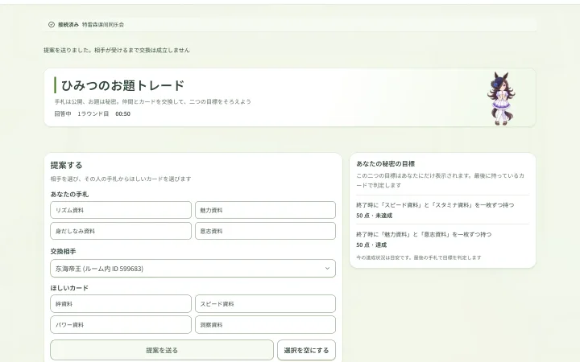</a>
<h4><a href="docs/ja/play/trade.md">カード交換</a></h4>
<p>欲しいカードは、誰かにとって交換したいカードかも。手札は公開、お題は秘密。3 ラウンドの交渉で秘密の目標を目指そう</p>
<p><a href="docs/ja/play/trade.md">画像付きガイド ↗</a></p>
</td><td width="50%"></td>
</tr>
</table>

### パーティー

<table>
<tr>
<td width="50%" valign="top">
<a href="docs/ja/play/clue-puzzle.md">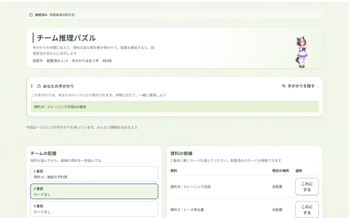</a>
<h4><a href="docs/ja/play/clue-puzzle.md">チーム情報パズル</a></h4>
<p>自分のヒントと仲間のヒント、どうつながる？情報を持ち寄って、プロフィールカードの順番を解き明かそう</p>
<p><a href="docs/ja/play/clue-puzzle.md">画像付きガイド ↗</a></p>
</td>
<td width="50%" valign="top">
<a href="docs/ja/play/rapport.md">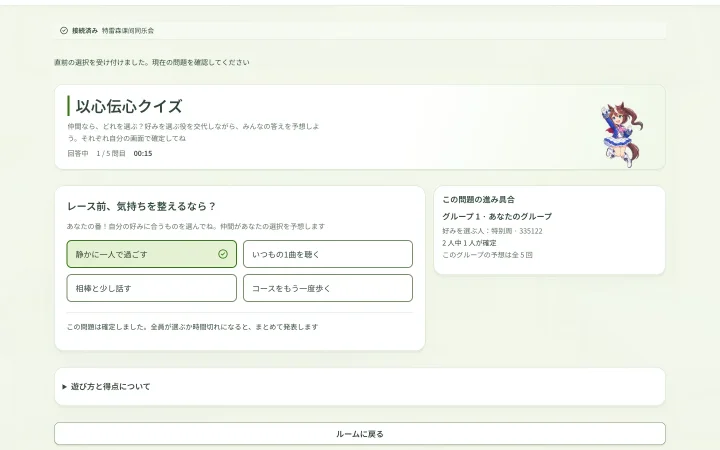</a>
<h4><a href="docs/ja/play/rapport.md">以心伝心クイズ</a></h4>
<p>いつも一緒の仲間なら、選ぶ答えも分かる？好みを選ぶ役を交代しながら予想して、一斉に答え合わせしよう</p>
<p><a href="docs/ja/play/rapport.md">画像付きガイド ↗</a></p>
</td>
</tr>
<tr>
<td width="50%" valign="top">
<a href="docs/ja/play/creative.md">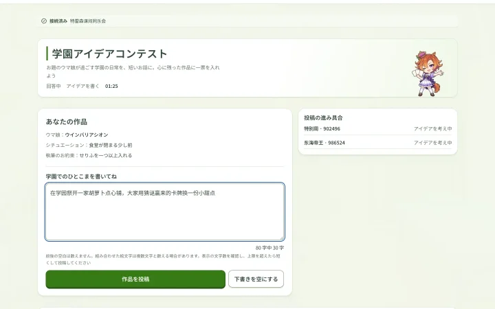</a>
<h4><a href="docs/ja/play/creative.md">創作企画</a></h4>
<p>休み時間の企画会議！配られたウマ娘・場面・条件から、80 文字以内でアイデアを考えよう。作品は匿名で公開し、参加者票と観客票の合計でアイデア賞を決めます</p>
<p><a href="docs/ja/play/creative.md">画像付きガイド ↗</a></p>
</td>
<td width="50%" valign="top">
<a href="docs/ja/play/bluff.md">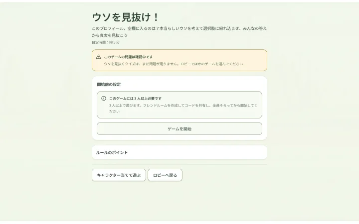</a>
<h4><a href="docs/ja/play/bluff.md">にせプロフィール発表会</a> · 問題を確認中</h4>
<p>このプロフィール、空欄に入るのは？本当らしいウソを考えて選択肢に紛れ込ませ、みんなの答えから真実を見抜こう</p>
<p><a href="docs/ja/play/bluff.md">画像付きガイド ↗</a></p>
</td>
</tr>
</table>

<details>
<summary>スマートフォンの画面</summary>

<p align="center">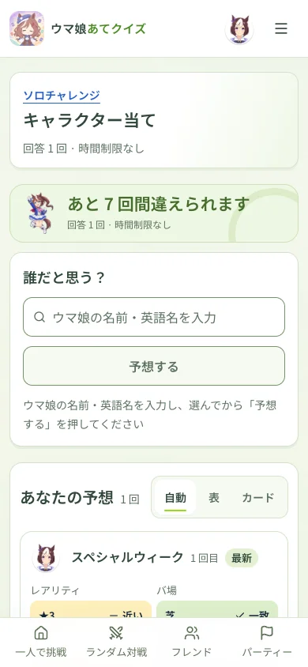 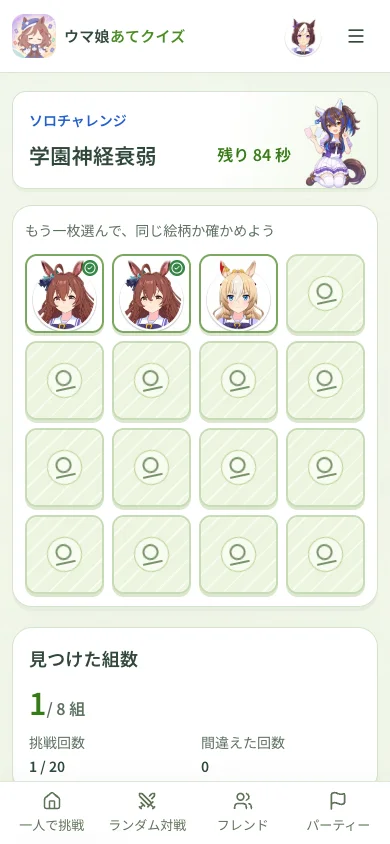</p>

</details>

<a id="start"></a>

## ゲームを動かす

Go 1.26.11、Node.js 24、pnpm 10.33.0、GNU Make が必要です。リポジトリのルートで実行します

```bash
make web-install
make web-build
make embed-spa
make embed-spa-check
make content-compile
make content-verify
make dev
```

起動したら [http://localhost:8080](http://localhost:8080) を開きます。スマートフォンやコンテナでの利用は [クイックスタート](docs/ja/快速开始.md)

## 遊びやすさの工夫

| 機能 | 内容 |
| --- | --- |
| 共通プロフィール | 名前とアイコンは全体で共通。同名の参加者は六桁のルーム内番号で区別 |
| 三言語 | 簡体字中国語・繁体字中国語・日本語。名前と案内は地域の表現に合わせて表示 |
| PC とスマートフォン | 広い画面は表と分割表示、小さい画面はカードと一列表示。回答内容とルールは共通 |
| 保存と再接続 | 対応する一人用種目は記録の入出力に対応。再接続では確定済みの回答を復元 |
| 選べる設定 | 種目、定員、対戦ロビー、Cloudflare Turnstile を個別に設定 |
| 音声形式 | **40 kbps VBR、Opus / WebM** |

<a id="docs"></a>

## 詳しく知る

**設置と起動** — [クイックスタート](docs/ja/快速开始.md) · [Linux](docs/ja/Linux部署指南.md) · [macOS](docs/ja/macOS部署指南.md) · [Windows](docs/ja/Windows部署指南.md)

**設定と運用** — [設定](docs/ja/配置参考.md) · [運用と更新](docs/ja/维护与更新指南.md) · [実験的なログイン](docs/ja/账户登录与游玩准入.md)

**開発と API** — [構成とモジュール](docs/ja/技术架构说明.md) · [API与实时通信](docs/ja/API与实时通信.md) · [問題データのビルド](docs/ja/内容编译.md)

**画面と資料** — [画面と操作](docs/ja/界面与交互规范.md) · [出典とライセンス](docs/ja/第三方依赖与资料来源.md)

<details>
<summary>構成とデータの流れ</summary>

React が画面操作と一人用の進行を担当し、Go が対戦の出題、回答、判定を管理します。ルームや結果は SQLite に保存し、問題データは別にビルドします

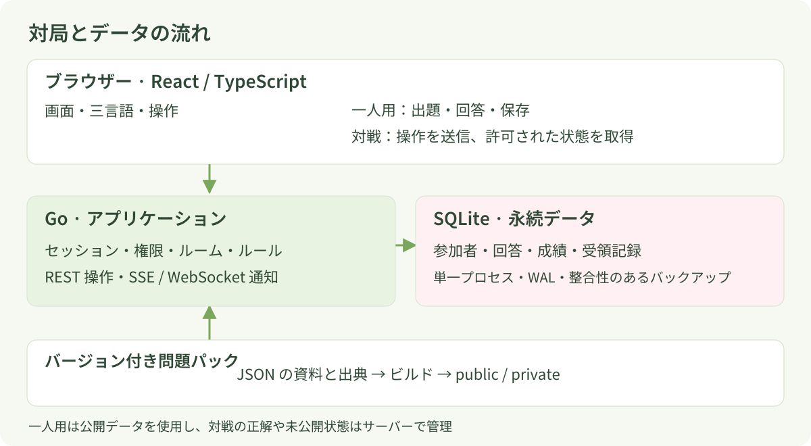

| パス | 担当 |
| --- | --- |
| `web/` | React · TypeScript · Vite |
| `internal/` | Go · SQLite · SSE / WebSocket |
| `cmd/` | 起動・バックアップ・問題ビルド |
| `data/` | 資料・出典・修正記録 |
| `api/` | OpenAPI |
| `docs/` | VitePress |

第三者ログインは既定で無効の実験的機能で、OAuth 2.0／OIDC に対応します。トレセンチャレンジとトレーナーランキングは画面の枠組みがあり、バックエンドは未接続です

</details>

<a id="contribute"></a>

## 参加とフィードバック

不具合の報告、キャラクター情報や訳名の訂正、操作性の改善を歓迎します。資料の訂正には対象と出典を添えてください。脆弱性は非公開で報告してください

[貢献ガイド](CONTRIBUTING.md) · [セキュリティ](SECURITY.md) · [行動規範](CODE_OF_CONDUCT.md)

## 出典とライセンス

BHCN STUDIO が開発する非公式の同人オープンソースゲームです。コードは [MIT](LICENSE) ライセンス。キャラクター、美術、音声、ブランドの権利は各権利者に帰属します

BiliWiki、萌娘百科、資料の編集者、別名の追加や内容の確認、不具合を知らせてくださった皆さまに感謝します

[出典とライセンス](docs/ja/第三方依赖与资料来源.md) · [BiliWiki](https://wiki.biligame.com/umamusume/) · [萌娘百科](https://zh.moegirl.org.cn/)
