<p align="center"><a href="README.md">简体中文</a> · <a href="README.zh-Hant.md">繁體中文</a> · <a href="README.ja.md">日本語</a></p>

<p align="center"></p>

<h1 align="center">马娘猜猜乐</h1>
<p align="center"><strong>你有多了解《赛马娘》？</strong><br>UmaGuessingGame</p>

<p align="center">
<a href="LICENSE"></a>
<a href="docs/玩法与规则.md"></a>

<a href="docs/快速开始.md"></a>
</p>

<p align="center"></p>

<p align="center">从九项线索猜角色，拼记忆、听声音、连赛场。一个人慢慢推理，也能和朋友开一场课间同乐赛</p>

<p align="center"><a href="#play"><strong>玩法图鉴</strong></a> · <a href="#start"><strong>运行游戏</strong></a> · <a href="#docs"><strong>文档导航</strong></a> · <a href="#contribute"><strong>参与贡献</strong></a> · <a href="https://numakkiyu.github.io/UmaGuessingGame/"><strong>文档网站</strong></a></p>

## 按自己的节奏，或和大家一起

<table>
<tr><td width="50%" valign="top"><h3>单人挑战</h3><p>准备好资料就开局，支持的玩法可保存记录，随时继续</p></td><td width="50%" valign="top"><h3>好友游玩</h3><p>创建房间、分享房间码，和约好的朋友一起玩</p></td></tr>
<tr><td width="50%" valign="top"><h3>随机匹配</h3><p>选择赛制加入队列，全员确认后自动开始</p></td><td width="50%" valign="top"><h3>派对模式</h3><p>主持人安排队伍和回合，大屏展示同乐赛进度</p></td></tr>
</table>

<a id="play"></a>

## 玩法图鉴

当前内容包开放 14 项玩法，「假档案发布会」的事实题仍在核对。站点可分别配置各玩法与游玩方式

### 角色知识

<table>
<tr>
<td width="50%" valign="top">
<a href="docs/play/classic.md">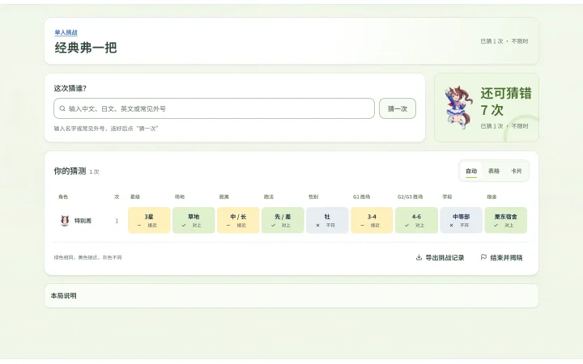</a>
<h4><a href="docs/play/classic.md">经典弗一把</a></h4>
<p>从熟悉的马娘猜起，用九条线索找到她</p>
<p><a href="docs/play/classic.md">图文玩法 ↗</a></p>
</td>
<td width="50%" valign="top">
<a href="docs/play/aptitude-grid.md">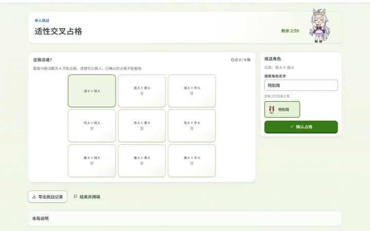</a>
<h4><a href="docs/play/aptitude-grid.md">适性交叉占格</a></h4>
<p>挑选同时满足行、列两项适性的马娘，填满九格棋盘。每位只能上场一次，确认后不能换人</p>
<p><a href="docs/play/aptitude-grid.md">图文玩法 ↗</a></p>
</td>
</tr>
<tr>
<td width="50%" valign="top">
<a href="docs/play/sort.md">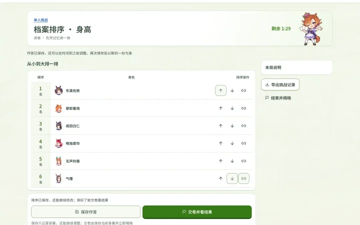</a>
<h4><a href="docs/play/sort.md">档案排序</a></h4>
<p>身高、生日和角色小知识，你能排对顺序吗</p>
<p><a href="docs/play/sort.md">图文玩法 ↗</a></p>
</td>
<td width="50%" valign="top">
<a href="docs/play/pedigree.md">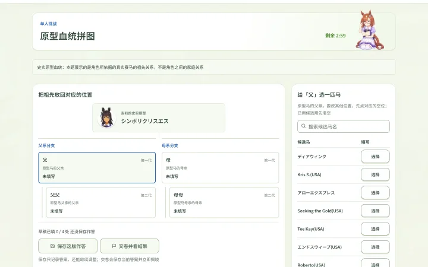</a>
<h4><a href="docs/play/pedigree.md">原型血统拼图</a></h4>
<p>角色的原型马，有着怎样的血统？沿父系与母系找线索，把父母和祖辈放回对应的位置</p>
<p><a href="docs/play/pedigree.md">图文玩法 ↗</a></p>
</td>
</tr>
</table>

### 观察与记忆

<table>
<tr>
<td width="50%" valign="top">
<a href="docs/play/memory.md">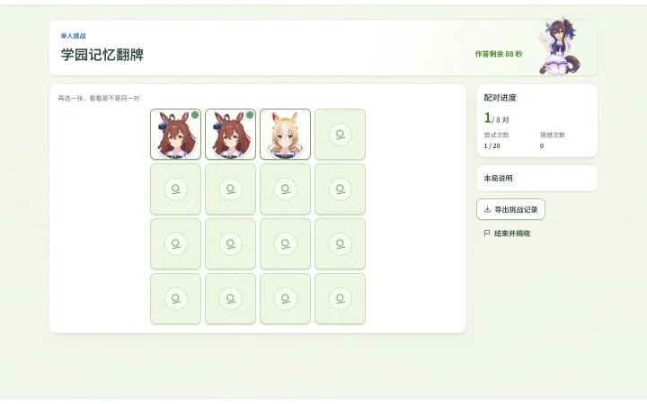</a>
<h4><a href="docs/play/memory.md">学园记忆翻牌</a></h4>
<p>翻牌前先看 8 秒，记住头像的位置。每次翻两张，最多用 20 次尝试找齐八对</p>
<p><a href="docs/play/memory.md">图文玩法 ↗</a></p>
</td>
<td width="50%" valign="top">
<a href="docs/play/audio.md">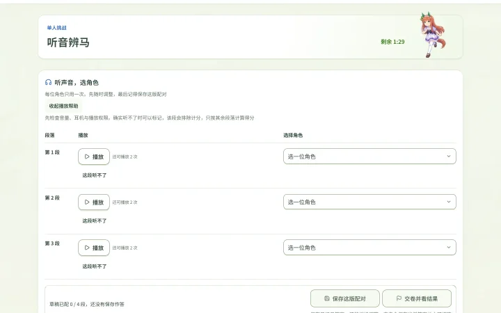</a>
<h4><a href="docs/play/audio.md">听音辨马</a></h4>
<p>熟悉的声音响起来，你能认出是谁吗？每段最多听两次，听出她就配好对。配错不额外扣分</p>
<p><a href="docs/play/audio.md">图文玩法 ↗</a></p>
</td>
</tr>
</table>

### 历史与关联

<table>
<tr>
<td width="50%" valign="top">
<a href="docs/play/race-rebuild.md">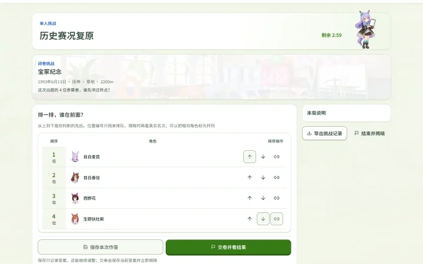</a>
<h4><a href="docs/play/race-rebuild.md">历史赛况复原</a></h4>
<p>重温那场比赛，把这次出题的参赛者按史实完赛顺序排好。遇到同着，也记得标出来</p>
<p><a href="docs/play/race-rebuild.md">图文玩法 ↗</a></p>
</td>
<td width="50%" valign="top">
<a href="docs/play/co-race-path.md">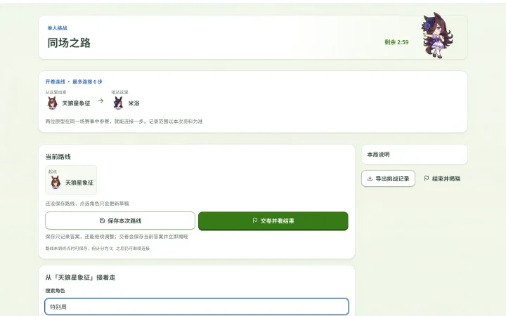</a>
<h4><a href="docs/play/co-race-path.md">同场之路</a></h4>
<p>沿着原型马同场参赛的记录，从一位马娘连到另一位。路线越短，得分越高</p>
<p><a href="docs/play/co-race-path.md">图文玩法 ↗</a></p>
</td>
</tr>
</table>

### 编队与策略

<table>
<tr>
<td width="50%" valign="top">
<a href="docs/play/draft.md">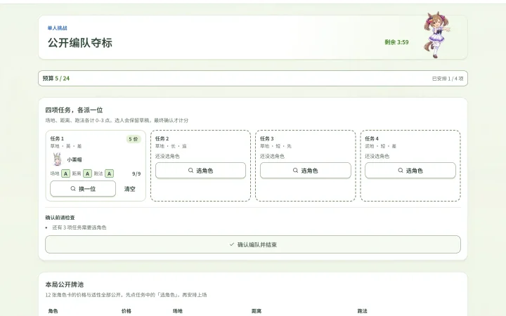</a>
<h4><a href="docs/play/draft.md">公开编队</a></h4>
<p>预算只有这么多，四项任务各派谁上场？查看价格与适性，选出四位不同的马娘</p>
<p><a href="docs/play/draft.md">图文玩法 ↗</a></p>
</td>
<td width="50%" valign="top">
<a href="docs/play/strategy-race.md">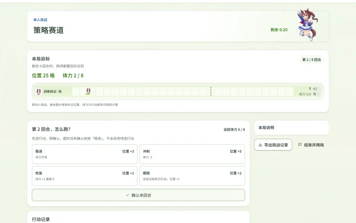</a>
<h4><a href="docs/play/strategy-race.md">回合制策略赛道</a></h4>
<p>冲刺的时机到了吗？分配好八回合的体力，每回合一起亮出行动，最后位置最靠前的队伍获胜</p>
<p><a href="docs/play/strategy-race.md">图文玩法 ↗</a></p>
</td>
</tr>
<tr>
<td width="50%" valign="top">
<a href="docs/play/trade.md">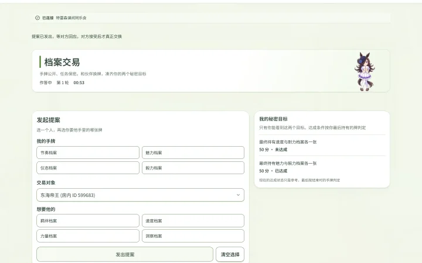</a>
<h4><a href="docs/play/trade.md">档案交易</a></h4>
<p>你想凑齐的牌，也许正好是别人愿意交换的。手牌公开、任务保密，三轮谈判后看看谁完成了秘密目标</p>
<p><a href="docs/play/trade.md">图文玩法 ↗</a></p>
</td><td width="50%"></td>
</tr>
</table>

### 聚会与合作

<table>
<tr>
<td width="50%" valign="top">
<a href="docs/play/clue-puzzle.md">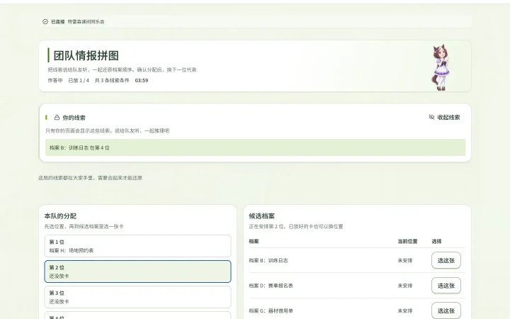</a>
<h4><a href="docs/play/clue-puzzle.md">团队情报拼图</a></h4>
<p>队友的线索和你手里的能对上吗？把情报说给大家听，一起排好档案卡</p>
<p><a href="docs/play/clue-puzzle.md">图文玩法 ↗</a></p>
</td>
<td width="50%" valign="top">
<a href="docs/play/rapport.md">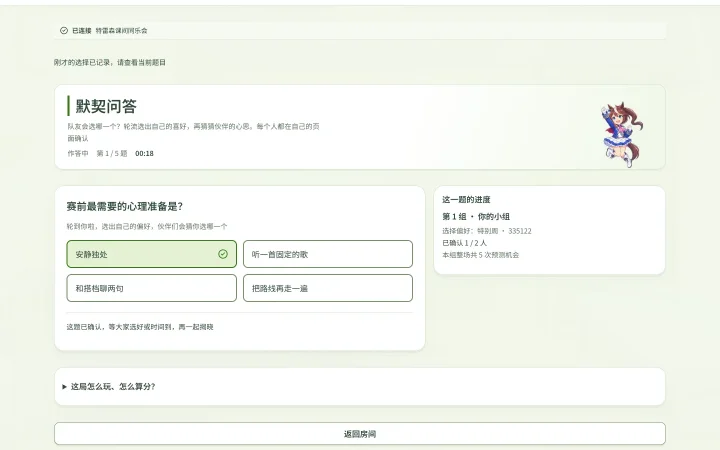</a>
<h4><a href="docs/play/rapport.md">默契问答</a></h4>
<p>一起聊了这么久，队友的心思你猜得中吗？轮流选喜好，锁定后一起揭晓答案</p>
<p><a href="docs/play/rapport.md">图文玩法 ↗</a></p>
</td>
</tr>
<tr>
<td width="50%" valign="top">
<a href="docs/play/creative.md">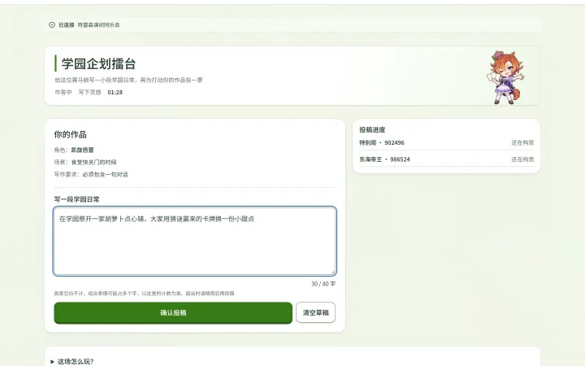</a>
<h4><a href="docs/play/creative.md">创意企划</a></h4>
<p>课间的企划会开始啦！抽到角色、场景和限制后，用 80 字写个点子，匿名展示给大家。参赛者票与观众票合计选出创意奖</p>
<p><a href="docs/play/creative.md">图文玩法 ↗</a></p>
</td>
<td width="50%" valign="top">
<a href="docs/play/bluff.md">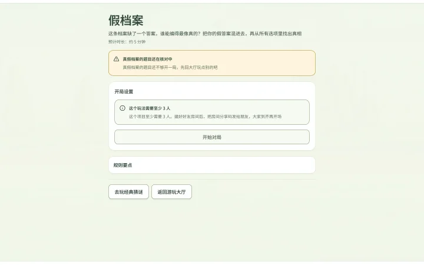</a>
<h4><a href="docs/play/bluff.md">假档案发布会</a> · 题库核对中</h4>
<p>这条档案缺了一个答案，谁能编得最像真的？把你的假答案混进去，再从所有选项里找出真相</p>
<p><a href="docs/play/bluff.md">图文玩法 ↗</a></p>
</td>
</tr>
</table>

<details>
<summary>手机画面</summary>

<p align="center">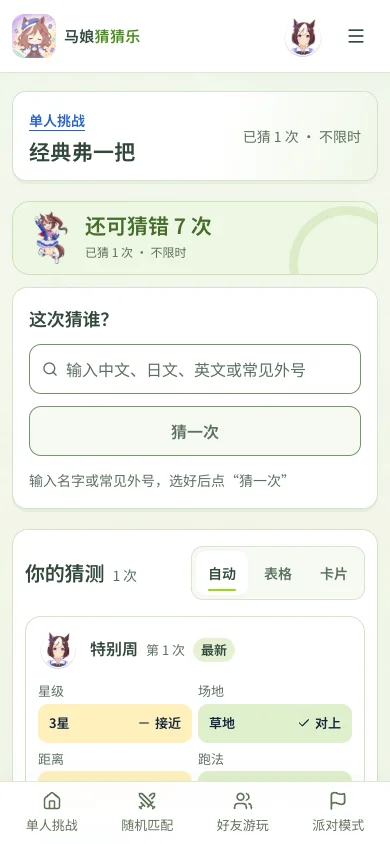 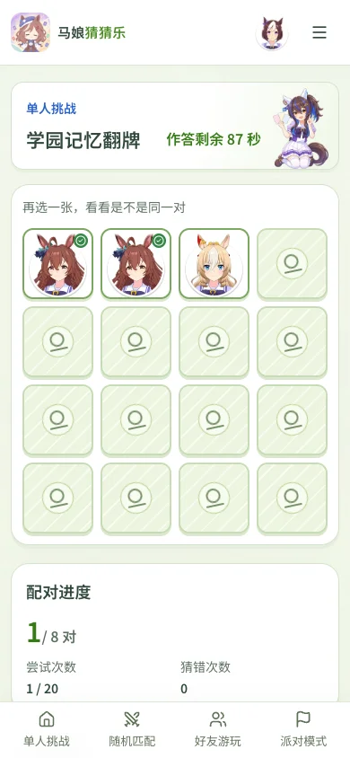</p>

</details>

<a id="start"></a>

## 把游戏运行起来

需要 Go 1.26.11、Node.js 24、pnpm 10.33.0 和 GNU Make，命令在仓库根目录执行

```bash
make web-install
make web-build
make embed-spa
make embed-spa-check
make content-compile
make content-verify
make dev
```

启动后打开 [http://localhost:8080](http://localhost:8080)。手机访问、容器运行及环境配置见 [快速开始](docs/快速开始.md)

## 为训练员准备的细节

| 功能 | 说明 |
| --- | --- |
| 一份个人设置 | 昵称和头像全站通用，六位房间编号区分同名玩家 |
| 三种语言 | 简体中文、繁體中文、日本語，角色名称与提示按地区适配 |
| 桌面与手机 | 宽屏表格与分栏，窄屏卡片与单列，作答内容保持一致 |
| 进度与重连 | 支持的单人玩法可导出、导入与续玩，联机恢复后读取已确认记录 |
| 按需配置 | 玩法、容量、匹配大厅和 Cloudflare Turnstile 可分别设置 |
| 语音格式 | **40 kbps VBR、Opus / WebM** |

<a id="docs"></a>

## 继续了解

**部署站点** — [快速开始](docs/快速开始.md) · [Linux](docs/Linux部署指南.md) · [macOS](docs/macOS部署指南.md) · [Windows](docs/Windows部署指南.md)

**配置与维护** — [配置参考](docs/配置参考.md) · [维护与更新指南](docs/维护与更新指南.md) · [账户登录与游玩准入](docs/账户登录与游玩准入.md)

**开发与接口** — [技术架构说明](docs/技术架构说明.md) · [API与实时通信](docs/API与实时通信.md) · [内容编译](docs/内容编译.md)

**界面与资料** — [界面与交互规范](docs/界面与交互规范.md) · [第三方依赖与资料来源](docs/第三方依赖与资料来源.md)

<details>
<summary>项目结构与数据流</summary>

React 页面负责交互与单人挑战；Go 服务管理联机出题、作答与裁决，SQLite 保存房间与结果。题库独立编译，可按站点需要开放玩法

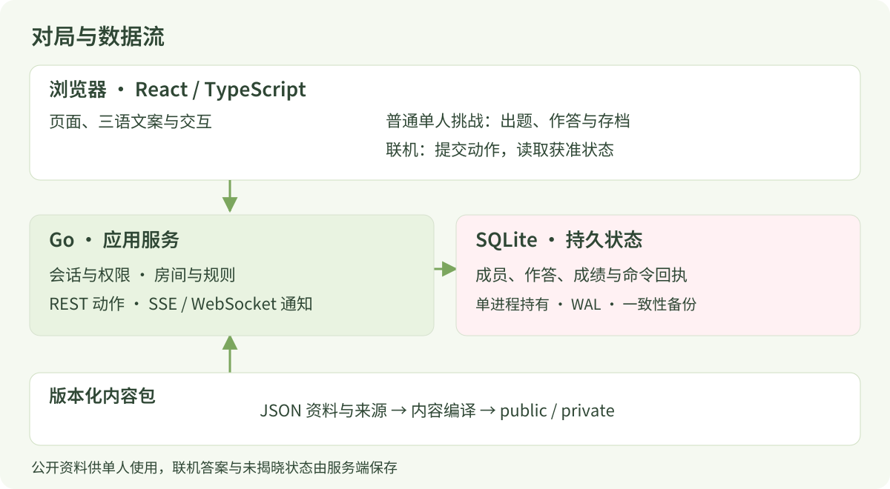

| 目录 | 用途 |
| --- | --- |
| `web/` | React · TypeScript · Vite |
| `internal/` | Go · SQLite · SSE / WebSocket |
| `cmd/` | 启动、备份与题库编译 |
| `data/` | 资料、来源与修订记录 |
| `api/` | OpenAPI |
| `docs/` | VitePress |

第三方账户登录为默认关闭的实验性功能，支持 OAuth 2.0／OIDC。特雷森挑战赛与训练员挑战榜目前为界面框架，后端尚未接入

</details>

<a id="contribute"></a>

## 参与与反馈

欢迎反馈游玩问题、修正角色资料与译名，或改进交互。资料纠错请附具体条目和来源；安全问题请私下报告

[贡献指南](CONTRIBUTING.md) · [安全策略](SECURITY.md) · [行为准则](CODE_OF_CONDUCT.md)

## 资料与许可

BHCN STUDIO 维护的非官方同人开源项目。代码采用 [MIT](LICENSE) 许可，角色、美术、声音与品牌的权利归各自权利人

感谢哔哩哔哩游戏百科、萌娘百科与各位资料编辑者，以及补充别名、核对内容和反馈问题的玩家

[资料来源与许可](docs/第三方依赖与资料来源.md) · [BiliWiki](https://wiki.biligame.com/umamusume/) · [萌娘百科](https://zh.moegirl.org.cn/)
