<p align="center"><a href="README.md">简体中文</a> · <a href="README.zh-Hant.md">繁體中文</a> · <a href="README.ja.md">日本語</a></p>

<p align="center"></p>

<h1 align="center">馬娘猜猜樂</h1>
<p align="center"><strong>你有多了解《賽馬娘》？</strong><br>UmaGuessingGame</p>

<p align="center">
<a href="LICENSE"></a>
<a href="docs/zh-Hant/玩法与规则.md"></a>

<a href="docs/zh-Hant/快速开始.md"></a>
</p>

<p align="center">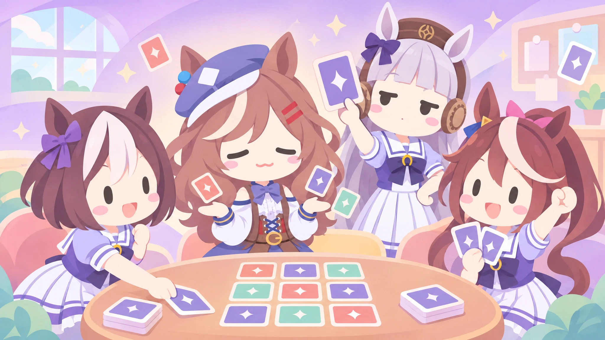</p>

<p align="center">從九項提示猜角色，考驗記憶、聽聲音、串連賽場。照自己的步調推理，也能和朋友辦場課間同樂賽</p>

<p align="center"><a href="#play"><strong>玩法圖鑑</strong></a> · <a href="#start"><strong>執行遊戲</strong></a> · <a href="#docs"><strong>文件導覽</strong></a> · <a href="#contribute"><strong>參與貢獻</strong></a> · <a href="https://numakkiyu.github.io/UmaGuessingGame/zh-Hant/"><strong>文件網站</strong></a></p>

## 照自己的步調，也能和大家一起

<table>
<tr><td width="50%" valign="top"><h3>單人挑戰</h3><p>備妥資料即可開始，支援的玩法能儲存紀錄，隨時接著玩</p></td><td width="50%" valign="top"><h3>好友遊玩</h3><p>建立房間、分享代碼，和約好的朋友一起玩</p></td></tr>
<tr><td width="50%" valign="top"><h3>隨機配對</h3><p>選擇賽制排隊，全員確認後自動開始</p></td><td width="50%" valign="top"><h3>派對模式</h3><p>主持人安排隊伍與回合，大螢幕分享同樂賽進度</p></td></tr>
</table>

<a id="play"></a>

## 玩法圖鑑

目前題庫開放 14 項，「假檔案發表會」仍在核對事實題。站點可分別設定玩法與遊玩方式

### 角色知識

<table>
<tr>
<td width="50%" valign="top">
<a href="docs/zh-Hant/play/classic.md">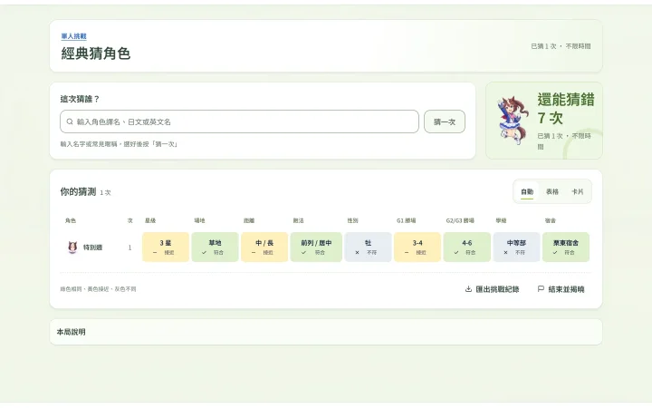</a>
<h4><a href="docs/zh-Hant/play/classic.md">經典猜角色</a></h4>
<p>從熟悉的賽馬娘猜起，用九項提示找到她</p>
<p><a href="docs/zh-Hant/play/classic.md">圖文玩法 ↗</a></p>
</td>
<td width="50%" valign="top">
<a href="docs/zh-Hant/play/aptitude-grid.md">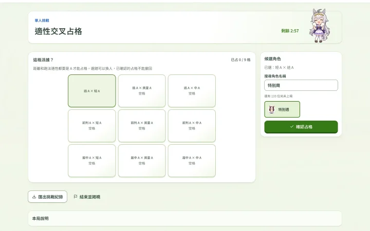</a>
<h4><a href="docs/zh-Hant/play/aptitude-grid.md">適性交叉占格</a></h4>
<p>挑選同時符合行、列兩項適性的賽馬娘，填滿九格棋盤。每位只能上場一次，確認後不能換人</p>
<p><a href="docs/zh-Hant/play/aptitude-grid.md">圖文玩法 ↗</a></p>
</td>
</tr>
<tr>
<td width="50%" valign="top">
<a href="docs/zh-Hant/play/sort.md">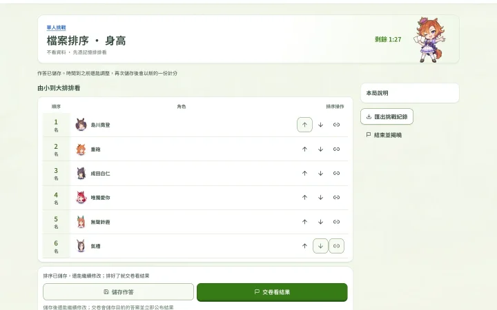</a>
<h4><a href="docs/zh-Hant/play/sort.md">檔案排序</a></h4>
<p>身高、生日與角色小知識，你能排對順序嗎</p>
<p><a href="docs/zh-Hant/play/sort.md">圖文玩法 ↗</a></p>
</td>
<td width="50%" valign="top">
<a href="docs/zh-Hant/play/pedigree.md">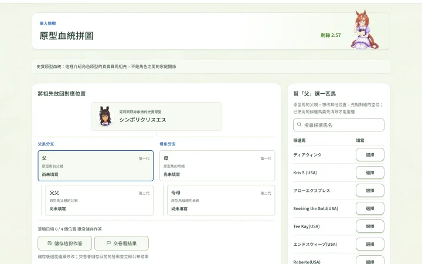</a>
<h4><a href="docs/zh-Hant/play/pedigree.md">原型血統拼圖</a></h4>
<p>角色的原型馬，有著怎樣的血統？沿父系與母系找線索，將父母和祖父母放回對應的位置</p>
<p><a href="docs/zh-Hant/play/pedigree.md">圖文玩法 ↗</a></p>
</td>
</tr>
</table>

### 觀察與記憶

<table>
<tr>
<td width="50%" valign="top">
<a href="docs/zh-Hant/play/memory.md">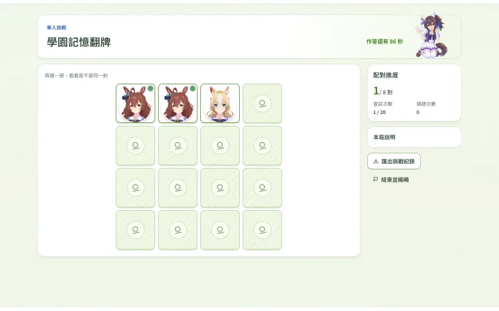</a>
<h4><a href="docs/zh-Hant/play/memory.md">學園記憶翻牌</a></h4>
<p>翻牌前先看 8 秒，記住頭像的位置。每次翻兩張，最多用 20 次嘗試找齊八對</p>
<p><a href="docs/zh-Hant/play/memory.md">圖文玩法 ↗</a></p>
</td>
<td width="50%" valign="top">
<a href="docs/zh-Hant/play/audio.md">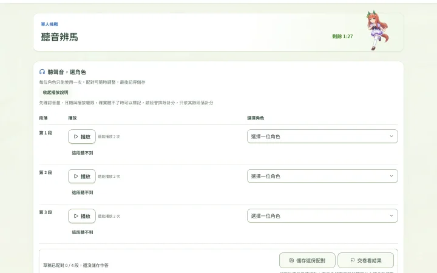</a>
<h4><a href="docs/zh-Hant/play/audio.md">聽音辨角色</a></h4>
<p>熟悉的聲音響起，你能認出是誰嗎？每段最多聽兩次，聽出她就配好對。配錯不額外扣分</p>
<p><a href="docs/zh-Hant/play/audio.md">圖文玩法 ↗</a></p>
</td>
</tr>
</table>

### 歷史與關聯

<table>
<tr>
<td width="50%" valign="top">
<a href="docs/zh-Hant/play/race-rebuild.md">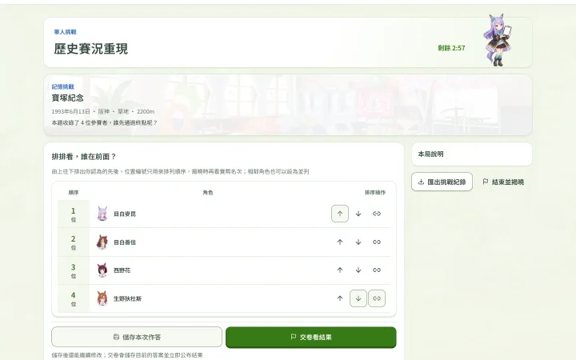</a>
<h4><a href="docs/zh-Hant/play/race-rebuild.md">歷史賽況重現</a></h4>
<p>重溫那場比賽，把這次出題的參賽者依史實完賽順序排好。並列完賽時，也記得標出來</p>
<p><a href="docs/zh-Hant/play/race-rebuild.md">圖文玩法 ↗</a></p>
</td>
<td width="50%" valign="top">
<a href="docs/zh-Hant/play/co-race-path.md">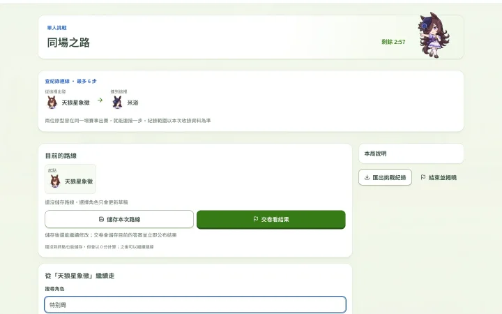</a>
<h4><a href="docs/zh-Hant/play/co-race-path.md">同場之路</a></h4>
<p>循著原型馬同場出賽的紀錄，從一位賽馬娘連到另一位。路線越短，得分越高</p>
<p><a href="docs/zh-Hant/play/co-race-path.md">圖文玩法 ↗</a></p>
</td>
</tr>
</table>

### 編隊與策略

<table>
<tr>
<td width="50%" valign="top">
<a href="docs/zh-Hant/play/draft.md">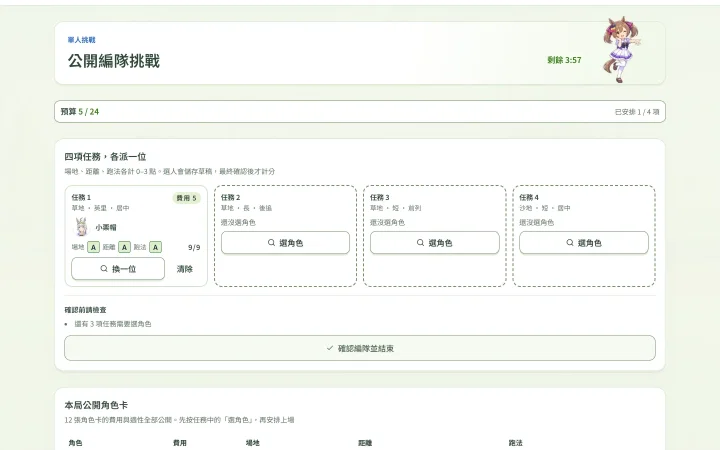</a>
<h4><a href="docs/zh-Hant/play/draft.md">公開編隊</a></h4>
<p>預算只有這麼多，四項任務各派誰上場？查看費用與適性，選出四位不同的賽馬娘</p>
<p><a href="docs/zh-Hant/play/draft.md">圖文玩法 ↗</a></p>
</td>
<td width="50%" valign="top">
<a href="docs/zh-Hant/play/strategy-race.md">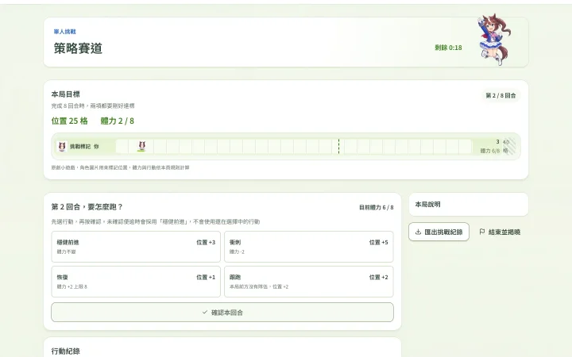</a>
<h4><a href="docs/zh-Hant/play/strategy-race.md">回合制策略賽道</a></h4>
<p>衝刺的時機到了嗎？分配好八回合的體力，每回合一起揭曉行動，最後位置最前的隊伍獲勝</p>
<p><a href="docs/zh-Hant/play/strategy-race.md">圖文玩法 ↗</a></p>
</td>
</tr>
<tr>
<td width="50%" valign="top">
<a href="docs/zh-Hant/play/trade.md">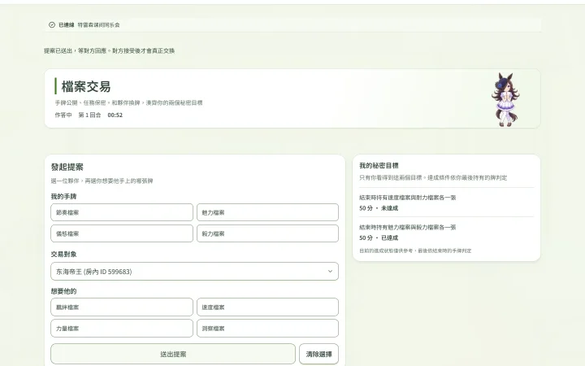</a>
<h4><a href="docs/zh-Hant/play/trade.md">檔案交易</a></h4>
<p>你想湊齊的牌，也許正好是別人願意交換的。手牌公開、任務保密，三輪協商後看看誰完成了秘密目標</p>
<p><a href="docs/zh-Hant/play/trade.md">圖文玩法 ↗</a></p>
</td><td width="50%"></td>
</tr>
</table>

### 聚會與合作

<table>
<tr>
<td width="50%" valign="top">
<a href="docs/zh-Hant/play/clue-puzzle.md">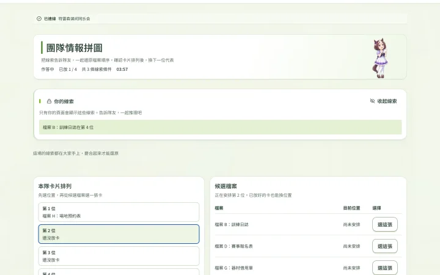</a>
<h4><a href="docs/zh-Hant/play/clue-puzzle.md">團隊情報拼圖</a></h4>
<p>隊友的線索和你手上的對得上嗎？把情報告訴大家，一起排好檔案卡</p>
<p><a href="docs/zh-Hant/play/clue-puzzle.md">圖文玩法 ↗</a></p>
</td>
<td width="50%" valign="top">
<a href="docs/zh-Hant/play/rapport.md">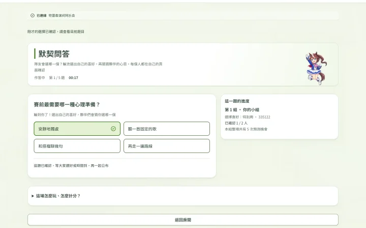</a>
<h4><a href="docs/zh-Hant/play/rapport.md">默契問答</a></h4>
<p>一起聊了這麼久，隊友的心思你猜得中嗎？輪流選喜好，鎖定後一起揭曉答案</p>
<p><a href="docs/zh-Hant/play/rapport.md">圖文玩法 ↗</a></p>
</td>
</tr>
<tr>
<td width="50%" valign="top">
<a href="docs/zh-Hant/play/creative.md">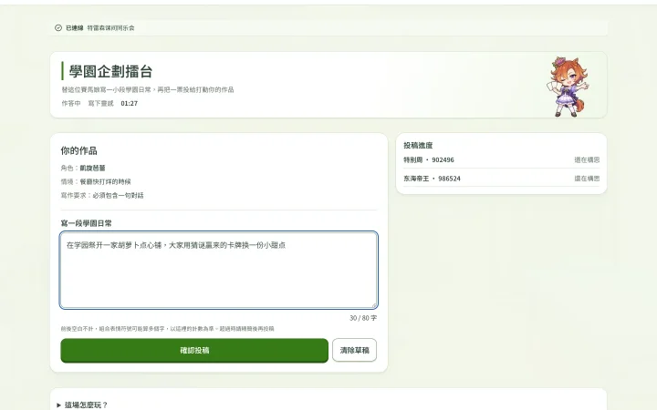</a>
<h4><a href="docs/zh-Hant/play/creative.md">創意企劃</a></h4>
<p>課間企劃會開始囉！抽到角色、場景和限制後，用 80 字寫個點子，匿名展示給大家。參賽者票與觀眾票合計選出創意獎</p>
<p><a href="docs/zh-Hant/play/creative.md">圖文玩法 ↗</a></p>
</td>
<td width="50%" valign="top">
<a href="docs/zh-Hant/play/bluff.md">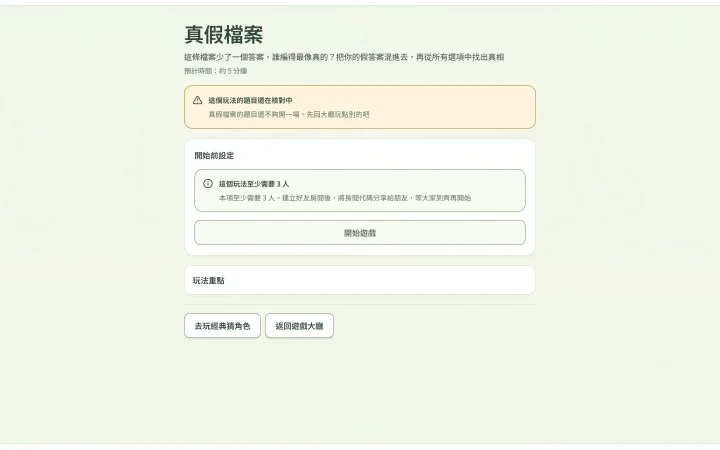</a>
<h4><a href="docs/zh-Hant/play/bluff.md">假檔案發表會</a> · 題庫核對中</h4>
<p>這條檔案少了一個答案，誰編得最像真的？把你的假答案混進去，再從所有選項中找出真相</p>
<p><a href="docs/zh-Hant/play/bluff.md">圖文玩法 ↗</a></p>
</td>
</tr>
</table>

<details>
<summary>手機畫面</summary>

<p align="center">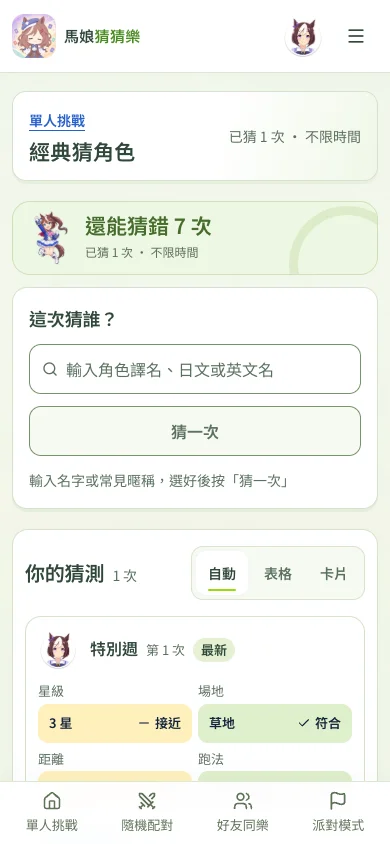 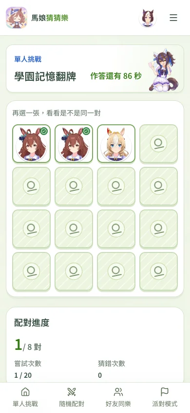</p>

</details>

<a id="start"></a>

## 把遊戲執行起來

需要 Go 1.26.11、Node.js 24、pnpm 10.33.0 與 GNU Make，請在專案根目錄執行

```bash
make web-install
make web-build
make embed-spa
make embed-spa-check
make content-compile
make content-verify
make dev
```

啟動後開啟 [http://localhost:8080](http://localhost:8080)，手機連線、容器與環境設定請見 [快速開始](docs/zh-Hant/快速开始.md)

## 為訓練員準備的細節

| 功能 | 說明 |
| --- | --- |
| 一份個人設定 | 全站共用暱稱與頭像，六位房內編號區分同名玩家 |
| 三種語言 | 簡體中文、繁體中文、日文，名稱與提示依地區習慣調整 |
| 桌面與手機 | 寬螢幕用表格與分欄，窄螢幕用卡片與單欄，作答內容與規則相同 |
| 進度與重連 | 支援的單人玩法可匯入、匯出與續玩，連線恢復後讀取確認紀錄 |
| 依需求設定 | 玩法、容量、配對大廳與 Cloudflare Turnstile 可分別設定 |
| 語音格式 | **40 kbps VBR、Opus / WebM** |

<a id="docs"></a>

## 接著了解

**部署站點** — [快速開始](docs/zh-Hant/快速开始.md) · [Linux](docs/zh-Hant/Linux部署指南.md) · [macOS](docs/zh-Hant/macOS部署指南.md) · [Windows](docs/zh-Hant/Windows部署指南.md)

**設定與維護** — [設定參考](docs/zh-Hant/配置参考.md) · [維護與更新](docs/zh-Hant/维护与更新指南.md) · [實驗性帳號登入](docs/zh-Hant/账户登录与游玩准入.md)

**開發與介面** — [架構與模組](docs/zh-Hant/技术架构说明.md) · [API与实时通信](docs/zh-Hant/API与实时通信.md) · [題庫編譯](docs/zh-Hant/内容编译.md)

**介面與資料** — [介面與互動](docs/zh-Hant/界面与交互规范.md) · [資料來源與授權](docs/zh-Hant/第三方依赖与资料来源.md)

<details>
<summary>專案結構與資料流程</summary>

React 頁面處理互動與單人挑戰，Go 服務管理連線出題、作答與判定，SQLite 儲存房間與結果。題庫獨立編譯，站點可選擇開放項目

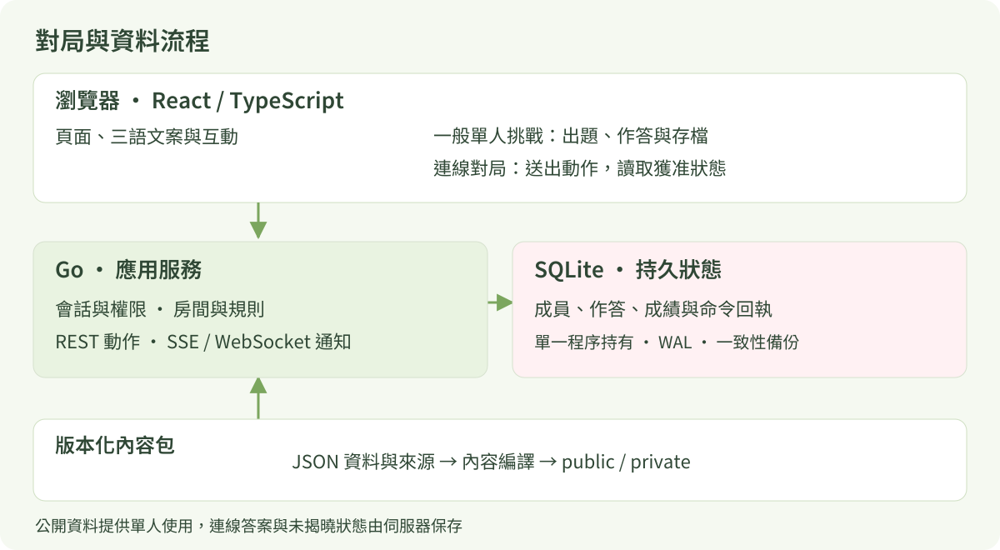

| 目錄 | 用途 |
| --- | --- |
| `web/` | React · TypeScript · Vite |
| `internal/` | Go · SQLite · SSE / WebSocket |
| `cmd/` | 啟動、備份與題庫編譯 |
| `data/` | 資料、來源與修訂紀錄 |
| `api/` | OpenAPI |
| `docs/` | VitePress |

第三方帳號登入是預設關閉的實驗性功能，支援 OAuth 2.0／OIDC。特雷森挑戰賽與訓練員挑戰榜目前為介面框架，後端尚未接入

</details>

<a id="contribute"></a>

## 參與與回饋

歡迎回報遊玩問題、修正角色資料與譯名，或改善互動。資料更正請附上條目與來源，安全問題請私下回報

[貢獻指南](CONTRIBUTING.md) · [安全政策](SECURITY.md) · [社群準則](CODE_OF_CONDUCT.md)

## 資料與授權

由 BHCN STUDIO 維護的非官方同人開源專案。程式碼採 [MIT](LICENSE) 授權，角色、美術、聲音與品牌權利歸各權利人所有

感謝嗶哩嗶哩遊戲百科、萌娘百科、資料編輯者，以及補充別名、核對內容與回報問題的玩家

[資料來源與授權](docs/zh-Hant/第三方依赖与资料来源.md) · [BiliWiki](https://wiki.biligame.com/umamusume/) · [萌娘百科](https://zh.moegirl.org.cn/)
