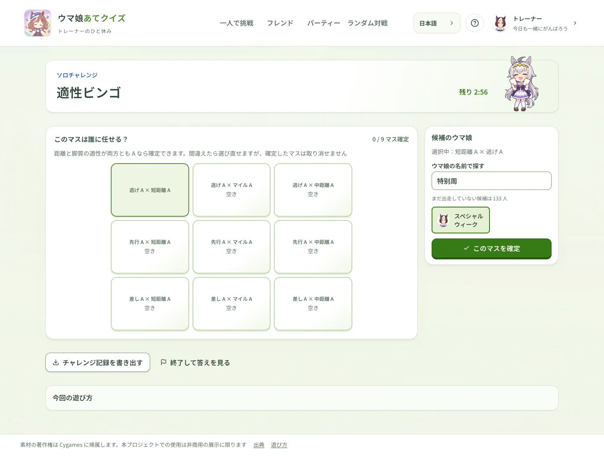
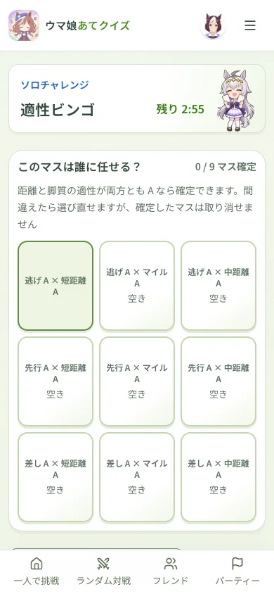

# 適性マス埋め

行と列の適性を両方満たすウマ娘を選んで、九つのマスを埋めよう。同じ一人は一度だけ。確定後は変更できません

## 操作の流れ

1. データを準備して開始し、行と列の適性条件を確認します
2. 空いているマスを選び、両方の条件を満たすウマ娘を検索します
3. 確定したマスは固定されます。同じウマ娘は一度だけ使えます
4. 残りの候補を考えながら、180 秒以内に九つのマスを埋めましょう

## ルールと採点

- 適性は収録された衣装の初期値です。継承・育成による上昇は含めず、マス埋めと採点には当サイト独自のルールを使います
- 各マスでは、行と列で指定された二つの適性がどちらも A のウマ娘を選びます
- 空いているマスを押してから、候補の中からウマ娘を選び、確定してください
- 一度埋めたマスは変更できません。同じウマ娘は一度しか使えません
- 得点は 100 × 正解マス数 ÷ 9。小数点以下は切り捨てます
- 確定前には条件を満たしているか表示しません。正解は答え合わせで公開します

## スマートフォンで遊ぶ

盤面の空きマスを選び、選択画面でウマ娘を探して確定します

[種目一覧](../玩法与规则.md) · [よくある質問](../常见问题.md) · [出典](../第三方依赖与资料来源.md)
