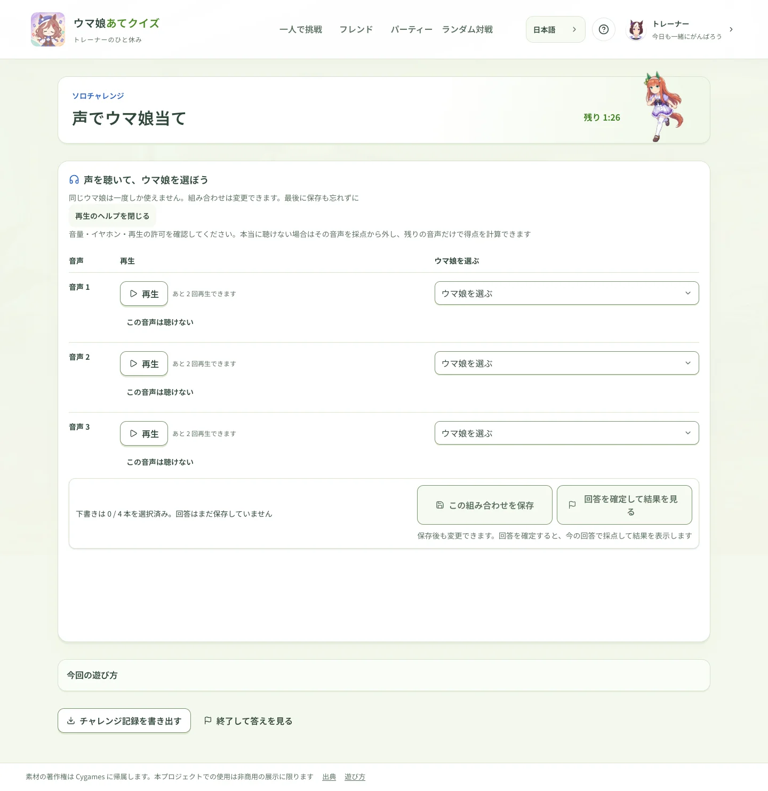
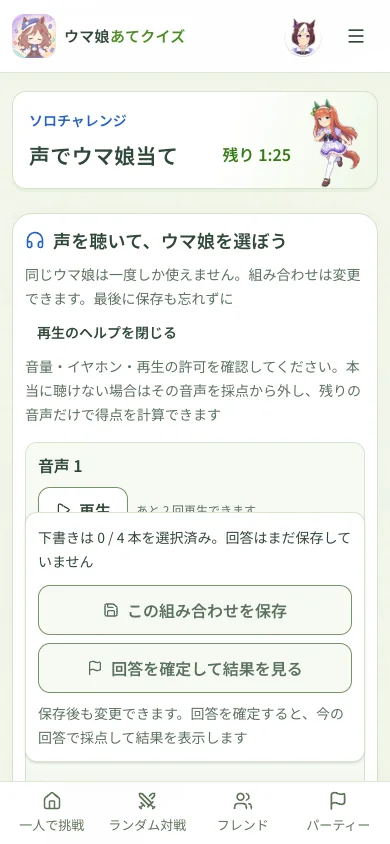

# 声当て

聞き覚えのある声、誰だか分かるかな？各ボイスは 2 回まで再生できます。話しているウマ娘と組み合わせよう。間違えても追加の減点はありません

## 操作の流れ

1. 音声の数を選び、すべてのデータを準備してから 90 秒の挑戦を始めます
2. 再生ボタンで聞きます。各音声は二回まで。途中で止めて再生し直す場合も一回に数えます
3. 各音声に話しているウマ娘を割り当てます。同じウマ娘は一度だけ使えます
4. 保存後も修正でき、提出すると結果を表示します。再生できない場合は音量と権限を確認し、画面から報告してください

## ルールと採点

- すべての音声の読み込みが完了してから回答を始めます
- 各音声は 2 回まで聴けます。停止後の再生も 1 回と数えます
- 聴けないときは音量や再生の許可を確認してください。複数人でのプレイはホストに報告して中止・再出題を待ちます。ソロチャレンジでは、その音声を採点から外せます
- 採点対象の音声のうち、正しく組み合わせた割合を 100 点満点に換算します。4 本すべてが採点対象なら、1 本正解ごとに 25 点です
- 締め切りまでは何度でも変更でき、最後に送信した回答で採点します

## 対戦での違い

全員が同じ音声を準備してから計時します。再生不良は進行役に連絡し、ラウンドを取り消してやり直します

## スマートフォンで遊ぶ

音声を準備し、再生してからウマ娘を選びます。確定前に各音声の組み合わせを確認できます

[種目一覧](../玩法与规则.md) · [よくある質問](../常见问题.md) · [出典](../第三方依赖与资料来源.md)
