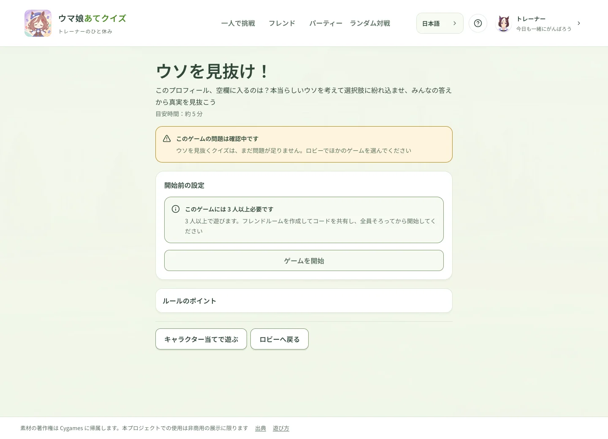
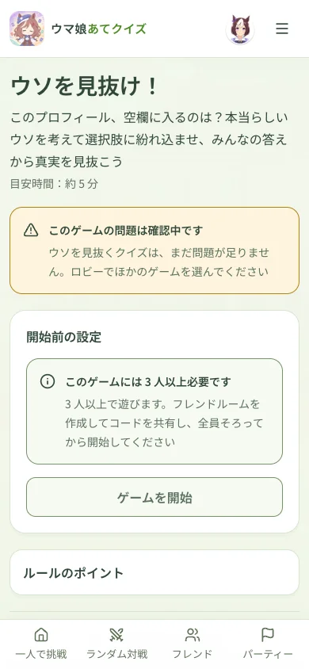

# にせプロフィール発表会

このプロフィール、空欄に入るのは？本当らしいウソを考えて選択肢に紛れ込ませ、みんなの答えから真実を見抜こう

::: info 問題データの状況
現在の問題パックでは公開されていません。画像は実際の入口で、以下は実装済みのルールです
:::

## 操作の流れ

1. 三人以上と確認済みの事実データが必要です。現在の問題パックでは公開されていません
2. 空欄に入りそうな 2〜40 文字のにせ回答を書いて提出します
3. 匿名の候補から本当の答えを選びます。自分のにせ回答には投票できません
4. 公開後に本当の資料と出典を読み、どの偽回答が選ばれたかを確認します

## ルールと採点

- 3 人以上で遊びます。それぞれウソの答えを考え、混ざった選択肢から本当の答えを探しましょう
- 最初に 2〜40 文字のウソの答えを書きます。前後の空白は数えず、組み合わせた絵文字は複数文字と数える場合があります。送信後は変更できません
- 次にすべての回答が混ざって表示されます。本当の事実に当たるものを選んでください
- 投票は変更できません。本当の答えを見抜くと 70 点、ほかの人をだますと最大 30 点です
- 作ったウソは今回のゲームだけで使います。実際のキャラクター情報と混同しないようにしてください

## スマートフォンで遊ぶ

利用可能になったら、スマートフォンで偽の回答を書き、匿名の選択肢から本当の答えを選べます

[種目一覧](../玩法与规则.md) · [よくある質問](../常见问题.md) · [出典](../第三方依赖与资料来源.md)
