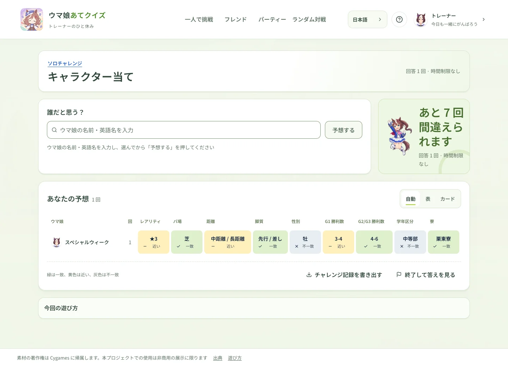
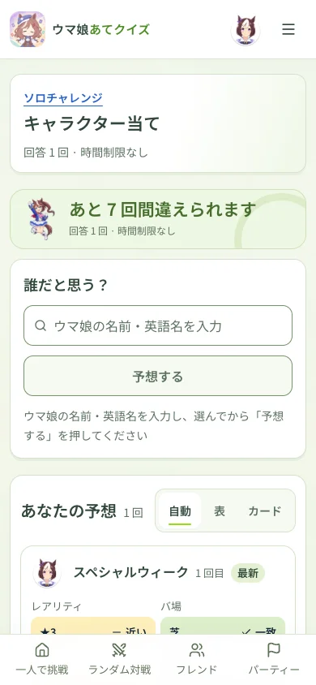

# キャラクター当て

九つのヒントから、思い浮かぶ一人を探そう

## 操作の流れ

1. 一人用からキャラクター当てを選び、データを準備して間違えられる回数を設定します
2. 名前を入力して候補から一人を選び、回答ボタンを押します
3. 九つの項目を比較します。緑は一致、黄は近い、灰は不一致、未知は資料不足です
4. ヒントを手がかりに次の一人を選びます。本人を当てれば成功。間違えると残り回数が一つ減り、使い切ると答えを公開します

## ルールと採点

- 比較するのはレアリティ、バ場、距離、脚質、性別、G1 勝利数、G2/G3 勝利数、学部、寮の九項目です
- 本人を当てると成功。間違えたときだけ回数を消費します。一人用は時間制限がなく、同じブラウザーで続けられます

## 対戦での違い

二人対戦は同じ答えを使い、先に当てた人が勝ちます。一人の回数が尽きても相手は続行し、対局終了時に答えを公開します。二人対戦で降参すると相手が即勝利。締切まで誰も当てられなければ双方勝利なしです

## スマートフォンで遊ぶ

名前を入力して候補からウマ娘を選び、回答します。ヒントはカード形式で表示され、残りの項目も展開して確認できます

[種目一覧](../玩法与规则.md) · [よくある質問](../常见问题.md) · [出典](../第三方依赖与资料来源.md)
