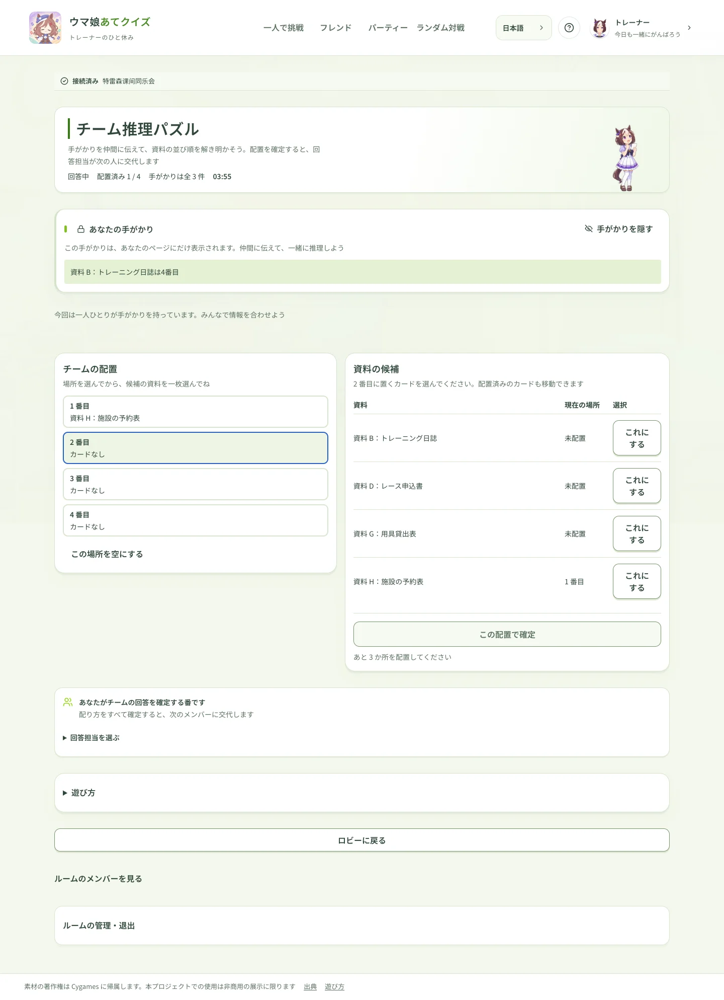
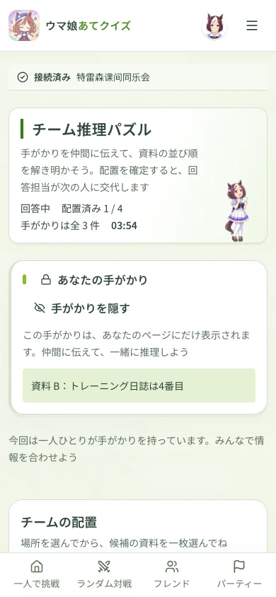

# チーム情報パズル

自分のヒントと仲間のヒント、どうつながる？情報を持ち寄って、プロフィールカードの順番を解き明かそう

## 操作の流れ

1. 一組 3〜6 人でリーダーを決め、それぞれに配られた手がかりを読みます
2. 手がかりを伝え合い、各カードがどの位置に入るか相談します
3. 現在の回答担当がすべての位置を割り当て、確定すると次のメンバーに交代します
4. 締切までは修正して再確定できます。最後の割り当てが満たした条件の割合で採点します

## ルールと採点

- 1〜8 チーム、各 3〜6 人で遊べます。1 チームでの協力も、複数チームでの対戦も可能です。始める前に待機画面でチームとリーダーを決めてください
- 各ゲームは 4〜6 枚のカードで、標準の制限時間は 240 秒。必要な情報はヒントにそろっているので、外の資料を調べる必要はありません
- 各メンバーに、自分の画面だけで見えるヒントが配られます。仲間に伝えて相談してください
- チーム全体の配置を確定できるのは、今の回答担当だけです。一度確定するごとに、次のメンバーへ交代します
- 締め切りまでは配置を調整できます。最後に確定した回答で採点し、送信時には正誤を表示しません
- ヒントの条件を満たした割合で採点し、小数点以下は切り捨てます。すべて満たすと 100 点、未確定は 0 点です
- 全チームが同じ問題で遊び、別々に採点します。ページを読み込み直してもヒントや制限時間は変わりません

## スマートフォンで遊ぶ

自分の画面でヒントを読み、仲間とカードの位置を相談します。現在の回答担当が配置を確定します

[種目一覧](../玩法与规则.md) · [よくある質問](../常见问题.md) · [出典](../第三方依赖与资料来源.md)
