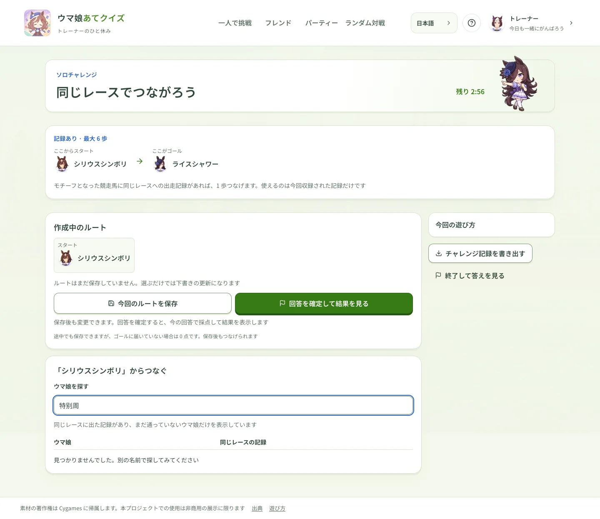
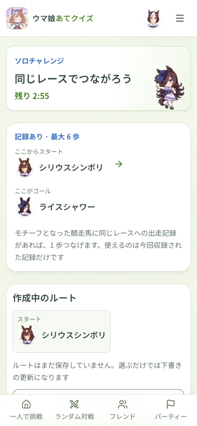

# 共通レースのつながり

モチーフ馬が同じレースに出た記録をたどり、一人から別のウマ娘へ。短いルートほど高得点です

## 操作の流れ

1. 共通レースのデータを準備し、記録を見るか記憶で挑戦するか選びます
2. 始点と終点を確認し、現在のモデル馬と同じレースに出た次のウマ娘を探します
3. 一人ずつつなぎます。同じ人物は二度通れません。記録ありでは根拠のレースを確認できます
4. 終点に到達した経路を保存するか提出します。問題データ内の最短経路に近いほど高得点です

## ルールと採点

- モチーフ馬が同じレースに出走した記録があれば、ウマ娘同士を一歩つなげられます
- 記録ありで遊ぶと、モチーフ馬同士が出走したレースを確認できます
- 同じウマ娘を二度通ることはできません。ループするルートは無効です
- ゴールまでつなぐと 100 点。最短ルートより一歩多いごとに 10 点引かれ、最低 20 点です。未到達や未保存は 0 点になります
- 最短ルートは答え合わせまで表示しません。つながるルートを自分で探してみましょう
- 記録ありでは、名前から同じレースに出走した相手を検索できます。記憶で挑戦する場合は、この記録を表示しません

## スマートフォンで遊ぶ

今のウマ娘から次の一人を探します。戻って選び直しながら、ゴールまでつなげます

[種目一覧](../玩法与规则.md) · [よくある質問](../常见问题.md) · [出典](../第三方依赖与资料来源.md)
