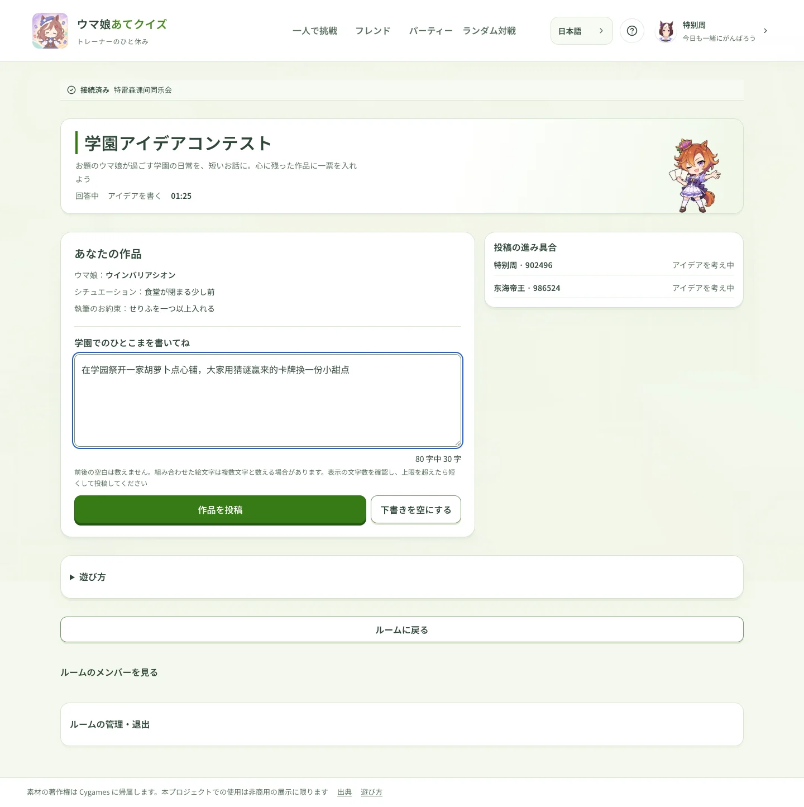
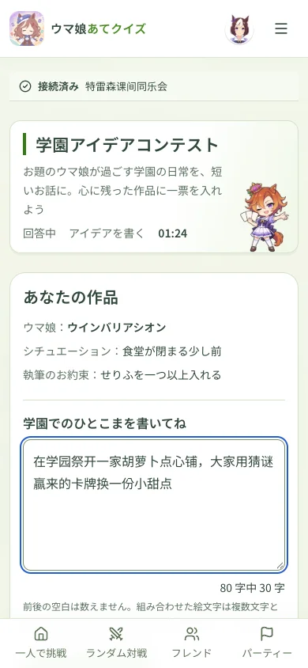

# 創作企画

休み時間の企画会議！配られたウマ娘・場面・条件から、80 文字以内でアイデアを考えよう。作品は匿名で公開し、参加者票と観客票の合計でアイデア賞を決めます

## 操作の流れ

1. お題のウマ娘、場面、制約を確認します
2. 制限時間内に 80 文字以内のアイデアを書きます。入力欄のカウンターを確認してください
3. 投稿すると内容が確定し、匿名作品を読んでほかの参加者に投票します
4. 得票で創作賞を決めます。同票は同時受賞。総合得点への加点は開始時の設定に従います

## ルールと採点

- 各チームにキャラクター、日常の場面、条件が配られます。90 秒以内に、80 文字以内の企画を書いてください
- 80 文字までです。前後の空白は数えません。組み合わせた絵文字は複数文字と数える場合があるので、入力欄の文字数を確認してください。上限を超えたら短くして投稿してください
- 作品は匿名で公開し、投票は 30 秒。一人 1 票で、自分や自分のチームの作品には投票できません
- チーム票と観客票は別々に集計します。一人で複数の端末を使う場合もあるため、票数と実際の参加人数は一致しないことがあります
- 進行役が事前に作品を確認します。ルールに合わない作品や空欄は公開しませんが、その作者も次の問題に参加できます
- アイデア賞は参加者票と観客票の合計で決め、同票は同時受賞です。有効な票がなければ受賞作はありません。標準では総合得点に含めません。加点がある場合も参加者票のみを使い、観客票は含めません

## スマートフォンで遊ぶ

入力欄で文字数を確認しながら企画を書きます。作品の公開後、投票先を選びます

[種目一覧](../玩法与规则.md) · [よくある質問](../常见问题.md) · [出典](../第三方依赖与资料来源.md)
