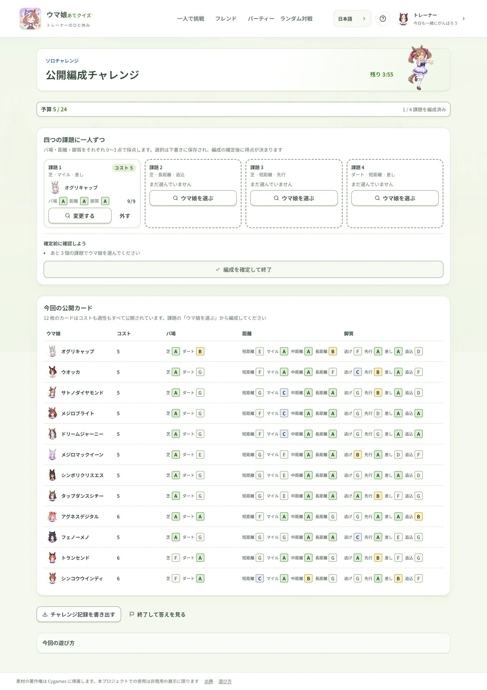
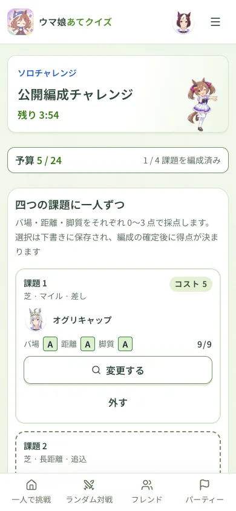

# 公開ドラフト編成

限られた予算で、四つの課題を誰に任せる？コストと適性を見ながら、異なる四人を選ぼう

## 操作の流れ

1. 四つの課題と候補の価格、予算を確認します
2. 各課題に一人ずつ異なるウマ娘を選び、バ場・距離・脚質適性を比べます
3. 四枠を埋めて、合計金額を予算内に収めます
4. 編成を確定すると終了します。課題ごとの適性ポイントで採点します

## ルールと採点

- 適性は収録された衣装の初期値です。コストと採点は当サイト独自のルールで、アプリのレース勝率を表すものではありません
- 四つの課題に一人ずつ選びます。同じウマ娘は重複して選べません
- 各カードには価格があり、合計は予算以内に収めます。標準の予算は 24 です
- 各課題の三つの適性を採点します。A は 3 点、B は 2 点、C は 1 点、それ以外は 0 点で、合計 36 点満点です
- 得点は 100 × 合計点 ÷ 36。小数点以下は切り捨てます
- 下書きを保存して何度でも調整できます。最終送信をすると編成は変更できません

## スマートフォンで遊ぶ

課題ごとにウマ娘を選び、予算と編成を確認します。確定するまでは入れ替えられます

[種目一覧](../玩法与规则.md) · [よくある質問](../常见问题.md) · [出典](../第三方依赖与资料来源.md)
