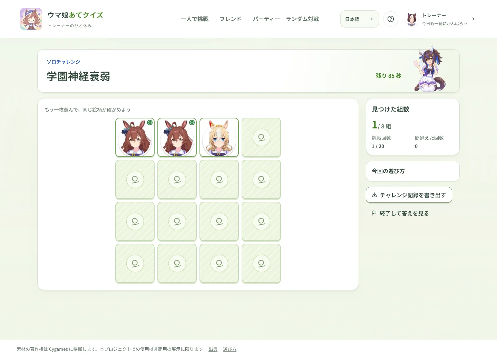
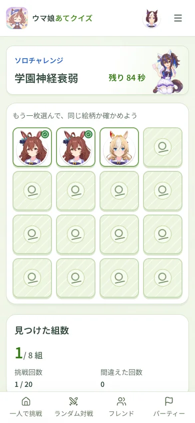

# 学園の神経衰弱

最初の 8 秒で絵柄の位置を覚えよう。二枚ずつめくって、20 回以内に八組のペアを探します

## 操作の流れ

1. 画像の準備が終わったら記憶を開始します
2. 8 秒間で 4×4 の盤面にある八組の位置を覚えます
3. 伏せられたら二枚ずつめくります。同じ画像ならペアとして残ります
4. 八組完成、20 回の試行、または回答時間 90 秒で終了します

## ルールと採点

- 挑戦は最大 20 回。二枚をめくると一回になり、一枚だけでは数えません
- そろったペアは、そのまま表向きになります
- そろえたペアの割合を 100 点満点に換算して小数点以下を切り捨て、間違えた回数ごとに 2 点引きます。得点の下限は 0 点です
- 伏せたカードにはペアのヒントはありません。覚えた位置を頼りにめくってみよう

## 対戦での違い

めくった記録は各自独立しています。対戦中は完成したペア数を確認し、最後に得点で比べます

## スマートフォンで遊ぶ

裏向きのカードを二枚タップします。絵柄と位置を覚えて、同じペアを探しましょう

[種目一覧](../玩法与规则.md) · [よくある質問](../常见问题.md) · [出典](../第三方依赖与资料来源.md)
