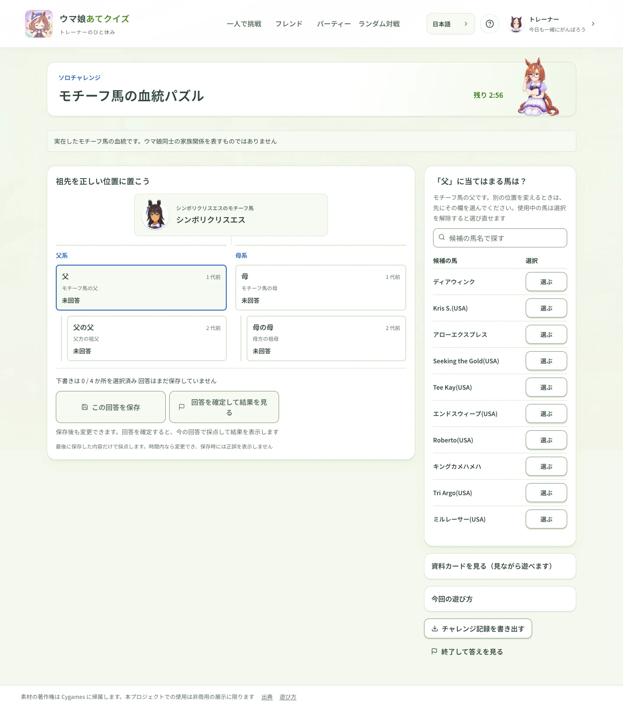

# モデル馬の血統パズル

モチーフとなった競走馬は、どんな血統？父系と母系をたどり、父母や祖父母を正しい位置に当てはめよう

## 操作の流れ

1. モデル馬のデータを準備し、埋める位置の数を選びます
2. 家系図の空欄を押して、父系と母系のどの位置か確認します
3. 候補から馬を選びます。公開されている資料カードも参照できます
4. 途中の回答も保存・提出できます。180 秒で終了し、保存済みの正しい位置を採点します

## ルールと採点

- 扱うのは史実の競走馬の血統です。キャラクター同士の家族関係ではありません
- 父・母や祖父母の空欄を埋めます。「父の母」と「母の父」は別の位置なので、向きを確かめましょう
- 空欄を選び、候補から馬を選んでください。馬名と血統の位置をよく確かめましょう
- 得点は 100 × 正しい位置の数 ÷ 全位置の数。小数点以下は切り捨てます
- 締め切りまでは何度でも変更でき、最後に送信した回答で採点します

## スマートフォンで遊ぶ

血統の空欄を選んでから候補の馬を選びます。終了後は各欄の答えを確認できます

[種目一覧](../玩法与规则.md) · [よくある質問](../常见问题.md) · [出典](../第三方依赖与资料来源.md)
