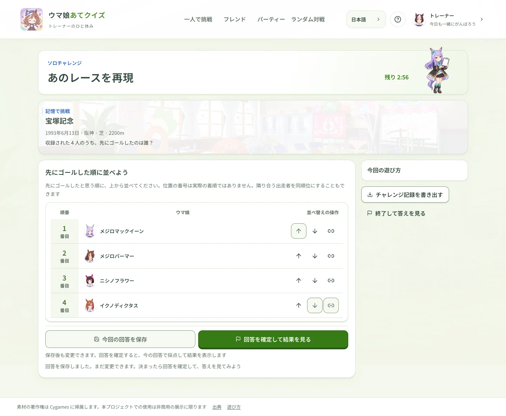
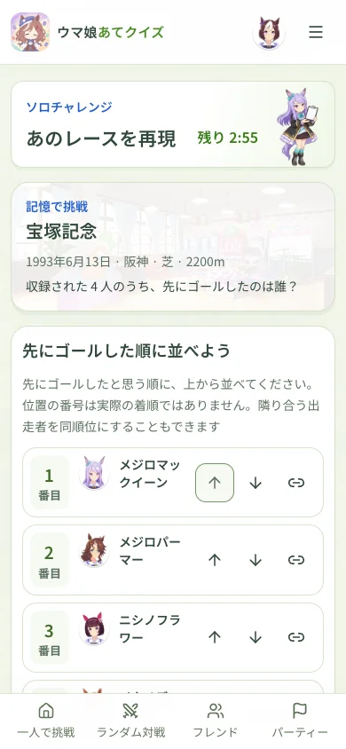

# レース着順の再現

あの一戦を思い出して、出題された出走者を史実の着順に並べよう。同着の組み合わせも忘れずに

## 操作の流れ

1. レースデータを準備し、記憶で解くかヒントを使うか選びます
2. レース名と開催日、出題された出走馬を確認し、上下ボタンで着順を並べます
3. 同着は同順位としてまとめます。保存後も変更できます
4. 提出するとすぐに終了します。二頭ずつの前後・同着関係を採点し、史実の着順を表示します

## ルールと採点

- 出走者の表示順はシャッフルされており、着順のヒントにはなりません
- 出走者二人ずつの組み合わせを比べ、前後や同着の関係が合っていれば一組正解です
- 出走者は一部のみ収録しています。答え合わせでは実際の着順を使い、未収録の着順を詰めて表示しません
- 同着は同順位にまとめてください。締め切りまでは保存し直せます。最後に保存した回答で採点します
- 答え合わせまでは実際の着順や正解率を表示しません
- 協力ルールでは前後の着順のヒントが出ます。相談して全体の順番を推理しましょう

## 対戦での違い

対戦は保存後も修正でき、締切時に全員で答えを確認します

## スマートフォンで遊ぶ

上下ボタンで出走者を並べ替え、同着は同順位にまとめて保存します

[種目一覧](../玩法与规则.md) · [よくある質問](../常见问题.md) · [出典](../第三方依赖与资料来源.md)
