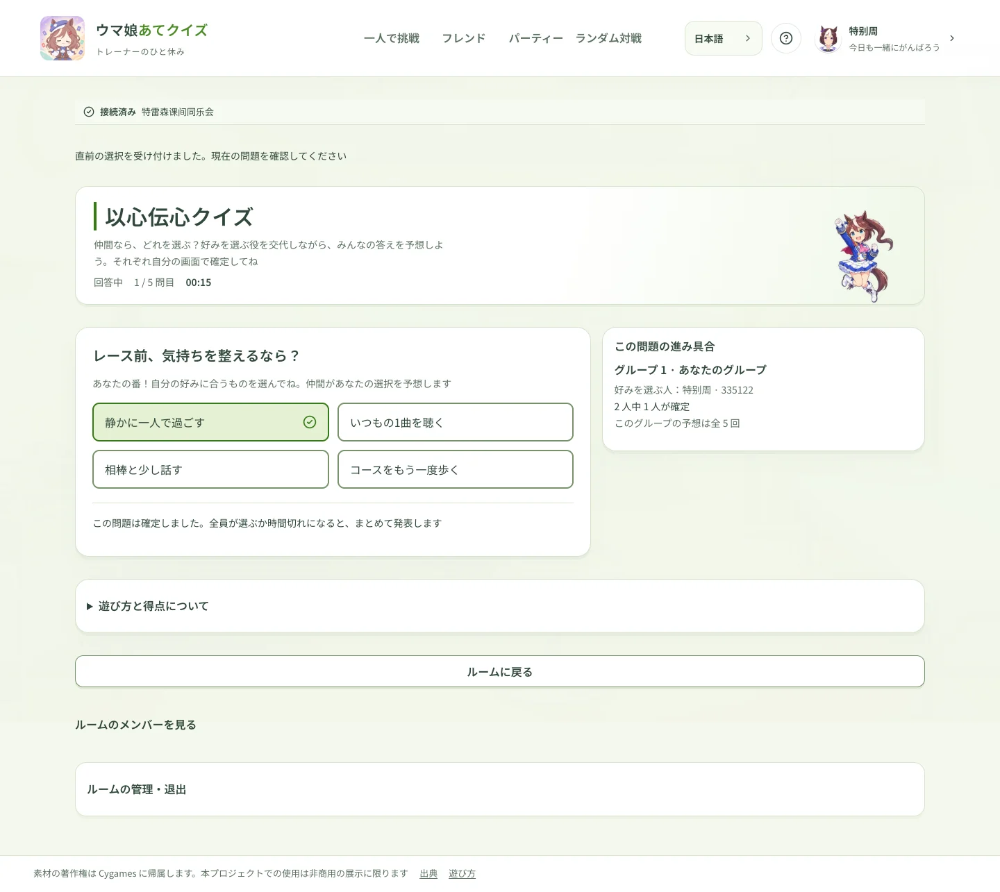
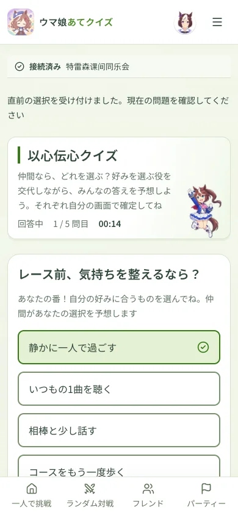

# 以心伝心クイズ

いつも一緒の仲間なら、選ぶ答えも分かる？好みを選ぶ役を交代しながら予想して、一斉に答え合わせしよう

## 操作の流れ

1. 二人以上で始め、今回の好みを選ぶ人と予想する人を確認します
2. 選ぶ人は自分の好みで回答し、ほかの人はその選択を予想します
3. 四択から選んで確定します。公開されるまでは相手の回答は見えません
4. 公開後は次の人が好みを選びます。一問 20 秒で、全体の予想の的中率を採点します

## ルールと採点

- 二人組か人数のバランスを取ったチームで、各問 20 秒。好みを選ぶ人は交代し、ほかの人が予想します。標準は 5 問ですが、全員に一度は順番が回るだけの問題が必要です。実際の問題数は開始時に確認してください
- 選択肢は毎回四つ。回答を締め切るまでは、お互いの選択は見えません
- 好みを選ぶときは、自分の気持ちで答えてね。同じグループの仲間が予想します
- 予想が当たるたびに 1 ポイント。グループの正解数を予想の総回数で割り、100 を掛けたものがチーム得点です。小数点以下は切り捨てます。予想の総回数は、各問で予想する人数を足した数で、開始時に発表します
- 未回答も予想の総回数に含まれるため、回答しないとチームの得点が下がります
- 全員が交代で好みを選び、同じグループの仲間がそれぞれ自分の画面で予想します

## スマートフォンで遊ぶ

各自の端末で好みや予想を選び、確定します。同じチームの回答がそろうか時間になると公開されます

[種目一覧](../玩法与规则.md) · [よくある質問](../常见问题.md) · [出典](../第三方依赖与资料来源.md)
