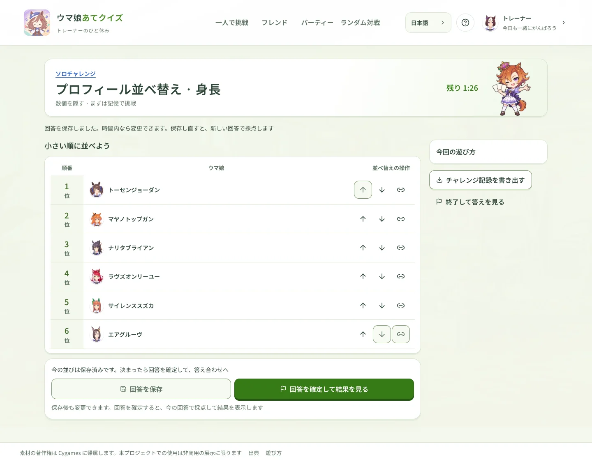
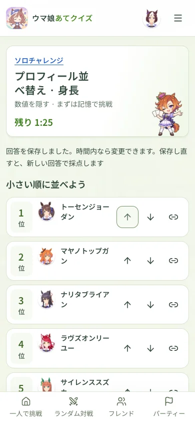

# 並べ替え

身長や誕生日、ウマ娘の知識で順序を当てよう

## 操作の流れ

1. 身長や誕生日などのテーマを選び、並べる方向を確認します
2. 上下ボタンで順序を変え、同じ値の二人は同順位にまとめます
3. 保存ボタンで現在の順序を記録します。締切までは修正して保存し直せます
4. 提出して結果を見るボタンで終了できます。時間切れの場合は最後に保存した回答を採点します

## ルールと採点

- 出題された方向に全員を並べ、同じ値は同順位にまとめます
- 二人ずつの前後・同順位関係で採点し、すべて正しければ 100 点です
- 締切までは保存し直せます。提出すると終了し、時間切れは最後の保存内容を採点します

## 対戦での違い

対戦では進行役の締切または時間切れで全員分を公開します

## スマートフォンで遊ぶ

カードの上下ボタンで順番を変え、同じ値のカードは同順位にまとめます

[種目一覧](../玩法与规则.md) · [よくある質問](../常见问题.md) · [出典](../第三方依赖与资料来源.md)
