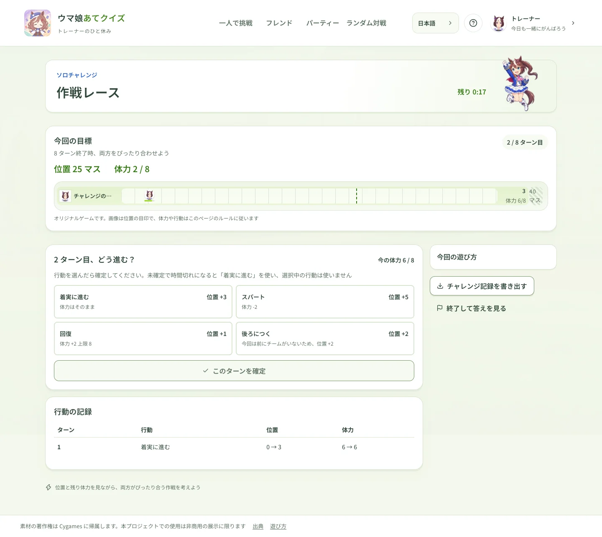

# ターン制レース

スパートのタイミングは今？8 ターン分の体力を考え、毎ターン行動を一斉に公開。最後に一番前にいるチームの勝ちです

## 操作の流れ

1. ルールを準備し、一人用では目標位置と終了時の体力条件を確認します
2. 各ターンに安定走行、スパート、回復、追走から一つ選びます
3. 確定ボタンで実行します。移動量と体力は履歴で確認できます
4. 八ターンで終了。一人用は目標達成、対戦では同時公開した行動による最終位置で競います

## ルールと採点

- 1 チームでチャレンジ、または 2〜8 チームで対戦できます。全 8 ターン、各 20 秒。行動は一斉に公開し、各チームは一つの駒を交代で動かします
- 位置 0・体力 6 からスタートし、体力の上限は 8 です。レース中にコースの条件は変わりません
- 着実に進む：位置 +3、体力はそのまま。スパート：体力が 2 以上なら位置 +5、体力 −2。回復：位置 +1、体力 +2、上限は 8
- 追走：ターン開始時に 1〜3 マス前のチームがいれば位置 +4、いなければ +2。開始時の位置で判定し、その後の移動は影響しません
- 体力不足ではスパートを選べません。締め切りまでに有効な行動がなければ、自動で「着実に進む」になります
- 8 ターン後の位置で順位を決め、同じ位置なら同順位です。順位は前方のチーム数 +1。対戦の得点は 100 ×（チーム数 − 順位）÷（チーム数 − 1）で、小数点以下を切り捨てます。1 チームのチャレンジでは順位点は付きません。行動の送信の早さは順位に影響しません

## 対戦での違い

一人用は目標位置と体力の条件に挑戦します。対戦は八ターン後の位置順で、同位置は同順位です

## スマートフォンで遊ぶ

体力と位置を確認して行動を選び、確定後にターンの結果を確認します

[種目一覧](../玩法与规则.md) · [よくある質問](../常见问题.md) · [出典](../第三方依赖与资料来源.md)
