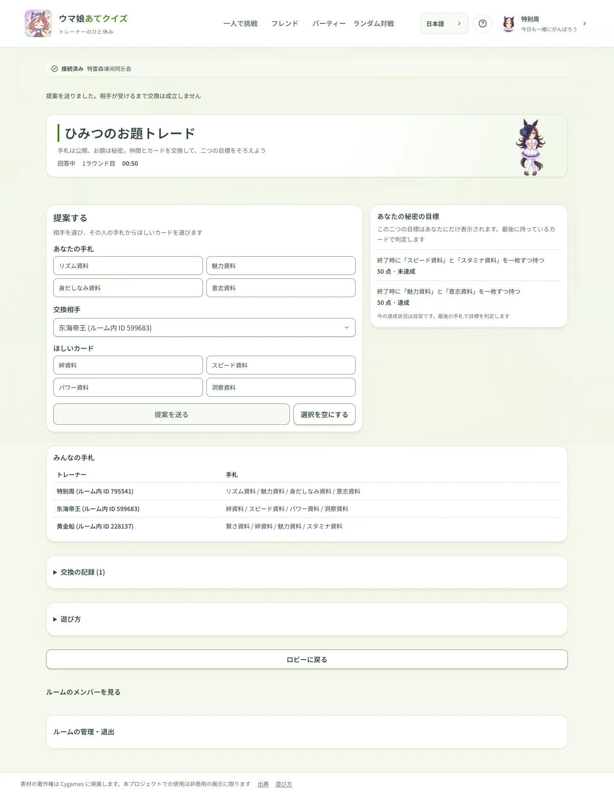
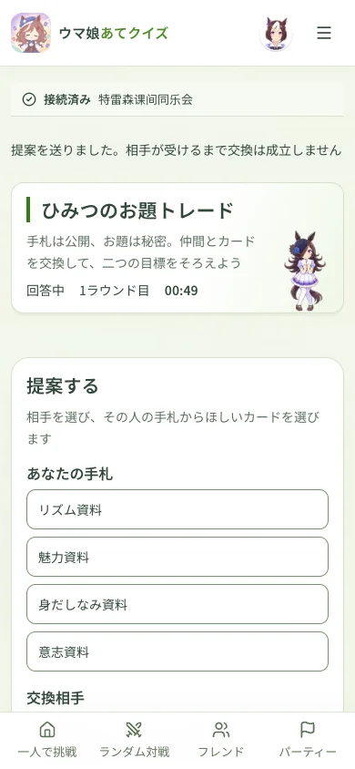

# カード交換

欲しいカードは、誰かにとって交換したいカードかも。手札は公開、お題は秘密。3 ラウンドの交渉で秘密の目標を目指そう

## 操作の流れ

1. 3〜8 人で始め、自分の四枚の手札と二つの秘密目標を確認します
2. 相手、自分が渡す一枚、欲しい一枚を選んで交換を申し込みます
3. 相手が承諾すると同時に交換します。断られた場合や期限切れは元のままです
4. 三ラウンド後に秘密目標を採点します。高得点の組み合わせを目指しましょう

## ルールと採点

- 一人 4 枚の公開手札と、二つの秘密の目標で遊びます。相手の手札は見えても、何を集めたいかは分かりません
- 各ラウンドで相手を選び、自分の一枚と相手の一枚の交換を申し込めます
- 相手が承諾すると同時に交換します。断られたり期限を過ぎたりした場合は、元の手札のままです
- スピード、スタミナ、絆などはカードの種類です。秘密の目標に書かれた種類を集めましょう
- 3 ラウンド後、達成した目標カードの点数が入ります。同じカードは二つの目標に使えません。合計点が最大の組み合わせを選び、同点なら達成数が多いもの、それも同じなら目標カードの順で選びます

## スマートフォンで遊ぶ

相手と渡すカード、欲しいカードを選んで提案します。届いた提案は承諾するか断れます

[種目一覧](../玩法与规则.md) · [よくある質問](../常见问题.md) · [出典](../第三方依赖与资料来源.md)
