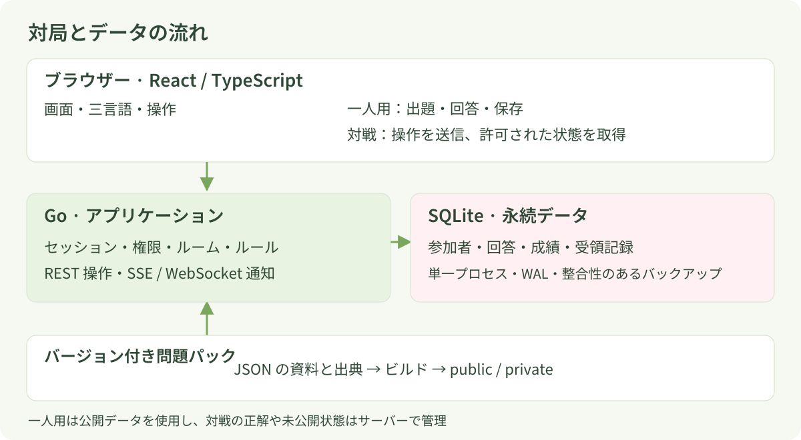

# 構成とモジュール

React がゲーム画面と一人用チャレンジ、Go が対戦の出題と判定、SQLite がセッション・ルーム・結果の保存を担当します。一つのサービスプロセスで動作し、問題データは別にビルドします

<ArchitectureDiagram />

## 全体構成

| 部分 | 実装と役割 |
| --- | --- |
| フロントエンド | React・TypeScript・Vite。画面、三言語、一人用記録、対戦クライアント |
| サービス | Go net/http。静的ページ、REST API、通知、デプロイ設定 |
| 保存 | SQLite WAL。ルーム、参加者、回答、受領記録、移行 |
| 問題データ | JSON をハッシュ付きの公開・非公開パックへビルド |
| デプロイ | 単一プロセスまたはコンテナー。読み取り専用パックと永続データを分離 |

## ディレクトリ

| パス | 役割 |
| --- | --- |
| cmd/server・cmd/content | 起動、バックアップ、問題ビルド、契約ツール |
| internal/httpapi | ルート、入力、認証、エラー投影 |
| internal/session・internal/account | 匿名プレイと独立したアカウント認証 |
| internal/room・internal/event | 参加者、チーム、進行役、ラウンド、イベント |
| internal/modes | 決定的なルール、操作検証、投影、採点 |
| internal/challenge | 検証型チャレンジの署名付きチケットと受領記録 |
| internal/content | 正規化、問題の利用条件、公開 |
| internal/storage | SQLite、トランザクション、移行、ロック、バックアップ |
| internal/realtime | SSE／WebSocket、カーソル、バックプレッシャー |
| internal/admission・internal/deployment | 入場確認、種目と容量の設定 |
| internal/wiring | モジュール接続とコミット後の通知 |
| internal/spafs・internal/staticserv | 埋め込みページ、制限付き素材配信 |
| web/src | ページ、コンポーネント、翻訳、ローカル記録 |

## 対戦の流れ

REST 書き込みはセッションと参加者を確認し、段階・バージョン・権限を検証してルームのコマンドキューへ入ります。状態、得点、受領記録、通知 outbox を同じトランザクションで更新し、コミット後に通知します

既定の接続は SSE、任意で WebSocket、失敗時はポーリングです。通知は変更の案内で、カーソルから権限に合う状態を取得します。操作は常に REST で送ります

ルール層は HTTP や SQL に依存せず、ルール・問題データのバージョンと制御された乱数から保存可能な結果を返します

## 保存と復元

一つの実行ディレクトリを一プロセスが所有します。読み取りプール、書き込みトランザクション、ルームと全体のキュー上限を分けます。適用済み移行は変更せず、新規移行を追加します

再接続では確定済み回答と締め切りを復元し、再送は元の受領記録を返します。退出、権限変更、参加枠の復元では旧接続を失効します

## データと秘密情報

一人用パックはブラウザーへ配布します。対戦の現在の答え、裏向きカード、未公開回答はサーバーに保持します。画像や意味の確認は種目別に行い、開始にはデプロイ設定と人数条件も適用します

## 画面と言語

PC とタブレットは表・分割配置、スマートフォンはカードを優先します。共通 UI と動きを減らす設定を使い、エラーは状況と次の操作を案内します。zh-Hans、zh-Hant、ja は地域ごとの言い回しで管理します

## デプロイ構成

同一 SQLite ディレクトリを複数コンテナーで共有しません。公開時は HTTPS、明示した Origin、信頼するプロキシ、管理用メトリクス制限を使います。複数インスタンスには所有権とイベント配送の再設計が必要です

[設定](配置参考.md) · [API](API与实时通信.md) · [問題データ](内容编译.md)
