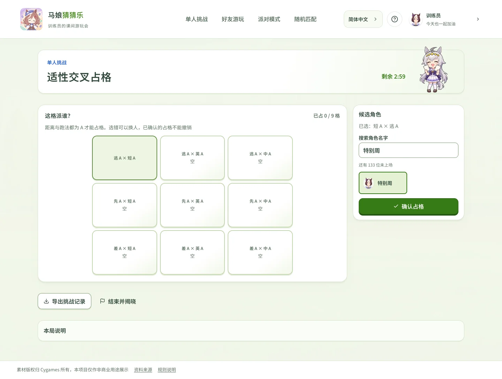
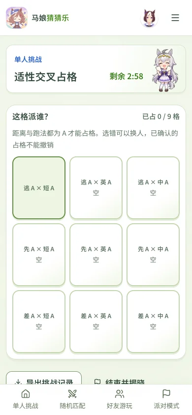

# 适性交叉占格

挑选同时满足行、列两项适性的马娘，填满九格棋盘。每位只能上场一次，确认后不能换人

## 怎么玩

1. 准备占格资料，开始后先看清横列与纵列的适性条件
2. 点一个空格，搜索并选择同时符合两项条件的角色
3. 确认占格。成功后该格锁定，同一角色只能用一次
4. 继续安排剩余角色，填满九格即可结束；留意 180 秒倒计时

## 规则与计分

- 适性采用收录版本的初始等级，不含继承或育成提升；九格与计分是本站娱乐规则
- 每格要求两项适性都是 A：一项来自所在行，一项来自所在列
- 先点一个空格，再从候选里选角色，确认后占格
- 占格不可撤销；同一个角色不能重复使用
- 得分 = 100 × 正确格数 ÷ 9，向下取整
- 确认前不会提示角色是否符合条件，揭晓后再一起对答案

## 手机上玩

先点棋盘上的空格，再在角色选择窗口中搜索并确认人选

[玩法一览](../玩法与规则.md) · [常见问题](../常见问题.md) · [资料来源](../第三方依赖与资料来源.md)
