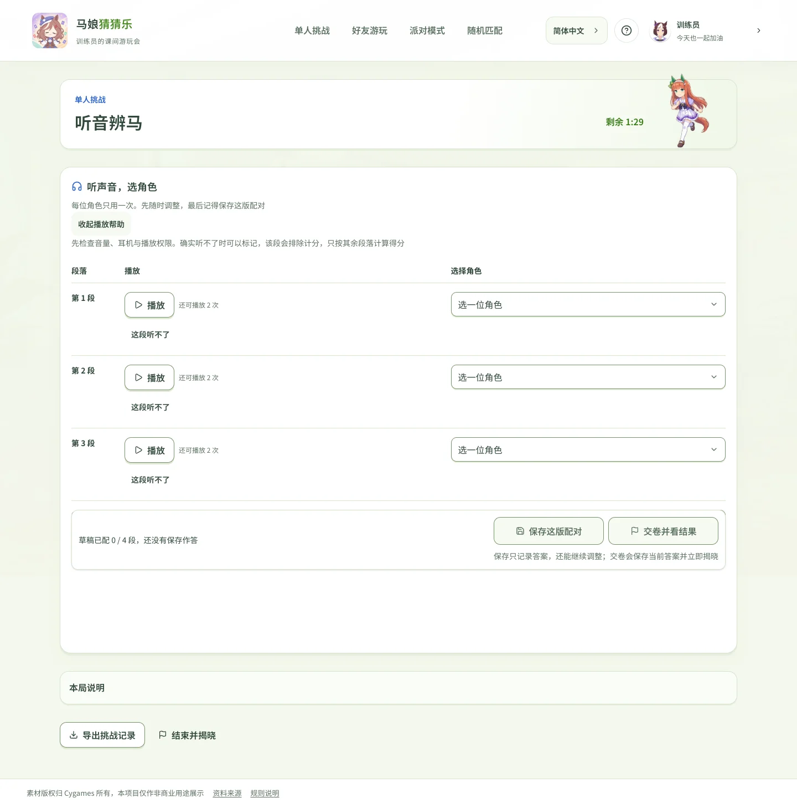
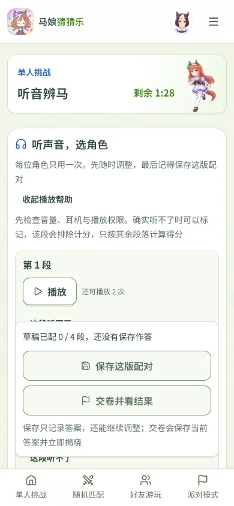

# 听音辨马

熟悉的声音响起来，你能认出是谁吗？每段最多听两次，听出她就配好对。配错不额外扣分

## 怎么玩

1. 选择片段数量，查看并准备语音，全部载入后开始 90 秒挑战
2. 主动点击播放，每段最多播放两次，停止后重播也占一次机会
3. 为每段选择说话的角色，同一角色只能对应一段
4. 保存作答可继续调整，交卷后立即看结果。无法播放时先检查音量与权限，再按界面标记故障

## 规则与计分

- 每一段语音都加载完后，再开始作答
- 每段最多听 2 次，停止后重播也算一次机会
- 听不了时先检查音量和播放权限。多人游玩请标记后告诉主持人，待作废重开；单人挑战可将该段排除计分
- 按参与计分的段落中配对正确的比例计分，满分 100 分；四段都能计分时，每答对一段得 25 分
- 截止前可以反复修改，以最后一次提交为准

## 联机时有什么不同

所有人准备好同一组语音后才计时；出现播放故障请通知主持人作废重开

## 手机上玩

先准备语音，点播放后选对应角色。确认配对前，可以逐段切换检查

[玩法一览](../玩法与规则.md) · [常见问题](../常见问题.md) · [资料来源](../第三方依赖与资料来源.md)
