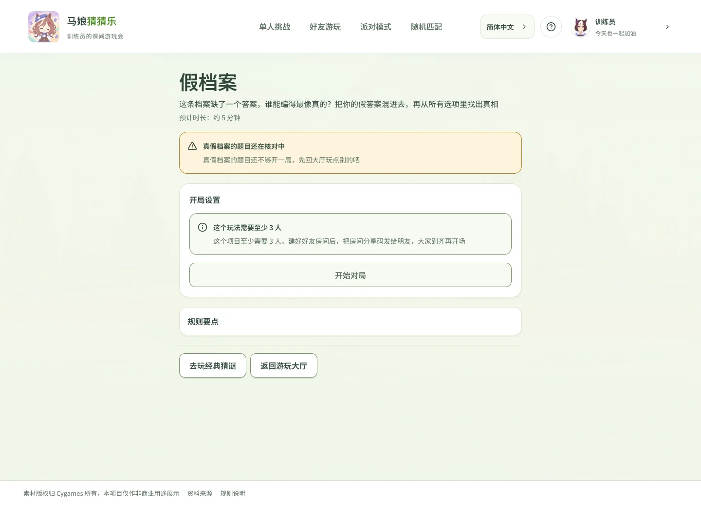
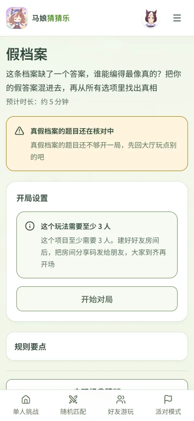

# 假档案发布会

这条档案缺了一个答案，谁能编得最像真的？把你的假答案混进去，再从所有选项里找出真相

::: info 题库状态
当前题库尚未开放此玩法，下图为实际入口。以下介绍已有玩法规则
:::

## 怎么玩

1. 本玩法需要至少三人，以及核实完成的事实题库；当前题库尚未开放
2. 开场后围绕缺失的档案答案，写一条 2–40 字的迷惑选项并提交
3. 匿名选项出现后，从中选择真实答案，自己的假答案不可投
4. 揭晓后查看真实档案与来源，再看看哪些假答案骗过了大家

## 规则与计分

- 至少 3 人一起玩，先各自编答案，再找出真正的那一项
- 先写一个 2–40 字的假答案，首尾空白不计，组合表情可能占多个字。确认送出后不能修改
- 第二阶段所有答案混在一起，你要选出哪一项是真实事实
- 选票不能修改。找出真相得 70 分，骗到别人最多得 30 分
- 假答案由玩家创作，揭晓时以附来源的真实档案为准

## 手机上玩

开放后可在手机上编写假答案，再从匿名选项中选择真实答案

[玩法一览](../玩法与规则.md) · [常见问题](../常见问题.md) · [资料来源](../第三方依赖与资料来源.md)
