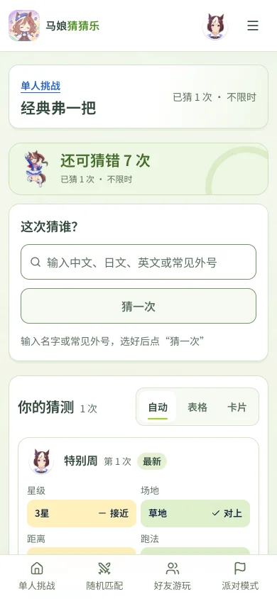

# 经典弗一把

从熟悉的马娘猜起，用九条线索找到她

## 怎么玩

1. 在单人挑战选择经典弗一把，准备资料后设置允许猜错的次数，开始挑战
2. 输入角色名或外号，从候选中点选一位，再点「猜一次」
3. 逐项比较九条线索。绿色为相同、黄色为接近、灰色为不同，未知表示资料暂缺
4. 结合已有线索继续猜。猜中角色本人即成功，猜错扣一次机会；次数用完后揭晓

## 规则与计分

- 九项比较：星级、场地、距离、跑法、性别、G1 胜场、G2/G3 胜场、学部、宿舍
- 猜中角色本人算成功，只有猜错扣次数。单人挑战不限时，可在当前浏览器继续

## 联机时有什么不同

双人对战共用一个答案，先猜对者获胜。一方次数用完后等待另一方，整场结束才揭晓。双人对战任一方认输，对手立即获胜。双方到截止仍未猜对时，双方均未获胜

## 手机上玩

输入名字后，从候选中点选角色，再点「猜一次」。线索以卡片展示，可展开查看其余项目

[玩法一览](../玩法与规则.md) · [常见问题](../常见问题.md) · [资料来源](../第三方依赖与资料来源.md)
