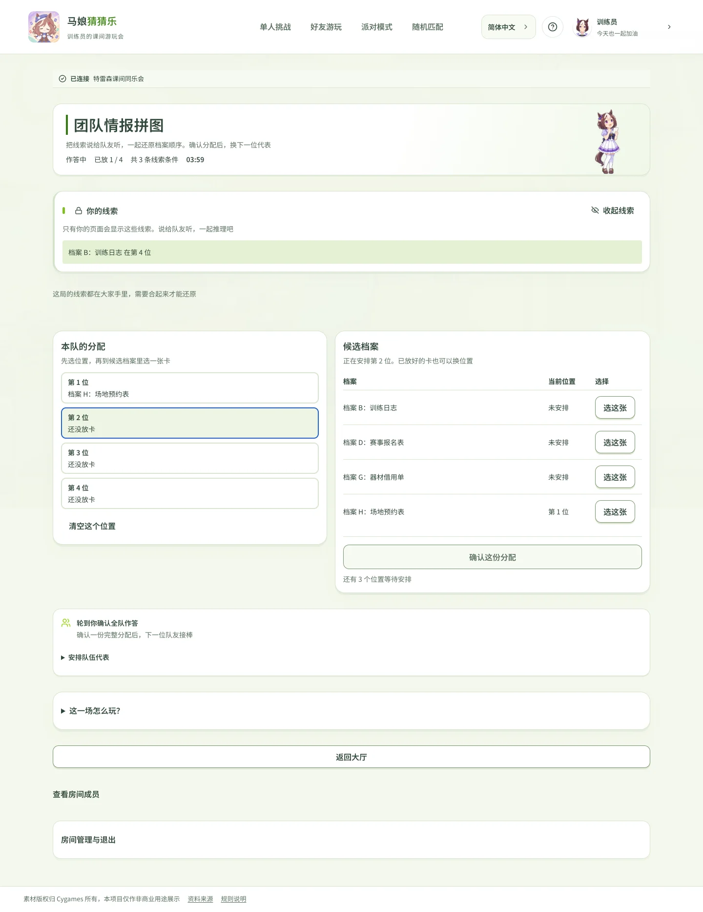

# 团队情报拼图

队友的线索和你手里的能对上吗？把情报说给大家听，一起排好档案卡

## 怎么玩

1. 每队安排 3–6 人并选好队长，开局后分别阅读自己收到的线索
2. 把线索告诉队友，一起推断每张档案卡应该放在哪个位置
3. 当前作答代表选择各位置的角色，确认完整分配后由下一位队员接棒
4. 截止前可继续商量并再次确认，按最后分配满足的线索比例计分

## 规则与计分

- 1–8 队，每队 3–6 人，一队合作或多队比赛都可以。开始前先在等待区分队，选好队长
- 每局 4–6 张档案卡，默认 240 秒。需要的信息都在线索里，不用另查资料
- 每位队员各有线索，只有自己的页面显示。把线索告诉队友，一起商量
- 只有当前代表能确认本队完整分配。每确认一次，就换下一位队友接棒
- 截止前可继续调整，以最后确认的分配计分；提交时不公布对错
- 按满足的线索条件所占比例取整计分，全部满足得 100 分，未确认得 0 分
- 各队同题、各自计分。刷新不换线索，也不会重新计时

## 手机上玩

在自己的页面查看线索，和队友讨论卡片位置，由当前代表确认排列

[玩法一览](../玩法与规则.md) · [常见问题](../常见问题.md) · [资料来源](../第三方依赖与资料来源.md)
