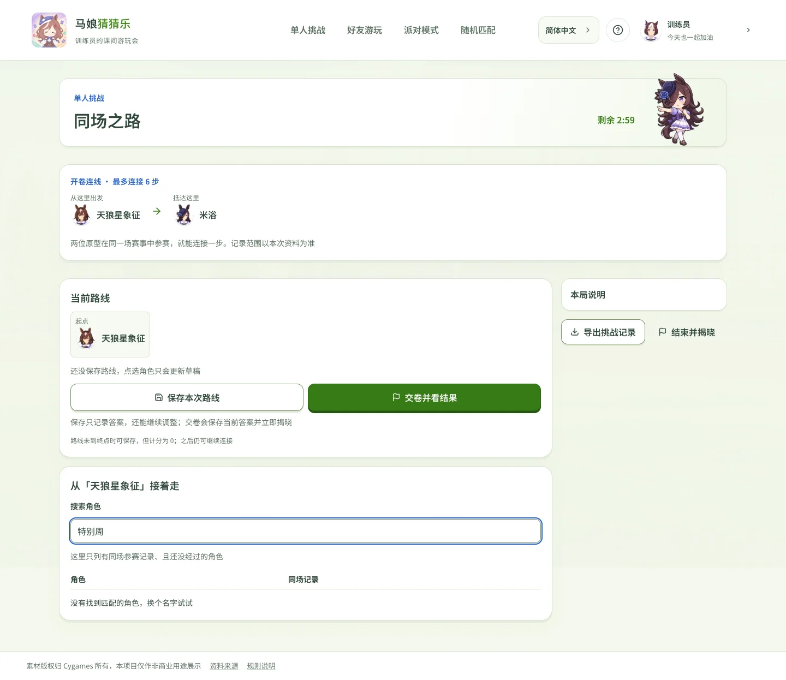

# 同场之路

沿着原型马同场参赛的记录，从一位马娘连到另一位。路线越短，得分越高

## 怎么玩

1. 准备同场资料，选择查记录或凭记忆挑战
2. 看清起点与终点，搜索与当前角色的原型马有同场经历的下一位
3. 逐步连接到终点，同一角色不能重复经过；查记录模式可查看赛事依据
4. 保存有效路线或直接交卷。路线越接近题库中的最短路径，得分越高

## 规则与计分

- 两位角色的原型马曾在同一场比赛出赛，就能连接一步
- 查记录时，可以查看两位角色的原型曾在哪场赛事相遇
- 同一角色不能重复经过；出现环会被判无效
- 成功连到终点得 100 分，每比最短路线多一步扣 10 分，最低 20 分；未到终点或未保存为 0 分
- 揭晓前不公布最短路线，需要自己寻找能走通的连法
- 查记录时可搜索角色，查看她的原型曾与谁同场出赛；凭记忆挑战时不显示这些记录

## 手机上玩

从当前角色继续搜索下一位，路线选错时可以撤回，再从上一步连接

[玩法一览](../玩法与规则.md) · [常见问题](../常见问题.md) · [资料来源](../第三方依赖与资料来源.md)
