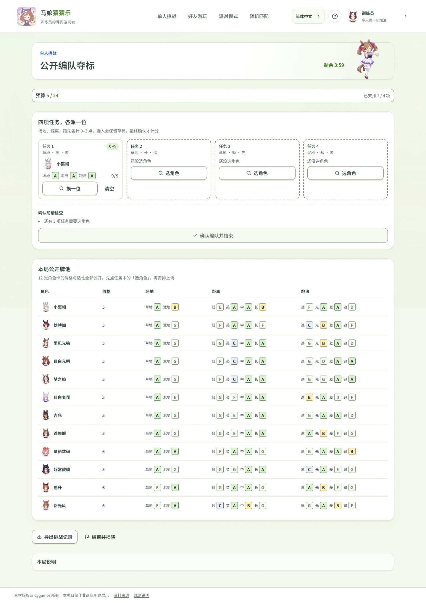

# 公开编队

预算只有这么多，四项任务各派谁上场？查看价格与适性，选出四位不同的马娘

## 怎么玩

1. 准备编队资料，查看四项任务、候选角色的价格与预算
2. 为每项任务选择一名不同角色，比较场地、距离与跑法三项适性
3. 留意总费用，调整阵容直到四个任务都有人选且费用未超预算
4. 点「确认编队并结束」锁定阵容，按各项适性点数计算成绩

## 规则与计分

- 初始适性来自收录的角色版本；价格与适性计点是本站娱乐规则，不代表手游比赛胜率
- 四个任务各需要一名角色；同一角色只能出场一次
- 每张卡有价格，总价不能超过预算（默认 24）
- 每项任务分别按场地、距离和跑法适性计点：A=3、B=2、C=1，其余为 0 点；四项任务合计满分 36 点
- 得分 = 100 × 总分 ÷ 36，向下取整
- 可以先保存草稿反复调整，最终提交会锁定编队

## 手机上玩

按任务逐一选择角色，随时查看预算与已选阵容，确认前可以换人

[玩法一览](../玩法与规则.md) · [常见问题](../常见问题.md) · [资料来源](../第三方依赖与资料来源.md)
