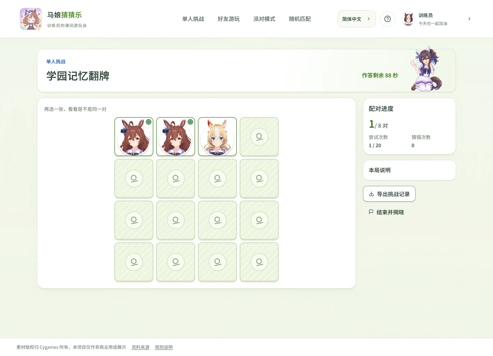
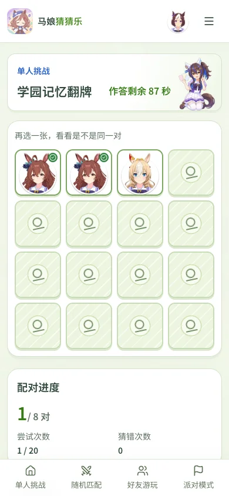

# 学园记忆翻牌

翻牌前先看 8 秒，记住头像的位置。每次翻两张，最多用 20 次尝试找齐八对

## 怎么玩

1. 准备翻牌资料并准备这一局，头像全部载入后点「开始记忆」
2. 在 8 秒观察时间内记住 4×4 棋盘中的八对头像
3. 盖牌后每次翻两张，头像相同就配对成功，配对牌保持亮起
4. 找齐八对、达到 20 次尝试或 90 秒作答时间结束时结算

## 规则与计分

- 最多 20 次尝试；每次尝试是「翻开两张」，翻一张不算
- 配对成功的一对会一直亮着
- 按配对比例换算成 100 分，小数部分舍去，再每配错一次扣 2 分，最低 0 分
- 盖住的牌没有配对提示，靠刚才记住的位置试试看

## 联机时有什么不同

每位玩家有自己的翻牌记录，实时进度显示已配对数量，最后比较得分

## 手机上玩

直接点两张盖住的牌进行配对，翻开后留意图案与位置

[玩法一览](../玩法与规则.md) · [常见问题](../常见问题.md) · [资料来源](../第三方依赖与资料来源.md)
