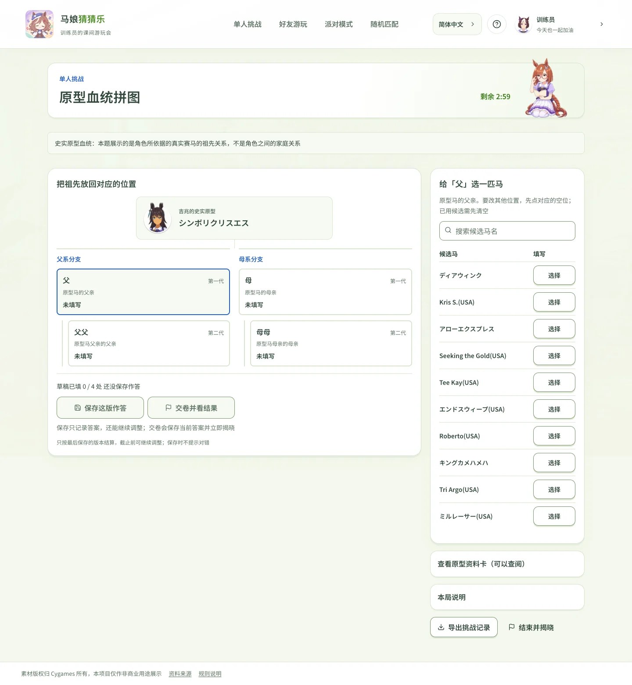

# 原型血统拼图

角色的原型马，有着怎样的血统？沿父系与母系找线索，把父母和祖辈放回对应的位置

## 怎么玩

1. 准备原型资料，选择要填写的空位数量后开始
2. 先选家系图上的一个空位，确认它位于父系还是母系
3. 从候选中选择原型马，依次填写其余位置，可以对照公开资料卡
4. 保存一版或直接交卷看结果。允许部分作答，180 秒后按最后保存的答案计分

## 规则与计分

- 按史实原型赛马的父系与母系祖先关系填写
- 空位可能是父、母或祖父母。「父母」指父亲的母亲，「母父」指母亲的父亲，别看反了
- 先选空位，再从候选中选马，注意区分马名与血统位置
- 得分 = 100 × 正确位置数 ÷ 总位置数，向下取整
- 截止前可以反复修改，以最后一次提交为准

## 手机上玩

先选血统空位，再选候选马。作答后可在结果中逐项核对

[玩法一览](../玩法与规则.md) · [常见问题](../常见问题.md) · [资料来源](../第三方依赖与资料来源.md)
