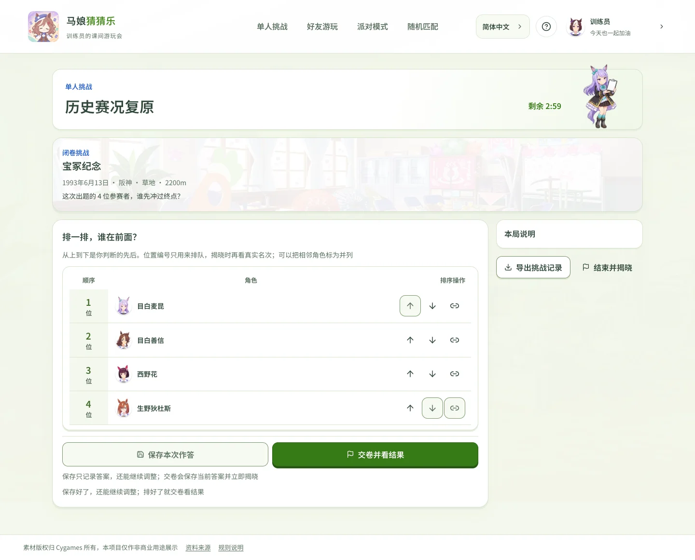
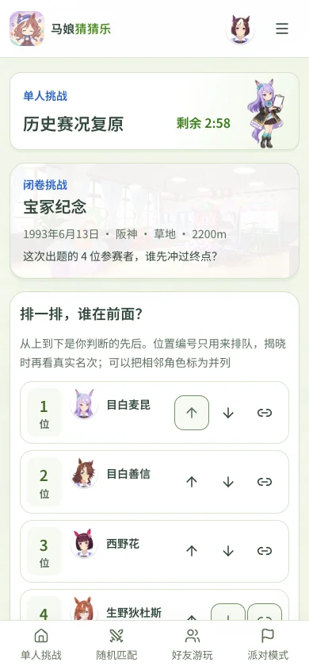

# 历史赛况复原

重温那场比赛，把这次出题的参赛者按史实完赛顺序排好。遇到同着，也记得标出来

## 怎么玩

1. 准备赛事资料，选择凭记忆排序或查看线索，开始复原
2. 读清赛事名称、日期与本题参赛名单，用上下按钮调整完赛次序
3. 遇到同着，用合并并列标出。保存作答后仍可继续修改
4. 点「交卷并看结果」立即结束。结算比较每两位参赛者的先后与并列关系，再显示真实名次

## 规则与计分

- 参赛名单是无序的，顺序里没有任何提示
- 每两位参赛者算一组，前后或并列关系判断正确就答对一组
- 本题只收录部分参赛者，揭晓保留真实名次，未收录的号位不重新编号
- 同名次需标为并列；截止前可以再次保存，最后保存的一份参与计分
- 揭晓前不会显示任何真实名次或正确率
- 合作玩法会提供相邻名次的线索，大家可以一起推理完整顺序

## 联机时有什么不同

联机对局保存后可以继续调整，主持人收卷或时间结束再一起揭晓

## 手机上玩

用上移、下移调整参赛者顺序，同着者合并为并列，排好后保存

[玩法一览](../玩法与规则.md) · [常见问题](../常见问题.md) · [资料来源](../第三方依赖与资料来源.md)
