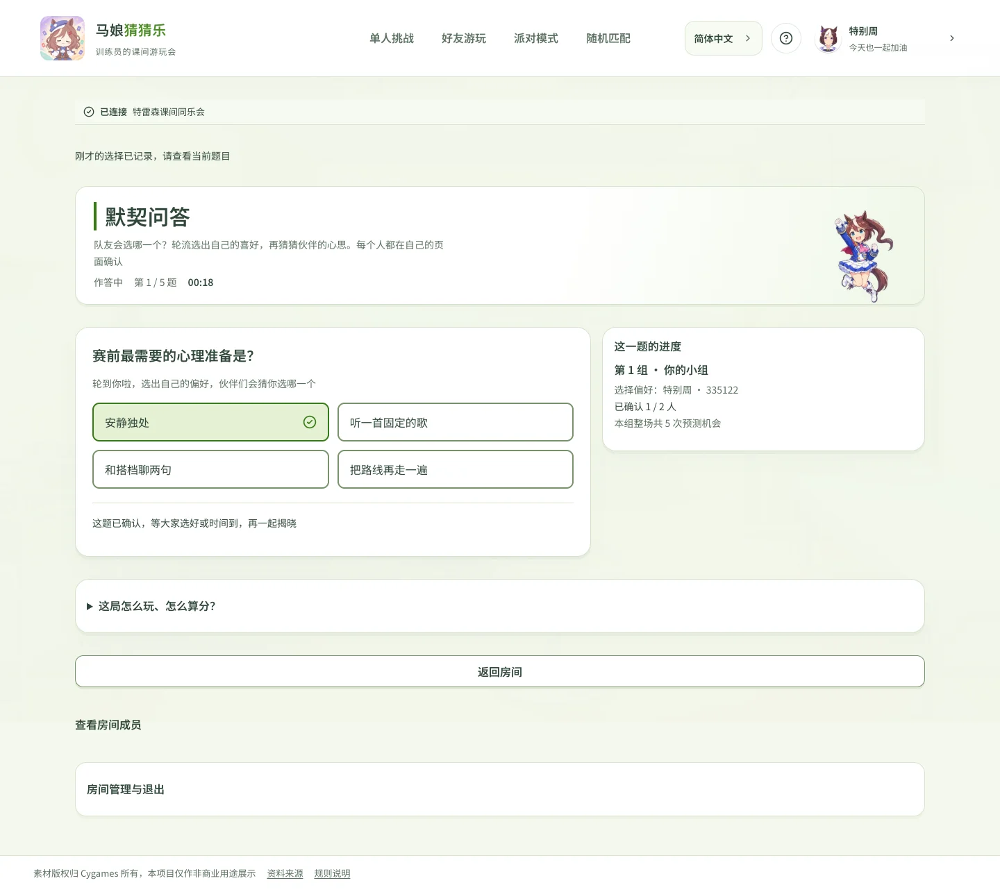
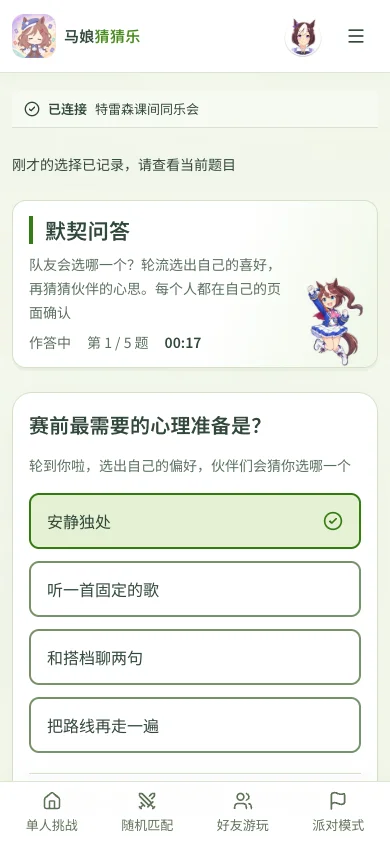

# 默契问答

一起聊了这么久，队友的心思你猜得中吗？轮流选喜好，锁定后一起揭晓答案

## 怎么玩

1. 至少两人开始，阅读本题谁选偏好、谁负责预测
2. 选偏好的人按自己的喜好选，其他人猜他会选哪一项
3. 各自选择四个选项之一并确认，锁定前彼此看不到选择
4. 揭晓后由下一位选偏好。每题 20 秒，按整场猜中的预测占比计分

## 规则与计分

- 两人搭档或人数均衡的小队，每题 20 秒，轮流由一位成员选偏好、其余成员预测。默认 5 题，题数至少要让每位成员轮到一次，以开场公布的题数为准
- 每题固定 4 个选项。锁定之前彼此看不到对方的选择
- 选偏好的时候，照自己的心意就好，再让同组伙伴来猜
- 每猜中一次得 1 点。全组猜中的次数除以整场预测机会，再乘 100 就是团队得分，小数舍去。预测机会按每题猜答案的人数累计，开场时公布
- 没有确认的预测也算在总次数内，但不得分；记得选好后点确认
- 每位成员都会轮流选择偏好，同组伙伴各自在自己的页面预测

## 手机上玩

各自在手机上选偏好或预测，点确认后等待同组伙伴，再一起揭晓

[玩法一览](../玩法与规则.md) · [常见问题](../常见问题.md) · [资料来源](../第三方依赖与资料来源.md)
