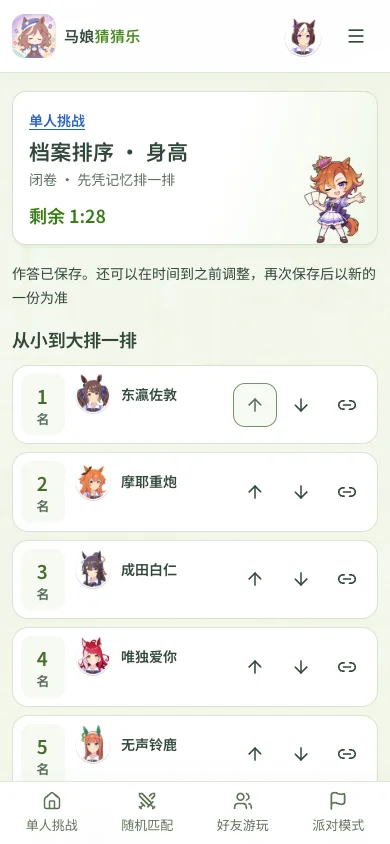

# 档案排序

身高、生日和角色小知识，你能排对顺序吗

## 怎么玩

1. 准备资料，选择身高、生日或本局开放的排序项目，并查看排列方向
2. 用上移、下移调整顺序；数值相同的角色合并为并列
3. 点「保存作答」记录当前排序，保存后仍可以修改并重新保存
4. 准备好后点「交卷并看结果」立即结算；时间到按最后保存的顺序计分

## 规则与计分

- 按题目方向排列全部角色，数值相同请合并为并列
- 按每两位角色之间的先后或并列关系计分，全部关系正确得 100 分
- 保存后可继续修改，交卷后立即结束；超时以最后保存的一版计分

## 联机时有什么不同

联机由主持人收卷或倒计时结束后统一揭晓，保存不会提前公开答案

## 手机上玩

用卡片上的上移、下移按钮调整顺序，相同数值可合并为并列

[玩法一览](../玩法与规则.md) · [常见问题](../常见问题.md) · [资料来源](../第三方依赖与资料来源.md)
