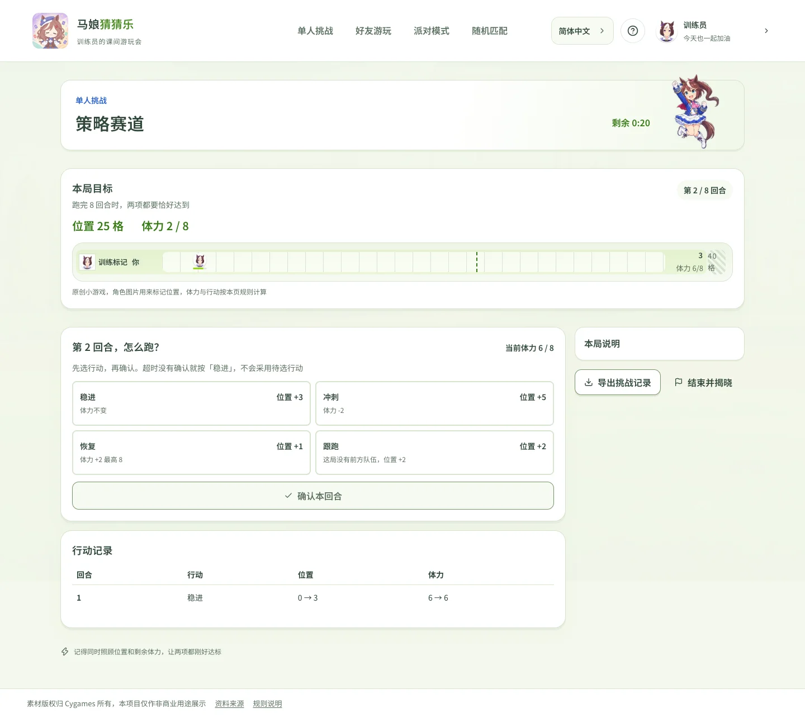

# 回合制策略赛道

冲刺的时机到了吗？分配好八回合的体力，每回合一起亮出行动，最后位置最靠前的队伍获胜

## 怎么玩

1. 准备赛道规则，单人先看目标位置与结束时的体力要求
2. 每回合从稳进、冲刺、恢复或跟跑中选择一项，留意体力消耗
3. 点确认才执行行动，回合记录会显示移动与体力变化
4. 完成八回合后检查目标；多人局同时亮出行动，按终点位置排名

## 规则与计分

- 一队挑战或 2–8 队对战，共 8 回合，每回合 20 秒。各队同时揭晓行动，共用一个标记，由队员轮流确认
- 初始位置 0、体力 6，体力上限为 8；比赛中场地条件保持不变
- 稳进：位置 +3、体力不变。冲刺：体力≥2 时位置 +5、体力 -2。恢复：位置 +1、体力 +2（封顶 8）
- 跟跑：本回合开始时若有队伍领先你 1–3 格，位置 +4；否则 +2。以本回合开始那一刻的位置为准，后面谁动了都不影响这次判断
- 冲刺至少需要 2 点体力；时间到仍未确认行动，就按「稳进」前进
- 8 回合后按位置排名，同位置并列，名次为前方队数加 1。对战得分 = 100 ×（队数 − 名次）÷（队数 − 1），向下取整；单队挑战不计排名分。确认行动的快慢不影响名次

## 联机时有什么不同

单人以达成目标位置和体力为目标；多人按八回合后的最终位置排名，同位置并列

## 手机上玩

查看当前体力和位置，选择行动后点确认，再看本回合结果

[玩法一览](../玩法与规则.md) · [常见问题](../常见问题.md) · [资料来源](../第三方依赖与资料来源.md)
