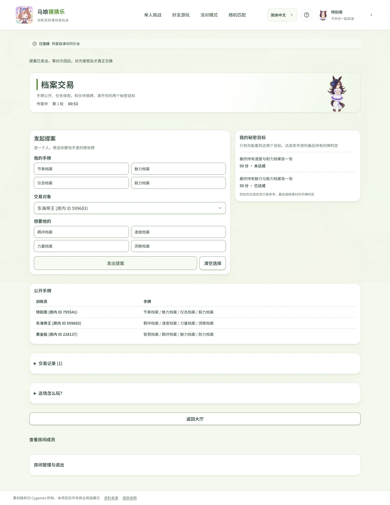
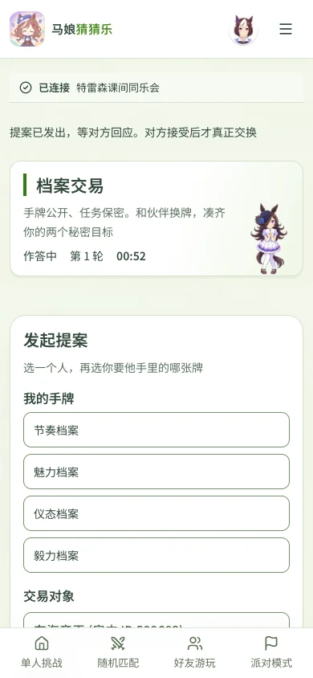

# 档案交易

你想凑齐的牌，也许正好是别人愿意交换的。手牌公开、任务保密，三轮谈判后看看谁完成了秘密目标

## 怎么玩

1. 邀请 3–8 位玩家，开局后查看自己的四张手牌与两个秘密目标
2. 选择对手、给出的卡和希望换来的卡，发起一换一提案
3. 对方查看提案并接受后，双方卡牌同时交换；拒绝或过期则保持原样
4. 三轮结束后按秘密目标计分，安排卡牌满足尽可能高分的目标组合

## 规则与计分

- 每人 4 张公开手牌、2 个秘密目标。你能看到大家手里的牌，但不知道对方想凑什么
- 每轮可以向任意一位对手提一个交换：你给出一张、换取对方一张。对方接受才成交
- 双方各选一张，对方接受后同时交换。拒绝或超时，双方都保留原来的牌
- 速度、耐力、羁绊等都是卡牌种类，按秘密目标收集对应种类即可
- 三轮后按完成的秘密目标计分，分值以目标卡为准。同一张牌不能同时用于两个目标；优先选总分最高的组合，同分时选完成目标较多的组合，仍相同则按目标卡顺序选择

## 手机上玩

先选交易对象，再选给出的牌与想换的牌；收到提案后可以接受或拒绝

[玩法一览](../玩法与规则.md) · [常见问题](../常见问题.md) · [资料来源](../第三方依赖与资料来源.md)
