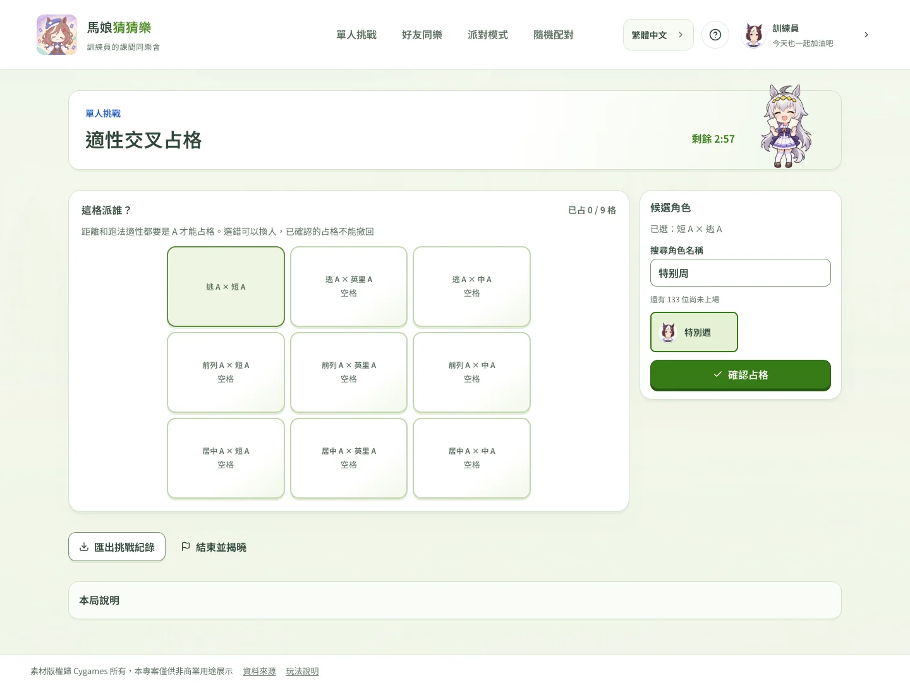
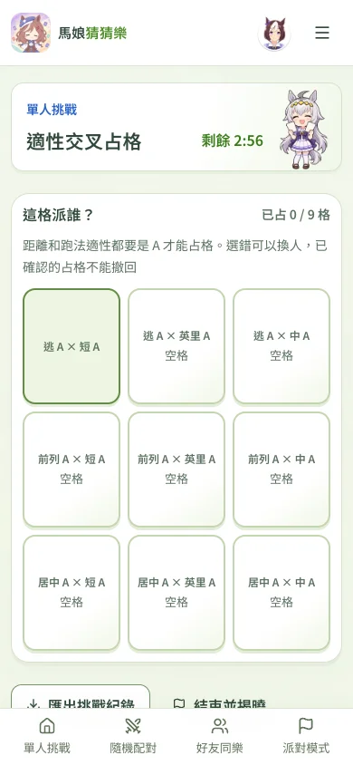

# 適性交叉占格

挑選同時符合行、列兩項適性的賽馬娘，填滿九格棋盤。每位只能上場一次，確認後不能換人

## 怎麼玩

1. 備妥資料後開局，先看清每列與每欄的適性條件
2. 點選空格，搜尋並挑選同時符合兩項條件的角色
3. 確認填入後空格會鎖定，同一角色只能使用一次
4. 繼續安排其他角色，在 180 秒內填滿九格即可完成

## 規則與計分

- 適性採收錄版本的初始等級，不含繼承或培育提升；九格與計分採本站的同樂規則
- 每格的兩項適性都必須是 A：一項來自所在列，另一項來自所在欄
- 先點選空格，再從候選名單選擇角色，確認後填入
- 填入後不能撤回，同一角色不能重複使用
- 得分 = 100 × 正確格數 ÷ 9，小數部分無條件捨去
- 送出前不會提示角色是否符合條件，揭曉後才會公布

## 手機上玩

先點棋盤上的空格，再於角色選擇視窗搜尋並確認人選

[玩法一覽](../玩法与规则.md) · [常見問題](../常见问题.md) · [資料來源](../第三方依赖与资料来源.md)
