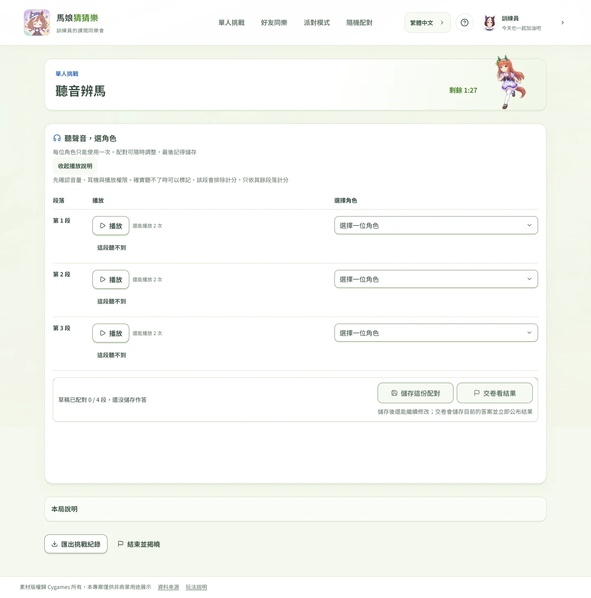
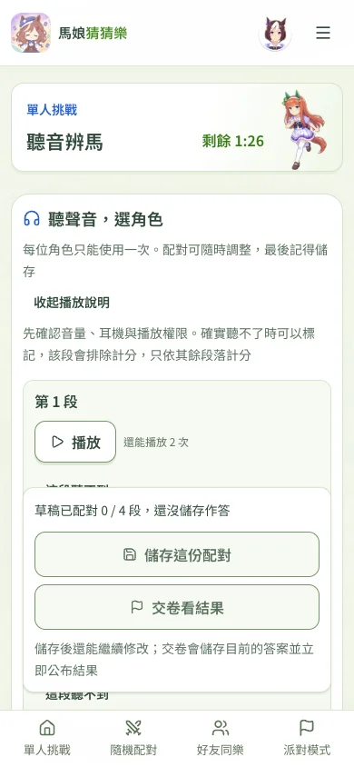

# 聽音辨角色

熟悉的聲音響起，你能認出是誰嗎？每段最多聽兩次，聽出她就配好對。配錯不額外扣分

## 怎麼玩

1. 選擇片段數量並準備語音，全部載入後開始 90 秒挑戰
2. 點選播放，每段最多兩次，停止後重播也算一次
3. 替各段選擇說話的角色，同一角色僅能對應一段
4. 可儲存後繼續調整，交卷後立即看結果。無法播放時先確認音量與權限，再依畫面標記問題

## 規則與計分

- 所有語音都載入完成後，才開始作答
- 每段最多聽 2 次，停止後重播也算一次機會
- 聽不到時先檢查音量與播放權限。多人遊玩請標記後告知主持人，等候作廢重開；單人挑戰可將該段排除計分
- 依列入計分的段落中配對正確的比例計分，滿分 100 分；四段都能計分時，每答對一段得 25 分
- 截止前可以反覆修改，依最後送出的答案計分

## 連線遊玩的差異

所有人備妥同一組語音後開始計時，播放問題請告知主持人作廢重開

## 手機上玩

先準備語音，播放後選擇對應角色。確認配對前，可以逐段切換檢查

[玩法一覽](../玩法与规则.md) · [常見問題](../常见问题.md) · [資料來源](../第三方依赖与资料来源.md)
