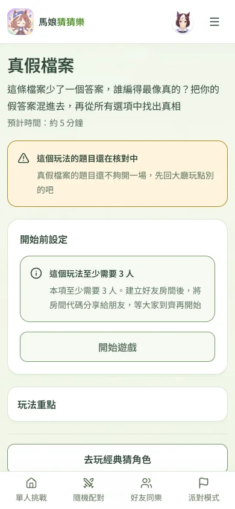

# 假檔案發表會

這條檔案少了一個答案，誰編得最像真的？把你的假答案混進去，再從所有選項中找出真相

::: info 題庫狀態
目前題庫尚未開放此玩法，下圖為實際入口，以下介紹已實作的規則
:::

## 怎麼玩

1. 本玩法需要至少三人與核實完成的事實題庫，目前尚未開放
2. 開局後依缺少的檔案答案，寫下 2–40 字的迷惑選項並送出
3. 匿名選項出現後找出真相，不能投自己的假答案
4. 揭曉後查看真實檔案與來源，再看看哪些假答案騙過了大家

## 規則與計分

- 至少 3 人一起玩，先各自編答案，再找出真正的那一項
- 先寫一個 2–40 字的假答案，前後空白不計，組合表情符號可能算多個字。確認送出後無法修改
- 第二階段會混合所有答案，請選出真正的事實
- 投票後不能更改。找出真相得 70 分，成功騙過別人最多得 30 分
- 編出的答案只用於本場遊戲，不是真實的角色資料

## 手機上玩

開放後可在手機上編寫假答案，再從匿名選項選出真實答案

[玩法一覽](../玩法与规则.md) · [常見問題](../常见问题.md) · [資料來源](../第三方依赖与资料来源.md)
