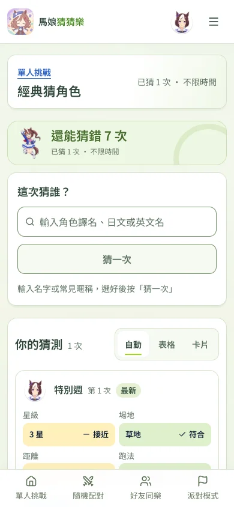

# 經典猜角色

從熟悉的賽馬娘猜起，用九項提示找到她

## 怎麼玩

1. 從單人挑戰選擇經典猜角色，備妥資料後設定可猜錯次數，開始挑戰
2. 輸入角色名或暱稱，從候選名單點選一位，再按「猜一次」
3. 比較九項提示：綠色相同、黃色接近、灰色不同，未知表示資料暫缺
4. 依提示繼續猜。猜中角色即成功，猜錯扣一次機會，用完後公布答案

## 規則與計分

- 九項比較：星級、場地、距離、跑法、性別、G1 勝場、G2/G3 勝場、學段、宿舍
- 猜中角色才算成功，猜錯才扣次數。單人挑戰不限時，可在同一瀏覽器繼續
- 雙人任一方認輸，對手立即獲勝；截止仍無人猜中時，雙方皆未獲勝

## 連線遊玩的差異

雙人對戰共用答案，先猜中者獲勝。一方用完次數後等待對手，整場結束才公布答案。雙人任一方認輸，對手立即獲勝；截止仍無人猜中時，雙方皆未獲勝

## 手機上玩

輸入名字後，從候選中點選角色，再送出猜測。提示以卡片呈現，可展開查看其餘項目

[玩法一覽](../玩法与规则.md) · [常見問題](../常见问题.md) · [資料來源](../第三方依赖与资料来源.md)
