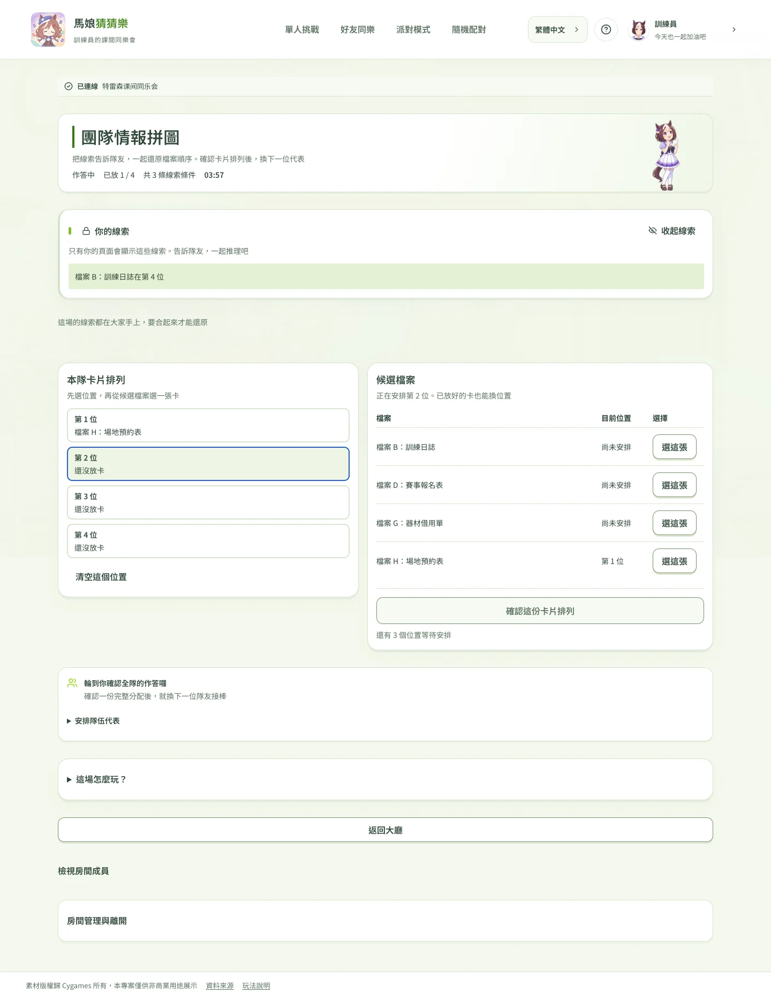
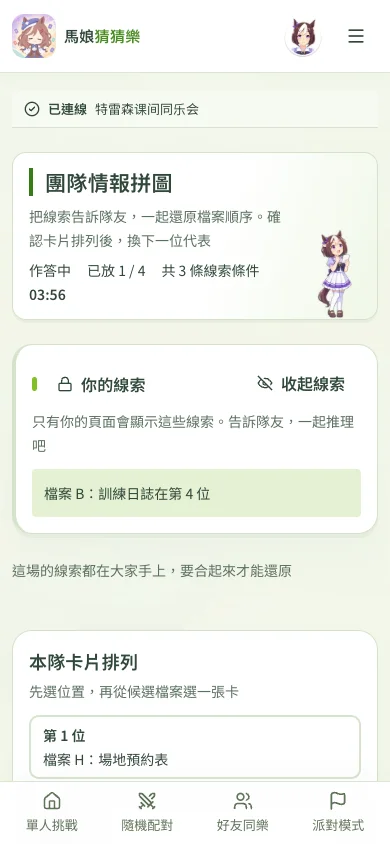

# 團隊情報拼圖

隊友的線索和你手上的對得上嗎？把情報告訴大家，一起排好檔案卡

## 怎麼玩

1. 每隊安排 3–6 人並選好隊長，各自閱讀收到的提示
2. 向隊友分享資訊，一起推理每張檔案卡的位置
3. 由目前的回答代表選擇各位置角色，確認後交棒給下一位隊員
4. 截止前可再次確認，依最後答案滿足提示的比例計分

## 規則與計分

- 1–8 隊，每隊 3–6 人，可以一隊合作，也能多隊較量。開始前先在等候區分隊，選好隊長
- 每局有 4–6 張檔案卡，預設時間為 240 秒。所需資訊都在線索中，不必另外查資料
- 每位隊員各有只在自己畫面顯示的線索。把線索告訴隊友，一起討論
- 只有目前的代表能確認全隊的完整卡片排列，每確認一次，就由下一位隊友接手
- 截止前仍可調整，依最後確認的卡片排列計分，送出時不公布對錯
- 依符合的線索條件比例計分，小數部分無條件捨去；全部符合得 100 分，未確認得 0 分
- 各隊使用相同題目，分別計分。重新載入不會更換線索，也不會重設時間

## 手機上玩

在自己的頁面查看線索，和隊友討論卡片位置，由目前代表確認排列

[玩法一覽](../玩法与规则.md) · [常見問題](../常见问题.md) · [資料來源](../第三方依赖与资料来源.md)
