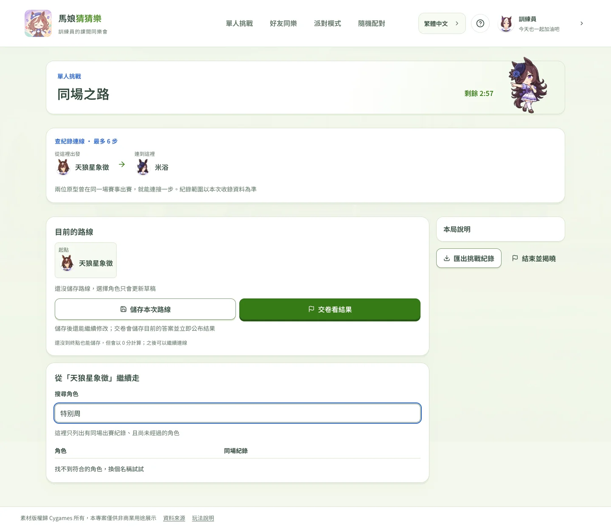
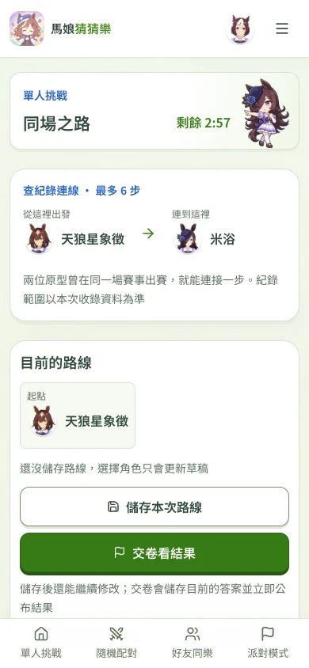

# 同場之路

循著原型馬同場出賽的紀錄，從一位賽馬娘連到另一位。路線越短，得分越高

## 怎麼玩

1. 準備同場資料，選擇查紀錄或憑記憶挑戰
2. 確認起點與終點，找出和目前角色的原型馬曾同場出賽的下一位
3. 逐步連到終點，同一角色只能經過一次；查紀錄模式可查看賽事依據
4. 儲存有效路線或直接交卷，越接近最短路線分數越高

## 規則與計分

- 兩位角色的原型馬曾在同一場比賽出賽，就能連接一步
- 查紀錄時，可以查看兩位角色的原型曾在哪場賽事相遇
- 同一角色不能重複經過，繞回已經過的角色會判為無效
- 成功連到終點得 100 分，每比最短路線多一步扣 10 分，最低 20 分；未到終點或未儲存為 0 分
- 揭曉前不公布最短路線，需要自己找出能走通的連法
- 查紀錄時可搜尋角色，查看她的原型曾與誰同場出賽；記憶挑戰不顯示這些紀錄

## 手機上玩

從目前角色繼續搜尋下一位，路線選錯時可以撤回，再從上一步連接

[玩法一覽](../玩法与规则.md) · [常見問題](../常见问题.md) · [資料來源](../第三方依赖与资料来源.md)
