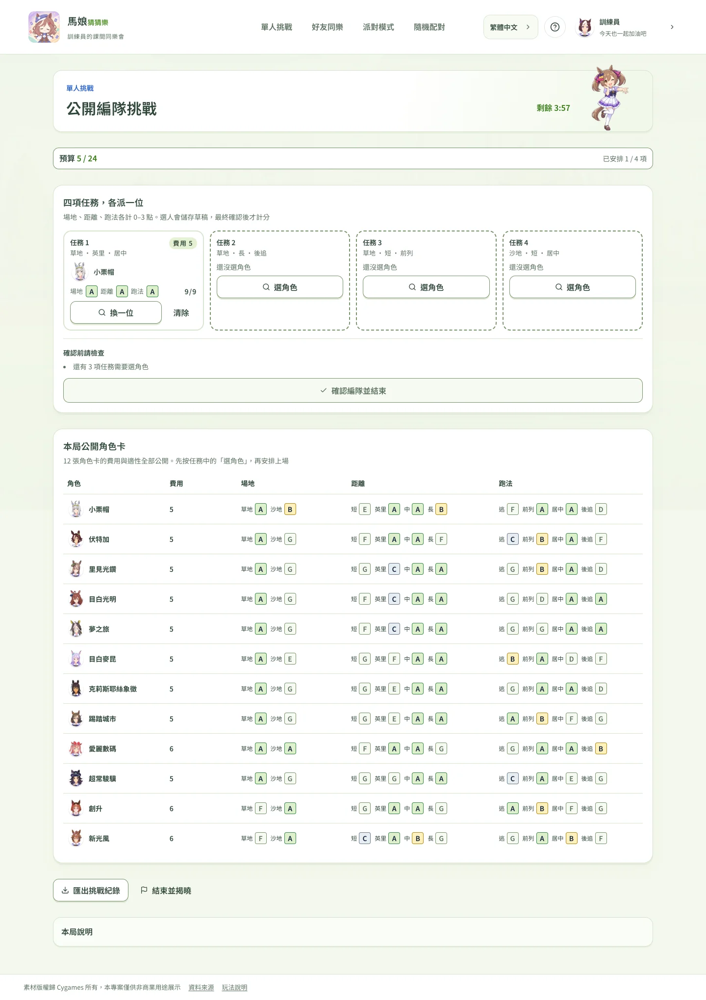

# 公開編隊

預算只有這麼多，四項任務各派誰上場？查看費用與適性，選出四位不同的賽馬娘

## 怎麼玩

1. 準備資料，查看四項任務、候選角色費用與預算
2. 每項任務各選一位不同角色，比較場地、距離與跑法適性
3. 調整陣容，讓四項任務都有人選且總費用符合預算
4. 確認編隊後立即鎖定並結算，依適性點數計分

## 規則與計分

- 初始適性依收錄的角色版本；費用與適性計點採本站的同樂規則，不代表手遊比賽勝率
- 四項任務各需要一位角色，同一角色只能上場一次
- 每張卡都有價格，總價不能超過預算，預設為 24
- 每項任務的三種適性分別計分：A 得 3 分、B 得 2 分、C 得 1 分，其他為 0 分；合計滿分 36
- 得分 = 100 × 合計分數 ÷ 36，小數部分無條件捨去
- 可以先儲存草稿，反覆調整；正式送出後就會鎖定陣容

## 手機上玩

依任務逐一選擇角色，隨時查看預算與已選陣容，確認前可以換人

[玩法一覽](../玩法与规则.md) · [常見問題](../常见问题.md) · [資料來源](../第三方依赖与资料来源.md)
