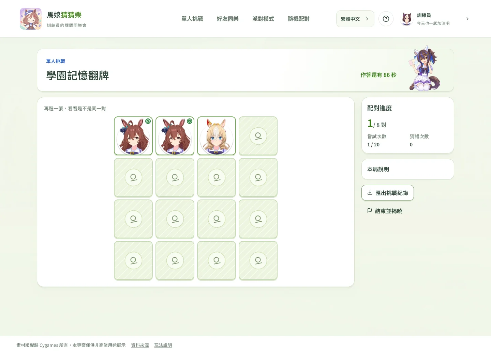
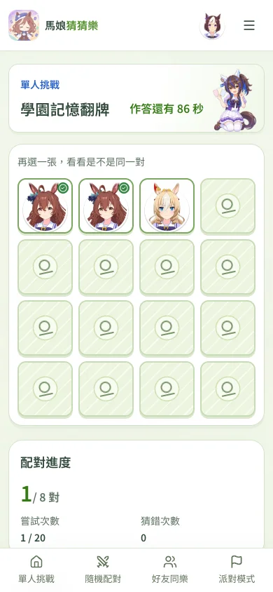

# 學園記憶翻牌

翻牌前先看 8 秒，記住頭像的位置。每次翻兩張，最多用 20 次嘗試找齊八對

## 怎麼玩

1. 備妥翻牌資料，等頭像載入後開始記憶
2. 用 8 秒記住 4×4 棋盤上的八對頭像
3. 蓋牌後一次翻兩張，相同就配對成功並保持翻開
4. 找到八對、用完 20 次嘗試或 90 秒作答結束時結算

## 規則與計分

- 最多嘗試 20 次。每次翻兩張才算一次，只翻一張不計次
- 成功配對的牌會持續顯示
- 依配對比例換算成 100 分，無條件捨去小數，再每配錯一次扣 2 分，最低為 0 分
- 蓋牌後沒有配對提示，試著回想剛才記住的位置

## 連線遊玩的差異

每人有獨立翻牌紀錄，進度顯示已配對數，結束後比較分數

## 手機上玩

直接點兩張蓋住的牌進行配對，翻開後留意圖案與位置

[玩法一覽](../玩法与规则.md) · [常見問題](../常见问题.md) · [資料來源](../第三方依赖与资料来源.md)
