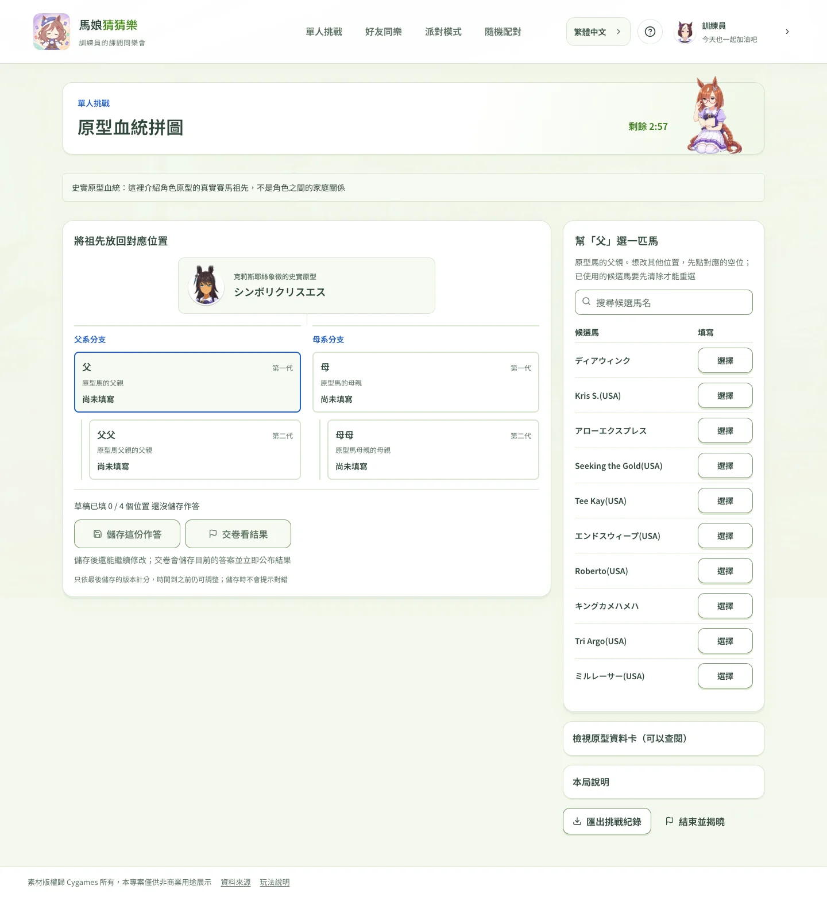

# 原型血統拼圖

角色的原型馬，有著怎樣的血統？沿父系與母系找線索，將父母和祖父母放回對應的位置

## 怎麼玩

1. 準備原型資料並選擇空位數量
2. 點選家系圖空位，確認是父系還是母系的位置
3. 從候選中選擇原型馬，參考資料卡逐格填入
4. 可先儲存或直接交卷。允許部分作答，180 秒後依最後儲存的答案計分

## 規則與計分

- 這裡呈現的是史實賽馬的血統，不是角色之間的家庭關係
- 空位可能是父、母或祖父母。「父母」是父親的母親，「母父」是母親的父親，別看反了
- 先選空位，再從候選中選馬，留意馬名與血統位置
- 得分 = 100 × 正確位置數 ÷ 總位置數，小數部分無條件捨去
- 截止前可以反覆修改，依最後送出的答案計分

## 手機上玩

先選血統空位，再選候選馬。作答後可在結果中逐項核對

[玩法一覽](../玩法与规则.md) · [常見問題](../常见问题.md) · [資料來源](../第三方依赖与资料来源.md)
