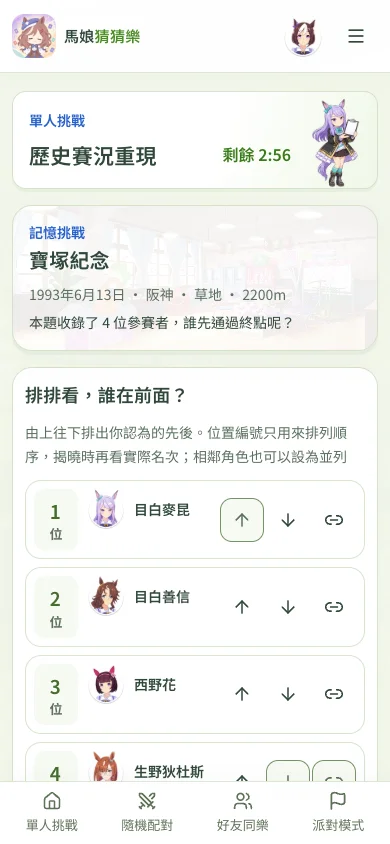

# 歷史賽況重現

重溫那場比賽，把這次出題的參賽者依史實完賽順序排好。並列完賽時，也記得標出來

## 怎麼玩

1. 備妥賽事資料，選擇憑記憶或看提示後開始
2. 確認賽事名稱、日期與參賽名單，用上下按鈕調整完賽次序
3. 同著請合併為並列，儲存作答後仍可修改
4. 交卷即可看結果。依每兩位參賽者的先後或並列關係計分，並公布真實名次

## 規則與計分

- 參賽名單已打亂，原本的顯示順序不提供提示
- 每兩位參賽者算一組，前後或並列關係判斷正確就答對一組
- 題目只收錄部分參賽者；揭曉時保留史實名次，不會因缺少其他參賽者而重新編號
- 同名次需設為並列。截止前可再次儲存，依最後儲存的答案計分
- 揭曉前不會顯示真實名次或答對比例
- 合作玩法會提供相鄰名次的線索，大家可以一起推理完整順序

## 連線遊玩的差異

連線對局可在儲存後繼續調整，收卷或時間到再一起揭曉

## 手機上玩

用上移、下移調整參賽者順序，同著者合併為並列，排好後儲存

[玩法一覽](../玩法与规则.md) · [常見問題](../常见问题.md) · [資料來源](../第三方依赖与资料来源.md)
