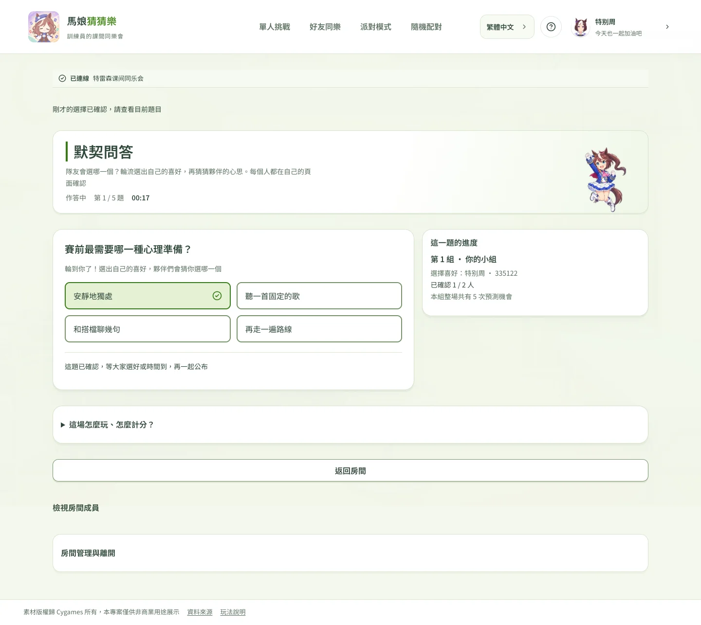
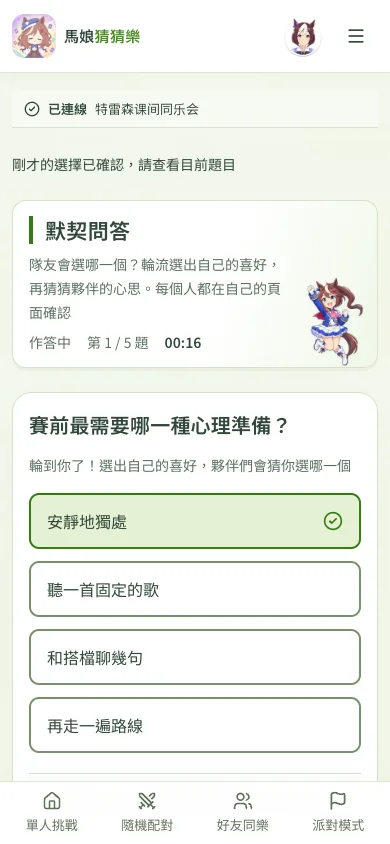

# 默契問答

一起聊了這麼久，隊友的心思你猜得中嗎？輪流選喜好，鎖定後一起揭曉答案

## 怎麼玩

1. 至少兩人開局，確認本題由誰選偏好、誰負責預測
2. 選偏好的人照自己的心意選，其他人猜他會選哪一項
3. 各選四個選項之一並確認，鎖定前看不到彼此選擇
4. 揭曉後換下一位選偏好，每題 20 秒，依整場猜中的比例計分

## 規則與計分

- 兩人搭檔或人數均衡的小隊，每題 20 秒，輪流由一位成員選喜好、其他成員猜答案。預設 5 題，題數至少要讓每位成員輪到一次，以開場公布的題數為準
- 每題固定 4 個選項，鎖定前看不到彼此的選擇
- 選喜好時，照自己的心意就好，再讓同組夥伴來猜
- 每猜中一次得 1 點。全組猜中的次數除以整場預測機會，再乘 100 就是團隊得分，小數無條件捨去。預測機會依每題猜答案的人數累計，開場時公布
- 未作答也算在總預測數內，因此不作答會降低團隊分數
- 每位成員都會輪流選擇喜好，同組夥伴各自在自己的頁面猜答案

## 手機上玩

各自在手機上選偏好或預測，確認後等待同組夥伴，再一起揭曉

[玩法一覽](../玩法与规则.md) · [常見問題](../常见问题.md) · [資料來源](../第三方依赖与资料来源.md)
