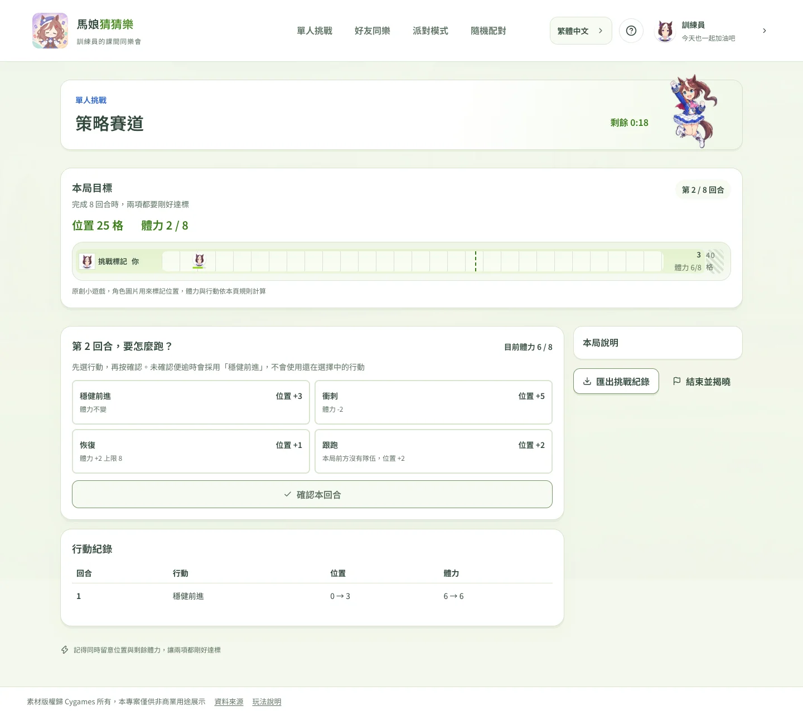

# 回合制策略賽道

衝刺的時機到了嗎？分配好八回合的體力，每回合一起揭曉行動，最後位置最前的隊伍獲勝

## 怎麼玩

1. 準備賽道規則，單人先確認目標位置與剩餘體力條件
2. 每回合選擇穩進、衝刺、恢復或跟跑，注意體力消耗
3. 確認後才會執行，回合紀錄會列出位置與體力變化
4. 八回合後確認是否達標，多人則同時揭曉行動，依最終位置排名

## 規則與計分

- 一隊挑戰或 2–8 隊對戰，共 8 回合，每回合 20 秒。各隊同時揭曉行動，共用一個標記，由隊員輪流確認
- 起始位置為 0、體力為 6，體力上限為 8；比賽中場地條件維持不變
- 穩進：位置 +3、體力不變。衝刺：需要體力至少 2，位置 +5、體力 −2。恢復：位置 +1、體力 +2，最多回到 8
- 跟跑：本回合開始時，若有隊伍領先你 1–3 格，位置 +4，否則 +2。以回合開始時的位置為準，之後的移動不影響判定
- 體力不足時無法衝刺。截止時若未選擇有效行動，會自動採用穩進
- 8 回合後依位置排名，同位置並列，名次為前方隊數加 1。對戰得分 = 100 ×（隊數 − 名次）÷（隊數 − 1），小數無條件捨去；單隊挑戰不計排名分。確認行動的快慢不影響名次

## 連線遊玩的差異

單人挑戰目標位置與體力，多人依八回合後的位置排名，同位置並列

## 手機上玩

查看目前體力與位置，選好行動後確認，再看本回合結果

[玩法一覽](../玩法与规则.md) · [常見問題](../常见问题.md) · [資料來源](../第三方依赖与资料来源.md)
