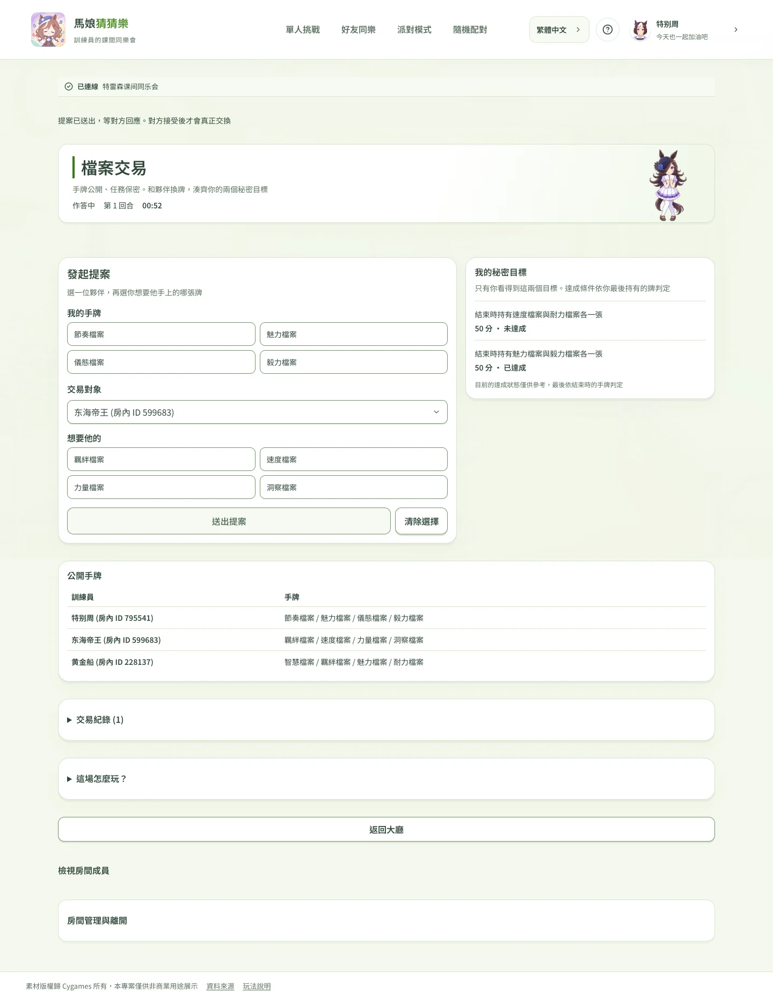
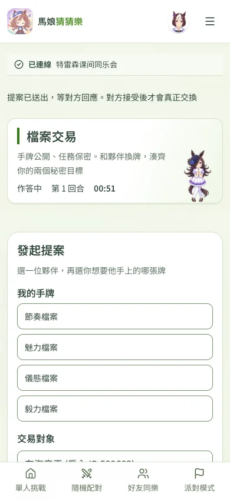

# 檔案交易

你想湊齊的牌，也許正好是別人願意交換的。手牌公開、任務保密，三輪協商後看看誰完成了秘密目標

## 怎麼玩

1. 邀請 3–8 位玩家，開局後查看四張手牌與兩個秘密目標
2. 選擇對手、付出的卡與想換入的卡，送出一換一提案
3. 對方接受後雙方同時交換，拒絕或逾時則維持原狀
4. 三輪後依秘密目標計分，善用手牌完成高分組合

## 規則與計分

- 每人 4 張公開手牌、2 個秘密目標。看得到大家手上的牌，但不知道對方想湊什麼
- 每輪可以向任一對手提出交換：用自己一張牌換對方一張牌，對方接受才成交
- 雙方各選一張，對方接受後同時交換。拒絕或逾時，雙方都保留原來的牌
- 速度、耐力、羈絆等都是卡牌種類，依秘密目標收集對應種類即可
- 三輪後依完成的秘密目標計分，分值以目標卡為準。同一張牌不能同時用於兩個目標；優先選總分最高的組合，同分時選完成目標較多的組合，仍相同則依目標卡順序選擇

## 手機上玩

先選交易對象，再選給出的牌與想換的牌；收到提案後可以接受或拒絕

[玩法一覽](../玩法与规则.md) · [常見問題](../常见问题.md) · [資料來源](../第三方依赖与资料来源.md)
