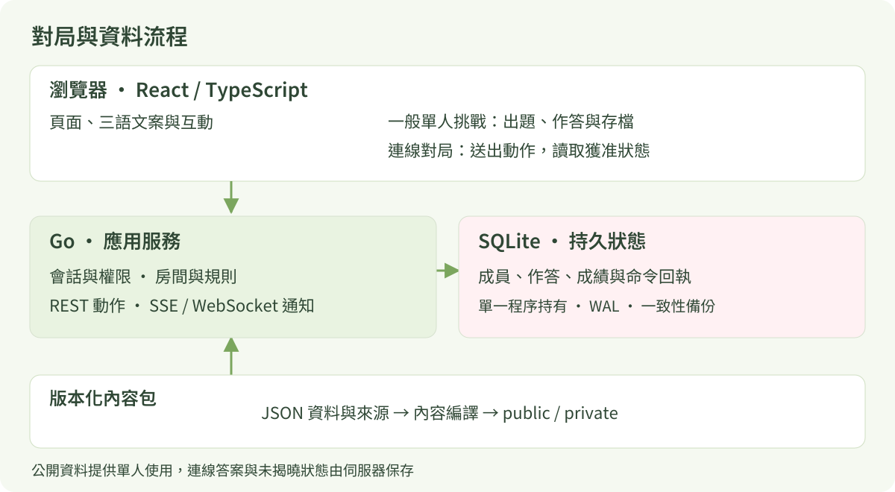

# 架構與模組

React 提供遊戲畫面與單人挑戰，Go 處理連線出題和判定，SQLite 儲存會話、房間與結果。一個服務程序即可執行，題庫獨立建置

<ArchitectureDiagram />

## 整體構成

| 部分 | 實作與責任 |
| --- | --- |
| 前端 | React、TypeScript、Vite；畫面、三語、單人狀態與連線用戶端 |
| 服務 | Go net/http；頁面、REST API、即時通知與部署設定 |
| 儲存 | SQLite WAL；房間、成員、作答、回執與遷移 |
| 內容 | JSON 來源編譯成有摘要的公開／私有內容包 |
| 部署 | 單一程序或容器，內容唯讀、執行資料獨立持久化 |

## 目錄

| 路徑 | 責任 |
| --- | --- |
| cmd/server、cmd/content | 啟動、備份、內容編譯與契約工具 |
| internal/httpapi | 路由、輸入、身分與錯誤投影 |
| internal/session、internal/account | 匿名遊玩與獨立帳號登入 |
| internal/room、internal/event | 成員、隊伍、主持、回合與活動 |
| internal/modes | 確定性規則、動作驗證、資訊投影與計分 |
| internal/challenge | 可驗證挑戰的簽章票據與回執 |
| internal/content | 資料正規化、題庫准入與發布 |
| internal/storage | SQLite、交易、遷移、目錄鎖與備份 |
| internal/realtime | SSE／WebSocket、游標與背壓 |
| internal/admission、internal/deployment | 入場確認、玩法與容量開關 |
| internal/wiring | 模組裝配與提交後通知 |
| internal/spafs、internal/staticserv | 嵌入頁面、受控資源路徑 |
| web/src | 頁面、元件、語言與本地紀錄 |

## 對局資料流程

REST 寫入先確認會話與成員，再檢查階段、版本及權限，進入房間指令佇列。狀態、成績、回執和通知 outbox 在交易內更新，提交後發通知

前端預設使用 SSE，可選 WebSocket，失敗後退回輪詢。通知表示狀態已變更，用戶端依游標讀取有權限的狀態，業務動作仍走 REST

規則層不讀 HTTP 或 SQL，輸入包含規則版本、題庫版本與受控隨機來源，輸出可持久化結果

## 儲存與恢復

一個程序擁有一個執行目錄，讀取池與寫入交易分開控制。房間佇列與全域佇列都有上限。已套用的遷移保持不變，結構改動新增遷移

重新連線恢復已確認作答與原截止時間，合法重試讀回原回執，不重複計分。權限變更、退出與席位恢復會撤銷舊連線

## 內容與隱私

單人資料可提供給瀏覽器，連線當前答案、暗牌與未公開作答留在伺服器。每個玩法分別檢查資料、圖片與語義審校，開局還受部署與人數限制

## 畫面與語言

桌面／平板依任務使用表格與分欄，手機優先卡片。互動採專案元件，動畫尊重減少動態，錯誤只說明狀況與處理方式。語言為 zh-Hans、zh-Hant、ja，各自適配玩家語境

## 部署範圍

同一 SQLite 目錄不供多個容器共用。公開服務使用 HTTPS、精確 Origin、可信代理與受限指標。擴展至多實例需另行設計資料所有權與事件路由

[設定參考](配置参考.md) · [API](API与实时通信.md) · [內容編譯](内容编译.md)
