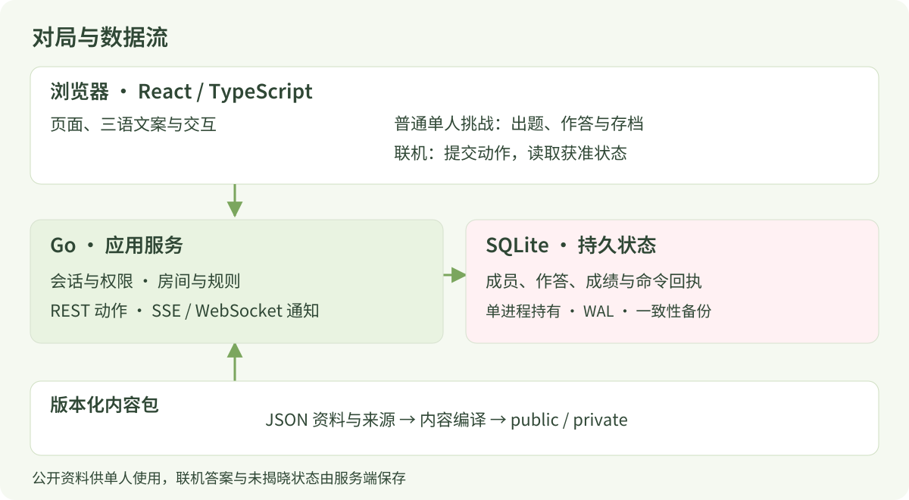

# 架构与模块

React 提供游戏页面与单人挑战，Go 处理联机出题和裁决，SQLite 保存会话、房间与结果。一个服务进程即可运行，题库独立构建

<ArchitectureDiagram />

## 模块与职责

| 目录 | 职责 |
| --- | --- |
| `cmd/server` | 配置解析、服务启动、健康检查与备份入口 |
| `cmd/content` | 内容编译、校验、当前版本解析与契约检查 |
| `internal/httpapi` | HTTP 路由、输入绑定、身份、权限与错误投影 |
| `internal/session` | 匿名身份、Cookie、CSRF 与展示会话 |
| `internal/account` | OAuth／OIDC、账户 UUID、登录会话与游玩要求 |
| `internal/room` | 成员、主持人、队伍、回合、命令顺序与事务 |
| `internal/modes` | 各玩法确定性规则、动作验证、投影及计分 |
| `internal/content` | 数据规范化、素材校验、题库准入与原子发布 |
| `internal/storage` | SQLite 连接、迁移、数据目录锁与一致性备份 |
| `internal/realtime` | SSE / WebSocket 通知、连接上限、重放与背压 |
| `internal/admission`、`internal/deployment` | 部署开关、入场校验与容量策略 |
| `internal/challenge` | 可验证挑战的题目凭据与回执 |
| `internal/event` | 活动赛程、队伍与展示协作 |
| `internal/wiring` | 跨模块装配及提交后的通知分发 |
| `internal/spafs`、`internal/staticserv` | 嵌入页面、受控静态路径与题包资源 |
| `web/src` | 页面、组件、三语资源、练习状态与联机客户端 |

## 对局数据流

普通联机写入通过 REST 进入 HTTP 层，服务端从会话与房间成员关系确定操作者，再验证阶段、版本与权限，按房间命令顺序调用规则引擎。状态、计分、回执及通知 outbox 在持久事务边界内更新，提交后发出实时通知

通知表示“某状态已变化”，不是新的权威计分来源。客户端依据事件游标恢复并读取有权限的快照；重复、乱序或中断不能令客户端自行认定重复得分。默认前端连接使用 SSE，可选 WebSocket，连接失败后回退轮询。业务动作不通过实时连接提交

规则层不接触 HTTP 或数据库。它接收版本明确的输入、公开/私有状态和动作，产生可持久化的结果。对随机题目使用受约束种子和内容版本，不能用浏览器当前时间作为比赛可信度依据

## 单人挑战与计分挑战

支持的单人挑战使用浏览器存储与公开练习资料，正常作答不依赖持续房间连接。记录保存在当前浏览器，准备资料、保存失败、导入导出与恢复均需向玩家说明实际结果；不在普通界面展示执行位置或部署术语

可验证挑战的凭据由服务端确认，成绩以服务端认可的提交与回执为准。浏览器可被用户修改，签名保证受签内容未被改写，不能证明答题者没有查阅资料或使用脚本。多人游戏、活动排名与主持权限均由服务端处理

## 存储与一致性

SQLite 使用 WAL，由一个进程拥有运行目录，读连接池与写事务分别控制。数据目录锁防止多个服务误用同一目录。房间级队列与全局队列均有上限，超限时拒绝请求并提示稍后重试

JSON 内容快照不是运行数据库的替代品：房间、会话、成员、成绩及审计需要关系约束和事务；题库与人工规则适合独立版本的 JSON 输入。已应用迁移保持不可变，需要变更表结构时新增迁移

## 内容与素材

`data/` 是构建输入，`content/pack-*` 是内容产物，`current` 指向已发布版本。编译时校验文件、来源和玩法所需字段，分别输出公开与私有 section。比赛答案不放入可下载公开树，练习资料则按练习的信任边界处理

每个玩法独立准入。引擎存在、前端有页面、题包允许开局、部署允许入口是不同条件。质量报告要保留缺失值、来源冲突和未审校记录，不能靠将状态改成 reviewed 强行开放玩法

题包头像与牌面可在本站提供；角色图片也可能按受控来源优先加载并使用本地回退，声音涉及经校验的资源。外部资源失败必须能退化，不能宣称所有素材都不联网

## UI、文案与本地化

大屏、桌面和平板按任务密度使用表格、分栏或舞台；手机竖屏优先卡片与单列操作，但字段意义与顺序保持一致。首要操作、当前任务、辅助说明及危险动作分级呈现，不用大面积提示挤占作答区

弹窗、选择器、校验与反馈使用项目组件，避免浏览器 `alert` / `confirm` / `prompt` 与原生表单验证气泡。浏览器权限、安全或下载确认不属于网页能完全控制的 UI，不能承诺隐藏这些浏览器安全界面

普通文案面向玩家，技术错误留在日志与必要的故障详情。支持 `zh-Hans`、`zh-Hant`、`ja`，繁体与日语按港台及日本玩家语境适配，不能机械替换文字。动画使用统一令牌，并尊重减少动态与设备性能

## 部署边界

单容器提供应用，内容包只读挂载，数据库与备份分开持久化。公网需要 HTTPS、正确 Origin、可信代理范围及监控隔离。横向扩容不能通过多个容器共享 SQLite 实现，需要重新设计数据所有权与事件路由

默认配置是起点，容量需在目标硬件、数据库规模、网络及玩法组合下验证。参见[配置参考](配置参考.md)、[API 与实时通信](API与实时通信.md)及[测试说明](测试与质量检查.md)
